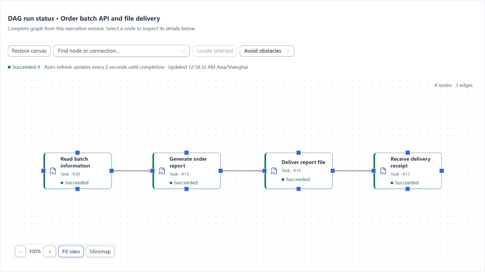
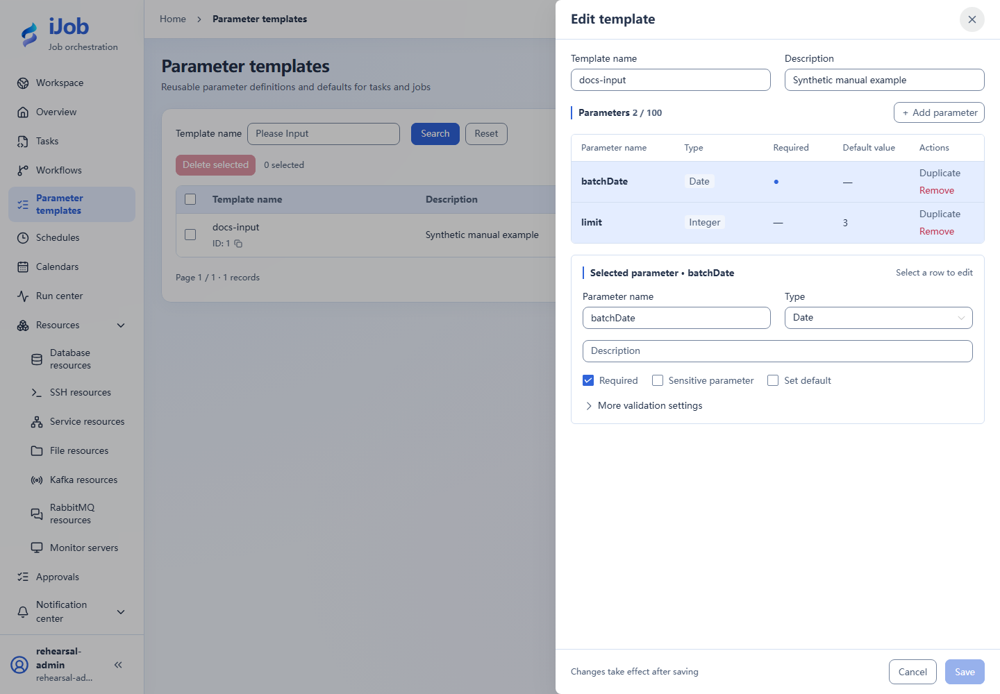

# Call an orders API and extract variables

[简体中文](../../zh-CN/examples/api-and-parameters.md) · [Manual home](../README.md)

Pass a date and limit to a read-only API, then extract total and amount for later steps.

## Audience and outcome

For users passing business inputs to an API, extracting response variables and distinguishing failure modes.

## Before you start

Complete the [shared preparation](../examples.md), then prepare the resources below.

| Resource | Requirement |
| --- | --- |
| HTTP service | A dedicated service reachable from the Worker. GET /orders/summary?batchDate=2026-01-03&limit=3 returns total=3 and amount=600. Use the Python 3 standard-library example service on this page. |
| Example runtime | Python 3 installed; no additional Python packages. |
| Parameter form | batchDate: required DATE; limit: INTEGER, default 3, minimum 1 and maximum 3. |

## Configuration

| Field / setting | Example value |
| --- | --- |
| Method | GET |
| Path | /orders/summary?batchDate=${batchDate!}&limit=${limit!} |
| Extraction | total→$.total; amount→$.amount |
| Body / response limit | empty / 1048576 bytes |

## Example file: http-summary.py

Save this content in your own new tutorial directory.

```python
# Copyright (c) 2026 ifielsc
# SPDX-License-Identifier: MIT
import argparse
import json
import time
from http.server import BaseHTTPRequestHandler, ThreadingHTTPServer
from urllib.parse import parse_qs, urlsplit

class Handler(BaseHTTPRequestHandler):
    def do_GET(self):
        request = urlsplit(self.path)
        query = parse_qs(request.query)
        status = 200
        if request.path in ("/", "/health"):
            result = {"status": "ok"}
        elif request.path == "/orders/summary":
            mode = query.get("mode", ["success"])[0]
            if mode == "slow":
                time.sleep(5)
            if mode == "unavailable":
                status, result = 503, {"error": "tutorial unavailable"}
            elif mode == "missing":
                result = {"amount": 600}
            else:
                try:
                    limit = int(query.get("limit", ["3"])[0])
                    if not 1 <= limit <= 3:
                        raise ValueError("limit")
                    result = {
                        "total": limit,
                        "amount": sum([100, 200, 300][:limit]),
                        "batchDate": query.get("batchDate", ["2026-01-03"])[0],
                    }
                except ValueError:
                    status, result = 400, {"error": "limit must be 1..3"}
        else:
            status, result = 404, {"error": "not found"}
        body = json.dumps(result).encode("utf-8")
        try:
            self.send_response(status)
            self.send_header("Content-Type", "application/json; charset=utf-8")
            self.send_header("Content-Length", str(len(body)))
            self.end_headers()
            self.wfile.write(body)
        except (BrokenPipeError, ConnectionResetError):
            pass

if __name__ == "__main__":
    parser = argparse.ArgumentParser()
    parser.add_argument("--host", default="127.0.0.1")
    parser.add_argument("--port", type=int, default=18762)
    args = parser.parse_args()
    server = ThreadingHTTPServer((args.host, args.port), Handler)
    print(f"Tutorial receiver: http://{args.host}:{args.port}", flush=True)
    try:
        server.serve_forever()
    except KeyboardInterrupt:
        pass
    finally:
        server.server_close()
```

Save http-summary.py in a fresh tutorial directory. On Windows, use python configured for Python 3:

```powershell
python -B http-summary.py
```

On Linux:

```sh
python3 -B http-summary.py
```

Ctrl+C stops only this process. If the port is occupied, choose another dedicated port with `--port` and update the resource; do not stop other processes.

## Steps

### 1. Start a dedicated test service

Start the example service using the commands above. It defaults to `127.0.0.1:18762` for a local Worker. A remote/container Worker requires an explicitly reachable address with access restricted to the dedicated practice network; do not expose this unauthenticated example publicly.

First open this URL on the service machine:

```text
http://127.0.0.1:18762/orders/summary?batchDate=2026-01-03&limit=3
```

Confirm numeric total=3 and amount=600. Use the base address actually reachable from the Worker in iJob’s service resource.

### 2. Create the service resource and parameter form

Create a service resource with the test base URL and a parameter form with batchDate/limit. A template name is not a variable value; container localhost is not the host service.

### 3. Configure the API task

Create API_CALL using the table settings and extractors, then save/publish. Load the form when triggering and set batchDate=2026-01-03 and limit=3.

### 4. Check inputs and outputs

Inspect the instance input snapshot: limit is numeric 3 and the date is correct. Check extracted total=3 and amount=600 against the service response.

### 5. Distinguish HTTP, extraction and timeout failures

Create three differently named failure-exercise tasks using the same resource, method, extractors and parameter form as the successful example. Change only the paths below, and still provide `batchDate=2026-01-03` and numeric `limit=3` when triggering.

HTTP 503:

```text
/orders/summary?batchDate=${batchDate!}&limit=${limit!}&mode=unavailable
```

Missing response field:

```text
/orders/summary?batchDate=${batchDate!}&limit=${limit!}&mode=missing
```

Slow response:

```text
/orders/summary?batchDate=${batchDate!}&limit=${limit!}&mode=slow
```

503 should produce FAILED without automatic resend due to task retry settings. The missing response omits total and should fail extraction. Set the slow task execution timeout to 2 seconds; the example service waits 5 seconds before replying, so inspect TIMED_OUT. These are deliberate outcomes of the example service.

## Expected results

| Check | Expected value |
| --- | --- |
| Success call | total=3, amount=600 and correctly typed input snapshot |
| HTTP 503 | FAILED with retries set to 0; no automatic resend |
| Slow response | Timed-out copy reaches TIMED_OUT |

## Common failures

| Symptom | Action |
| --- | --- |
| Remote commit with local timeout | Real write APIs need idempotency keys or result lookup; do not blindly repeat this read-only example. |

## Report delivery extension

Extend an API read into `API_CALL → ETL → FILE_TRANSFER → API_CALL`: read batch information, generate an order report, deliver the file, and verify a receipt based on the actual file. Applies to iJob 1.0.0.

### 1. Reuse the order tutorial setup

Complete the resources, tasks, and business-date template in [Daily order reconciliation and report delivery](order-reconciliation.md), and run the normal date `2026-10-28` successfully. The target database should then contain 12 orders totaling 7,800. Keep that tutorial's receipt receiver running; it also provides `/orders` and `/health`.

Use its “Report receiving service” resource and the published tasks “Generate order delivery report,” “Deliver order report,” and “Verify delivery receipt.” The `/orders/summary` service earlier on this page is a separate example and cannot replace the order tutorial's receiver.

### 2. Create the batch-reading task

Create an API_CALL task named “Read order batch API”:

| Field | Value |
| --- | --- |
| Service resource | Report receiving service |
| Method / path | GET / `/orders` |
| Query parameters (JSON) | `{"bizDate":"${bizDate}"}` |
| Request body | Leave empty |
| Business success condition | JSONPath `$.ok`; EQ; expected `true` |
| Response variables | `batchId → $.batchId`, `remoteRows → $.rows`, `remoteTotal → $.totalAmount` |
| Common timeout / retry count / retry interval | 120 seconds / 0 / 0 |

Save the task. `/orders?bizDate=2026-10-28` returns the fixed synthetic batch `ORD-2026-10-28`, with 12 rows and a total amount of 7,800. This API read **does not write orders to the target database**; the report uses the target data already prepared.

### 3. Build and run the four-node job

Create “Order batch API and file delivery” with these nodes:

| Node ID | Referenced task |
| --- | --- |
| `batch` | Read order batch API |
| `export` | Generate order delivery report |
| `transfer` | Deliver order report |
| `receipt` | Verify delivery receipt |

Connect `batch → export → transfer → receipt` and use ALL_SUCCESS / STOP. Enable, validate, save, and publish the job. Select the order tutorial's business-date template as its default, and execute with `2026-10-28`.



### 4. Check both the API result and the file result

| Check location | Expected result |
| --- | --- |
| `batch` output | `batchId = ORD-2026-10-28`, `remoteRows = 12`, `remoteTotal = 7800` |
| Target database and delivered CSV | 12 orders totaling 7,800; the CSV also has one header row |
| `transfer` node | `fileTransfer.uploadedFileCount = 1` |
| `receipt` node / root output | `deliveredRows = 12`, `deliveredAmount = 7800`; the receipt references this root instance |
| Job status | All four nodes and the root run are SUCCESS |

Inspect the batch node's own variables. Intermediate outputs do not necessarily all appear in the root output. This example displays the API information and actual CSV result separately; it **does not automatically compare the two sources**. Add an explicit comparison rule when your workflow requires one.

Repeating the run overwrites this tutorial's file for the same date and appends another receipt record. Use dedicated directories. Follow the [main tutorial's cleanup instructions](order-reconciliation.md#safety-and-cleanup), and also retire the additional job and batch task from this section.

## Safety and cleanup

Stop the example service process you started and remove failing copies without affecting other HTTP services.

## Version and limitations

Applies to 1.0.0 HTTP GET and JSONPath extraction, including numeric inputs, HTTP 503 and task timeout with retries set to 0. SOAP, OAuth2, remote cancellation and write deduplication need their own service contracts.

## Interface reference

These are actual interface references for this capability. Names and instance IDs may differ from your run; follow the steps and expected results for extensions.



## Related pages

- [API calls](../user-guide/plugins/api-call.md)

- [Parameter templates, inputs and variables](../user-guide/parameters.md)
