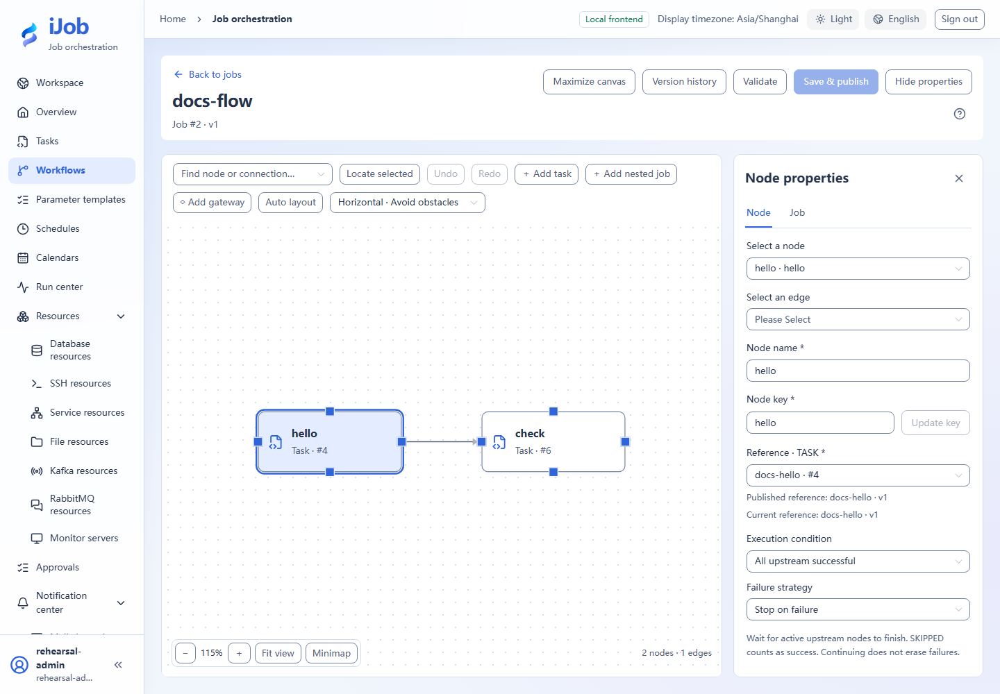
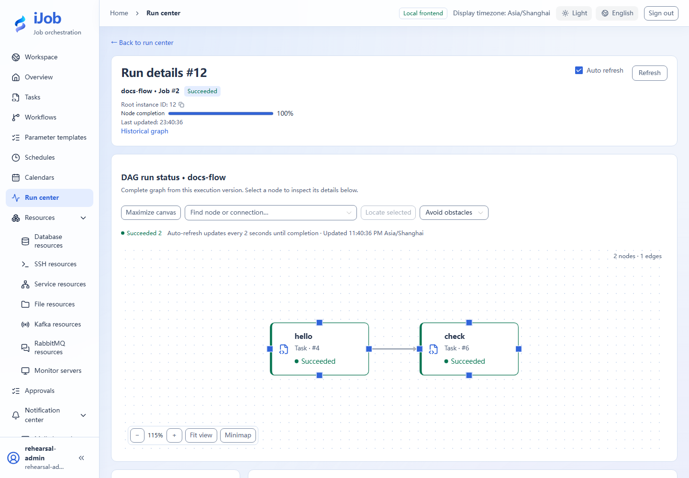

# Build parallel joins and conditional routes

[简体中文](../../zh-CN/examples/dag-control-flow.md) · [Manual home](../README.md)

Wait for two parallel branches before joining, then choose one route by amount.

## Audience and outcome

For users who can run individual tasks and are ready to build parallel joins and conditional routes.

## Before you start

Complete the [shared preparation](../examples.md), then prepare the resources below.

| Resource | Requirement |
| --- | --- |
| Base tasks | Four published harmless SCRIPT tasks A/B/C/D that print their names; retries 0. |

## Configuration

| Field / setting | Example value |
| --- | --- |
| Parallel edges | A→B, A→C, B→D, C→D |
| D condition / failure policy | ALL_SUCCESS / STOP |
| Exclusive gateway | Condition `input.amount > 100`; review priority 1/non-default; finish priority 2/single default |

## Steps

### 1. Create node tasks

Save A/B/C/D with LOCAL and POWERSHELL, for example `Write-Output 'A'` followed by `Start-Sleep -Seconds 1`. If B/C publish variables, use distinct names such as branchB and branchC to avoid merge ambiguity.

### 2. Draw and publish the parallel job

Create a job with the four task nodes and table edges; set D to ALL_SUCCESS. Validate, save/publish and inspect actual referenced versions.

### 3. Run and inspect the join

Run manually and inspect node timings. B/C start after A; D starts after both B/C finish. All nodes and root succeed. Actual B/C time overlap also depends on Worker capacity and concurrency limits.

### 4. Create a separate amount-routing job

Use “New job” to create a separate amount-routing example rather than leaving disconnected nodes in the parallel graph. First publish harmless SCRIPT tasks review and finish that print their own names.

Add exclusive gateway G and tasks review/finish, use G as the entry, then connect:

```text
G -> review
G -> finish
```

Select the G-to-review branch and use the structured condition editor:

| Field | Value |
| --- | --- |
| Route key | review |
| Priority | 1 |
| Default route | Disabled |
| Operator | Greater than GT |
| Left type / value | Variable / input.amount |
| Right type / value | Literal / 100 (numeric, without quotes) |

For G-to-finish, set route key finish, priority 2 and the single default route, without a condition. Validate and save/publish.

Create a parameter form with optional INTEGER `amount` and no default. Load it when triggering; run once with numeric 150 and again with numeric 50. Only review runs in the first case and only finish in the second; the unselected branch is SKIPPED. Use numbers, not strings.

### 5. Optional: exercise missing input and failure

Trigger the amount-routing job with optional `amount` omitted. The unguarded comparison fails rather than choosing the default route. If the business flow accepts missing values, add an explicit EXISTS guard and inspect that variant separately.

Create a separate failure exercise with the A→B/C→D graph and a B script that exits 7. Compare B failure policy STOP; B policy SKIP with D=ALL_SUCCESS; and B policy SKIP with D=ALWAYS. Save/publish before each run and inspect downstream execution/skipping. The root remains FAILED in all three cases.

## Expected results

| Check | Expected value |
| --- | --- |
| Parallel join | D waits for both upstream terminals; passing baseline root SUCCESS |
| Amount 150 / 50 | Select review / finish respectively; unselected branch SKIPPED and root SUCCESS |
| B fails (optional extension) | Root remains FAILED; inspect each downstream-policy variant separately |

## Common failures

| Symptom | Action |
| --- | --- |
| Variable conflict | Use distinct names for different upstream outputs; do not depend on overwrite order. |

## Safety and cleanup

Disable tutorial schedules and remove unwanted branch/failure copies without modifying tasks used elsewhere.

## Version and limitations

Applies to 1.0.0 four-node joins and amount-based exclusive routing, using Windows PowerShell tasks. Missing inputs and alternative failure policies remain optional extensions. Existing interface references do not replace this four-node graph’s own results.

## Interface reference

These are actual interface references for this capability. Names and instance IDs may differ from your run; follow the steps and expected results for extensions.





## Related pages

- [Workflow nodes, conditions and gateways](../user-guide/job-nodes.md)

- [Workflows: composition, publication and versions](../user-guide/jobs.md)
