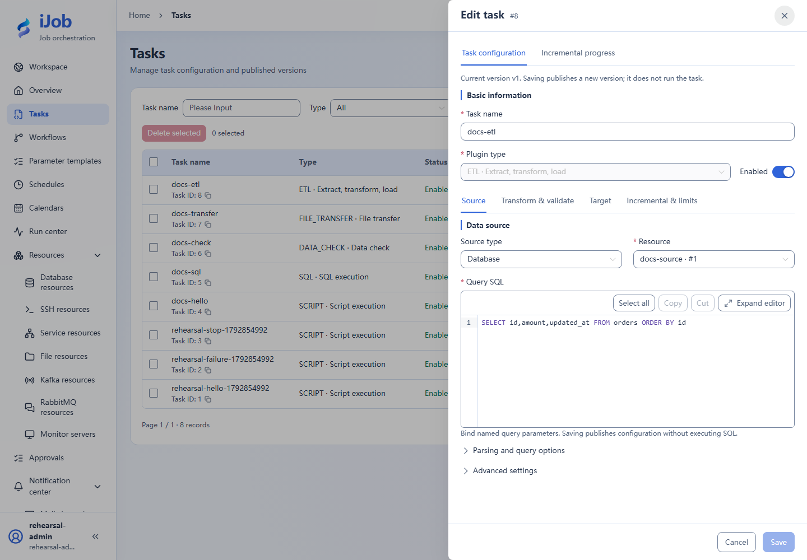
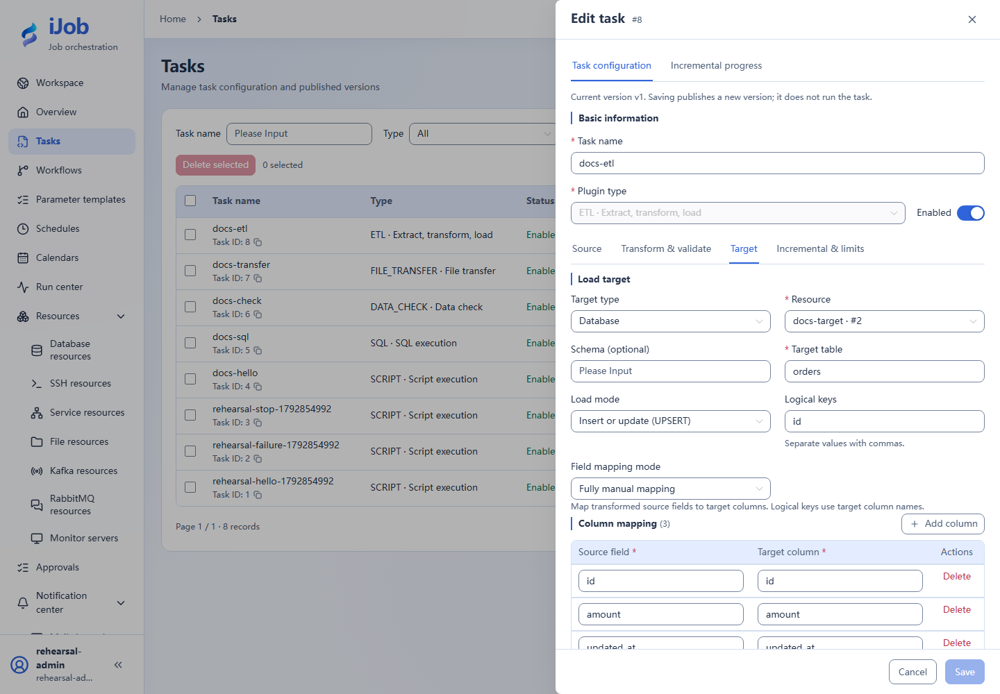
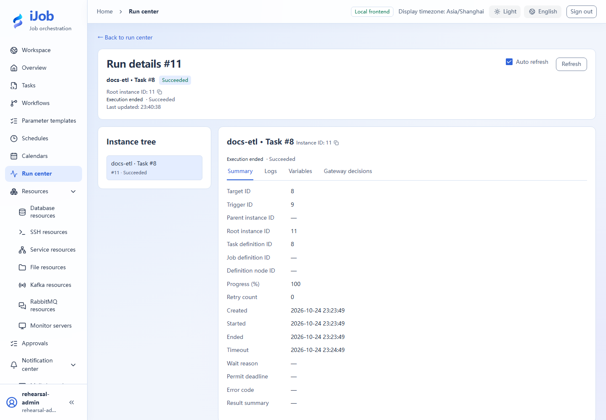

# Sync incremental orders with equal-watermark handling

[简体中文](../../zh-CN/examples/etl-full-incremental.md) · [Manual home](../README.md)

Load three orders, append an order at the same timestamp, and keep reruns idempotent.

## Audience and outcome

For users syncing changing data with timestamp watermarks, tie-breakers and idempotent reruns.

## Before you start

Complete the [shared preparation](../examples.md), then prepare the resources below.

| Resource | Requirement |
| --- | --- |
| Source and target | Two separate PostgreSQL business databases. A setup identity has CREATE/INSERT on the dedicated databases; iJob’s source connection needs SELECT, and its target connection needs corresponding write privileges. |
| Data | An id primary key, integer amount and TIMESTAMP updated_at. Do not reuse a TEXT watermark column. |
| Worker | An available Worker; set task retries to 0 while checking each run. |

## Configuration

| Field / setting | Example value |
| --- | --- |
| Source / target type | DATABASE / DATABASE |
| Target / write mode | orders / UPSERT |
| Logical key | id |
| Mappings | id→id; amount→amount; updated_at→updated_at |
| Initial incremental setting | Disabled |
| Checkpoint key | A new key dedicated to this tutorial, such as docs-orders-incremental-01 |

## Steps

### 1. Create source and target tables

Prepare two fresh dedicated business databases. Run setup as a database identity with CREATE/INSERT privileges; the task may use a different read-only source account. If a table already exists, choose a new dedicated database/table instead of replacing it.

Run table creation and inserts in the **source business database**:

```sql
CREATE TABLE orders (
 id INTEGER PRIMARY KEY,
 amount INTEGER NOT NULL,
 updated_at TIMESTAMP NOT NULL
);
INSERT INTO orders VALUES
 (1,100,TIMESTAMP '2026-01-01 00:00:00'),
 (2,200,TIMESTAMP '2026-01-02 00:00:00'),
 (3,300,TIMESTAMP '2026-01-03 00:00:00');
```

In the **target business database**, create only the empty table, without source sample inserts:

```sql
CREATE TABLE orders (
 id INTEGER PRIMARY KEY,
 amount INTEGER NOT NULL,
 updated_at TIMESTAMP NOT NULL
);
```

Grant SELECT on the source table to iJob’s source account and the required read/insert/update privileges on the target table to its target account. Create and test separate database resources. The setup identity need not be used for routine task execution.

### 2. Configure and run a full load

Create an ETL task using the configuration table. Use:
```sql
SELECT id,amount,updated_at FROM orders ORDER BY id;
```
Save/publish, trigger manually, wait for the final status and query the target:
```sql
SELECT COUNT(*) AS rows, SUM(amount) AS amount FROM orders;
```
Expect 3 rows totaling 600. Repeat the full load: the target remains 3 rows/600.

### 3. Configure the watermark and stable ordering

Enable increments. Set watermark field updated_at, type TIMESTAMP, initial value 2025-12-31T00:00:00, tie-breaker field id and initial tie-breaker value 0. Use a new checkpoint key. Set the upper-bound query to SELECT MAX(updated_at) FROM orders. Replace the source query with:
```sql
SELECT id,amount,updated_at FROM orders
WHERE (updated_at > CAST(:etlLastWatermark AS timestamp)
 OR (updated_at = CAST(:etlLastWatermark AS timestamp) AND id > :etlLastTie1))
 AND updated_at <= CAST(:etlUpperWatermark AS timestamp)
ORDER BY updated_at,id;
```
Keep filtering and ordering aligned with the watermark configuration.

### 4. Establish the incremental checkpoint

Save/publish and run manually. A new checkpoint rereads the initial three rows; UPSERT leaves 3 rows/600. Inspect incremental progress and confirm the dedicated checkpoint key.

### 5. Append an order at the same watermark

Run in the source database:
```sql
INSERT INTO orders VALUES (4,400,TIMESTAMP '2026-01-03 00:00:00');
```
Run the incremental task again, then inspect the target. Expect 4 rows totaling 1000 and exactly one row with id=4.

### 6. Rerun without new data

Run again without modifying the source. The target remains 4 rows/1000. Check target data, the checkpoint and the actual definition version, as well as the instance status.

## Expected results

| Check | Expected value |
| --- | --- |
| First and repeated full load | 3 rows, total 600 |
| First incremental checkpoint | 3 rows, total 600 |
| Append id=4 at the same watermark | Extract and insert 1 row; target has 4 rows, total 1000 |
| Empty rerun | Extract 0 rows; target remains at 4 rows, total 1000 |
| Keys | Exactly one row each for ids 1, 2, 3 and 4 |

## Common failures

| Symptom | Action |
| --- | --- |
| Timestamp mismatch | Use TIMESTAMP and retain the explicit CASTs; JSON strings need database type conversion. |
| Missing equal-watermark rows | Check the tie-breaker field, initial value and ORDER BY. |
| Target write failure | Inspect committed data and checkpoint state before rerunning with UPSERT; target writes and checkpoint updates are separate commit boundaries. |

## Safety and cleanup

Disable any tutorial schedule. Wait for active instances before removing the tutorial task and dedicated data. Do not reset checkpoints still used by other tasks.

## Version and limitations

Applies to 1.0.0 with PostgreSQL source and target: full load, a TIMESTAMP watermark with id tie-breaker, an equal-watermark append and an empty rerun. Use a fresh checkpoint key for each independent exercise. File increments, other database dialects and SCD2 are separate extensions.

## Interface reference

These are actual interface references for this capability. Names and instance IDs may differ from your run; follow the steps and expected results for extensions.







## Related pages

- [ETL: source, transforms, target and increments](../user-guide/plugins/etl.md)

- [SQL and data-quality checks](sql-and-validation.md)

- [Business messages and run notifications](push-and-notifications.md)
