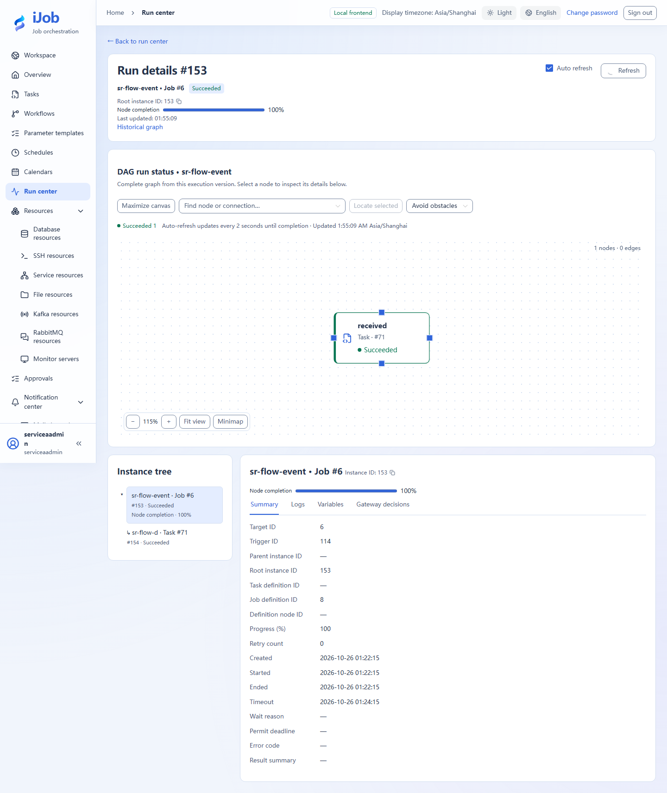
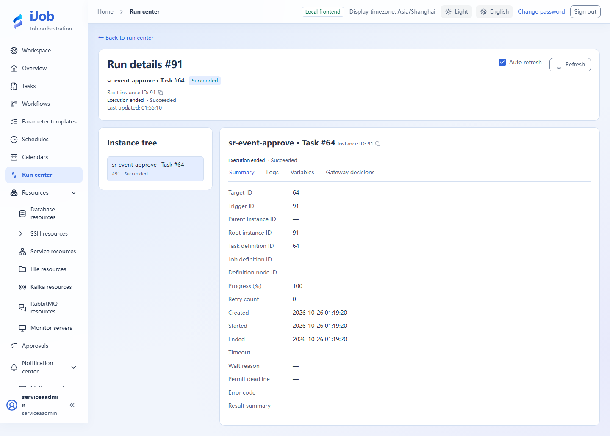

# Resume a run after an event or approval

[简体中文](../../zh-CN/examples/events-and-approval.md) · [Manual home](../README.md)

Wait for a matching event or designated approval and observe the same instance continue.

## Audience and outcome

For users whose workflows wait for an external business signal or a human decision.

## Before you start

Complete the [shared preparation](../examples.md), then prepare the resources below.

| Resource | Requirement |
| --- | --- |
| Event setup | A dedicated event code/business key with permissions to configure EVENT and publish events. |
| Approval setup | DATABASE authentication with an enabled designated ADMIN/OPERATOR who has completed initial password change. |

## Configuration

| Field / setting | Example value |
| --- | --- |
| Event code / business key | docs.order.ready / order-001 |
| Task execution timeout | Unset |
| Wait timeout / lookback | 300 seconds / 0 seconds |
| Approvers | Actual allowed users in this environment, not sample IDs |

## Steps

### 1. Publish and start a wait

Create EVENT with WAIT_EVENT. If changing the action prompts to clear the task execution timeout, confirm it. Leave that timeout unset and use plugin wait timeout 300 seconds with zero lookback. Set event code `docs.order.ready`, business key `order-001` and leave the correlation key empty for this example.

Save/publish and run manually. Locate WAITING_EVENT and note the instance ID. Wait timeout and ordinary task execution timeout are different fields; a positive execution timeout cannot be combined with this waiting action.

### 2. Publish a matching event

Create a separate EVENT publish task with the same event code/business key, correlation key matching the wait configuration, and payload {"rows":3}. Save and execute it.

### 3. Inspect the original instance

Return to the first instance and confirm it leaves waiting and completes. Inspect the matched wait and outputs rather than confusing the publisher's instance with the waiter.

### 4. Create an approval variant

Create EVENT with WAIT_APPROVAL and put the business description in the task description. Select actual allowed users, set wait timeout to 300 seconds and leave task execution timeout unset; confirm clearing it if prompted.

Save/run, then sign in as the designated ADMIN or OPERATOR to review the business context/instance in Approvals and approve. Observe the same instance complete; use an ADMIN session for logs or output variables.

### 5. Observe rejection and optionally check permissions

Create a separate wait to reject and inspect its failure reason. A user not listed cannot decide it. Expired or completed waits cannot be approved again as new success.

### 6. Extension: check HTTP-ingress deduplication

Enable `app.event.ingress.enabled` and use an authenticated account with EVENT_PUBLISH permission. Create a separate wait using business key `order-http-001`. Once it is waiting, send this body to `POST /api/events`:

```json
{"sourceKey":"docs-http-demo","eventCode":"docs.order.ready","businessKey":"order-http-001","idempotencyKey":"tutorial-http-001","payload":{"rows":3}}
```

The first response should have `duplicate=false`. Replay the identical request with the same source, idempotency key and content: expect the same `eventId` with `duplicate=true`, while the original wait resumes only once. Use new business and idempotency keys for a new independent exercise.

## Expected results

| Check | Expected value |
| --- | --- |
| Matching event | Original wait reaches SUCCESS with the same instance ID |
| Approved | The decision is attributable; the same instance resumes and reaches SUCCESS |
| Rejected | A separate waiting instance ends FAILED with a rejection reason |
| Duplicate HTTP publication (extension) | Same source, idempotency key and content return the same eventId; the second response has duplicate=true |
| Wrong key or unauthorized user (optional extension) | No incorrect resolution / no permission to approve; exercise each separately |

## Common failures

| Symptom | Action |
| --- | --- |
| No approvers under STATIC | Approval requires DATABASE accounts; do not disable authentication for the tutorial. |
| Event predates waiting | With zero lookback, register the wait first. Configure an explicit lookback window for older events. |

## Safety and cleanup

Stop remaining tutorial waits and disable tutorial bindings/schedules; do not republish real business events.

## Version and limitations

Applies to 1.0.0 event waiting, DATABASE approval and HTTP-ingress idempotency. Compare eventId and duplicate for HTTP replays; this is separate from executing an EVENT publication task. Wrong keys, unauthorized users, file detection and restart recovery need their own exercises.

## Interface reference

These are actual interface references for this capability. Names and instance IDs may differ from your run; follow the steps and expected results for extensions.





## Related pages

- [Event publishing, waiting and approval](../user-guide/plugins/event.md)

- [Event approvals and records](../user-guide/events.md)
