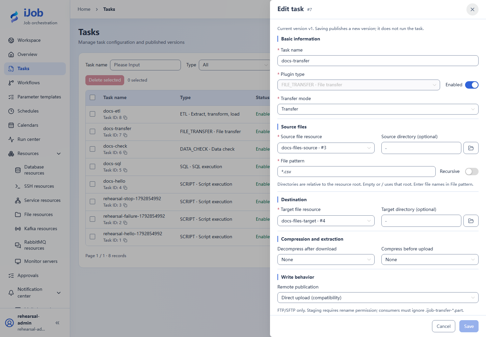
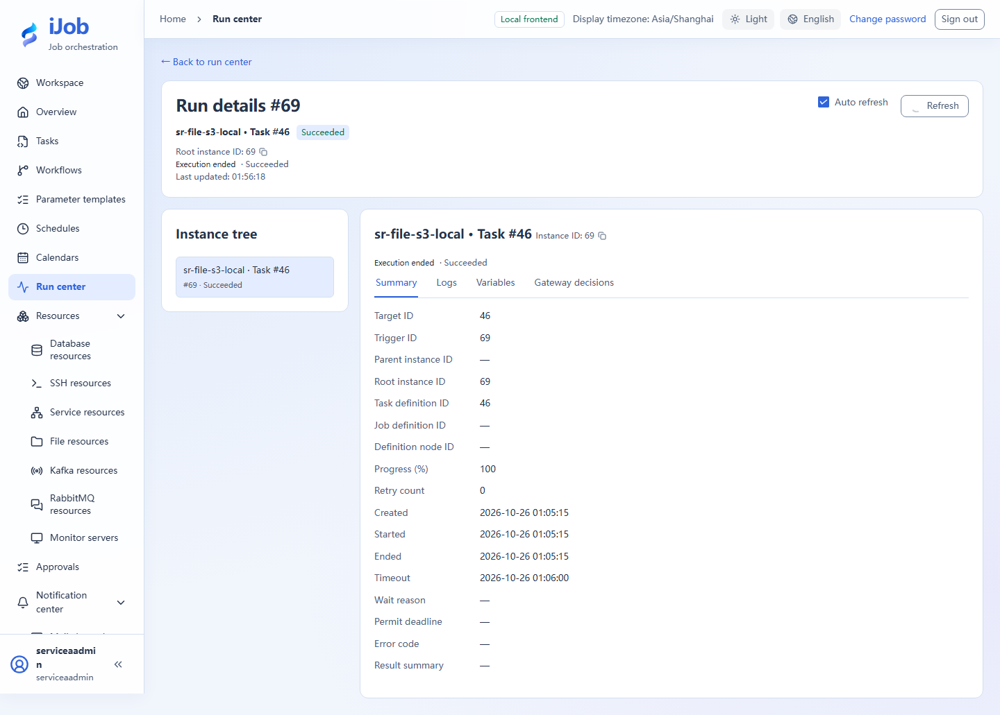

# Local and remote file transfer

[简体中文](../../zh-CN/examples/file-transfer.md) · [Manual home](../README.md)

**Verification: tested in this round’s isolated environment within the scope below.**

Fields: [File transfer and archives](../user-guide/plugins/file-transfer.md).

## Prepare, configure and run

Prepare two independent LOCAL file resources and orders.csv under the source root:

```csv
id,amount
1,100
2,200
3,300
```

Choose source/target resources, sourcePath=`.`, targetPath=`.`, filePattern=`*.csv`, recursive=false, overwrite=false and deleteSource=false. After running, compare target filename, bytes and SHA-256 and confirm the source remains.

A repeat may fail because the target exists: this tests overwrite policy. Use fresh targets for overwrite/archive variants. SFTP/S3 need separate services, identities, buckets/directories and write verification; LOCAL success does not establish those protocols.

## Scope verified this round

This round transferred a UTF-8 sample CSV through isolated LOCAL, SFTP, FTP and S3-compatible services and verified matching SHA-256 on readback. Checks covered preserving existing targets with overwrite=false, FTP write denial for a read-only account and S3 rejection of incorrect keys. Large files, archive limits, resumable transfers and other vendors remain separate.

## Finish

Retain inputs, definition versions, trigger/instance IDs, sanitized logs and target checks. Stop only processes/schedules owned by this case; other environments and historical evidence are not cleanup targets.

## Real page examples

Exercised LOCAL transfer configuration, not proof of SFTP/S3 acceptance.



Successful transfer from an isolated S3-compatible service to LOCAL, captured on 2026-10-26. The downloaded file was separately verified by SHA-256; this screenshot shows execution status and does not replace content verification.


