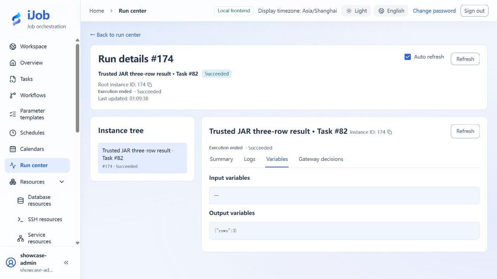

# Deploy a trusted Local JAR and invoke it

[简体中文](../../zh-CN/examples/local-jar.md) · [Manual home](../README.md)

Use a minimal protocol-1 extension to emit hello-localjar and rows=3.

## Audience and outcome

For workflow authors who have completed the quick start.

## Before you start

Read the [shared tutorial preparation](../examples.md). Estimates exclude external-service installation. Use your own tutorial resources, paths and ports.

| Resource | Requirement |
| --- | --- |
| Build dependency | Java 21 JDK and a trusted ijob-plugin-spi:1.0.0 JAR; obtain the trusted SPI 1.0.0 artifact from your deployment owner. |
| Deployment access | API and target Workers have access to their controlled artifact directories with LOCAL_JAR enabled. |

## Configuration

| Field / setting | Example value |
| --- | --- |
| Filename / version | hello-job-1.0.0.jar / 1.0.0 |
| Entry class | com.example.jobs.HelloTask |
| Protocol | IJob-Plugin-Api-Version: 1 |
| Business parameters | None for this minimal example |

## Example file: HelloTask.java

Save this content in your own new tutorial directory.

```java
// Copyright (c) 2026 ifielsc
// SPDX-License-Identifier: MIT
package com.example.jobs;

import com.ifielsc.ijob.spi.localjar.LocalJarContext;
import com.ifielsc.ijob.spi.localjar.LocalJarExecution;
import com.ifielsc.ijob.spi.localjar.LocalJarResult;
import com.ifielsc.ijob.spi.localjar.LocalJarTask;

public final class HelloTask implements LocalJarTask {
    public HelloTask() {}

    @Override
    public LocalJarResult run(LocalJarExecution execution, LocalJarContext context) {
        context.checkExecution();
        context.logInfo("hello-localjar");
        context.putVariable("rows", 3);
        return LocalJarResult.success("hello-localjar");
    }
}
```

After saving both example files on this page, run the commands for your platform from the fresh tutorial directory. First replace the SPI path in the first line with your trusted artifact’s actual path. Stop and correct any compilation/packaging error instead of using leftover output.

Windows PowerShell:

```powershell
$spiJar = 'D:/tutorial/lib/ijob-plugin-spi-1.0.0.jar'
New-Item -ItemType Directory -Path classes | Out-Null
javac --release 21 -cp "$spiJar" -d classes HelloTask.java
jar --create --file hello-job-1.0.0.jar --manifest MANIFEST.MF -C classes .
(Get-FileHash -LiteralPath ./hello-job-1.0.0.jar -Algorithm SHA256).Hash.ToLowerInvariant()
```

Linux:

```sh
SPI_JAR='/srv/tutorial/lib/ijob-plugin-spi-1.0.0.jar'
mkdir classes
javac --release 21 -cp "$SPI_JAR" -d classes HelloTask.java
jar --create --file hello-job-1.0.0.jar --manifest MANIFEST.MF -C classes .
sha256sum hello-job-1.0.0.jar
```

Package only your own classes from classes, not the SPI JAR. Use the calculated hash for the artifact identity.

## Example file: MANIFEST.MF

Save this content in your own new tutorial directory.

```text
Manifest-Version: 1.0
IJob-Plugin-Api-Version: 1
IJob-Plugin-Class: com.example.jobs.HelloTask
Implementation-Version: 1.0.0

```

Retain the final newline and blank line when saving MANIFEST.MF, using UTF-8 without BOM or ASCII.

## Steps

### 1. Prepare the minimal extension

Use the accompanying HelloTask.java and MANIFEST.MF. Reference the SPI JAR at compile time, but package only your com/example classes, not SPI/platform classes. Substitute the actual trusted SPI path in the build command.

### 2. Record the artifact identity

Check the three manifest attributes: IJob-Plugin-Api-Version=1, Implementation-Version=1.0.0 and IJob-Plugin-Class=com.example.jobs.HelloTask. Calculate actual SHA-256 with Get-FileHash or sha256sum.

### 3. Deploy to API and Workers

Set app.plugin.local-jar.enabled=true and a controlled root-directory. Mount/copy the same artifact according to deployment mode, verify matching hashes, then restart through the maintenance procedure. The UI does not upload JAR files.

### 4. Create and run the task

Create LOCAL_JAR with filename, actual hash and entry class. Leave an empty object in the business parameter editor. Save validates metadata; confirm the displayed implementation version is 1.0.0 before running the task manually.

### 5. Inspect output and rejection

Check SUCCESS, the `hello-localjar` log, and numeric output `rows = 3`, unlike a string emitted through a script declaration. Optional negative exercise: create a separate draft with an incorrect hash or entry class and check save rejection against the plugin metadata rules. These negative cases are outside this page’s confirmed successful-invocation scope. Do not overwrite the correct artifact to manufacture failure.

## Expected results

| Check | Expected value |
| --- | --- |
| Invocation | SUCCESS; `hello-localjar` log; numeric `rows = 3` |
| Optional metadata negative cases | Inspect rejection for a separate wrong-hash/class draft without changing the correct artifact |

## Common failures

| Symptom | Action |
| --- | --- |
| API saves but Worker cannot find artifact | Check directories/hashes on every target node; the platform database does not copy files. |
| Long task ignores stop | Extensions must call checkExecution and register closeable resources; the minimal synchronous example does not prove arbitrary cancellation. |

## Safety and cleanup

After checking active runs and published references, have the deployment owner remove the sample through artifact management; do not empty the plugin directory.

## Version and limitations

Applies to iJob 1.0.0 new-namespace SPI, protocol 1. The example is compiled with Java 21 and executed on a Windows Worker; tasks in both interface languages return SUCCESS, `hello-localjar`, and numeric `rows=3`. Size and SHA-256 depend on your actual artifact; do not copy another build’s hash. Trusted code runs inside the host JVM. Cancellation of arbitrary extensions, negative metadata cases, and multi-Worker deployment need separate checks; this is not an untrusted-code sandbox.

The following image shows the actual tutorial run:



## Related pages

- [Trusted Local JAR plugins](../user-guide/plugins/local-jar.md)

- [Plugin switches and Local JAR deployment](../configuration/plugins.md)
