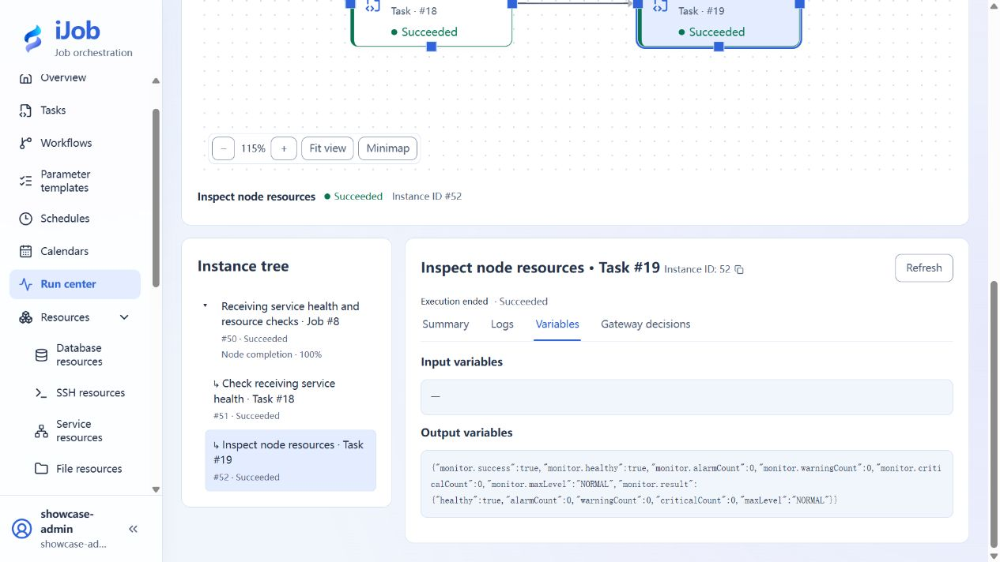
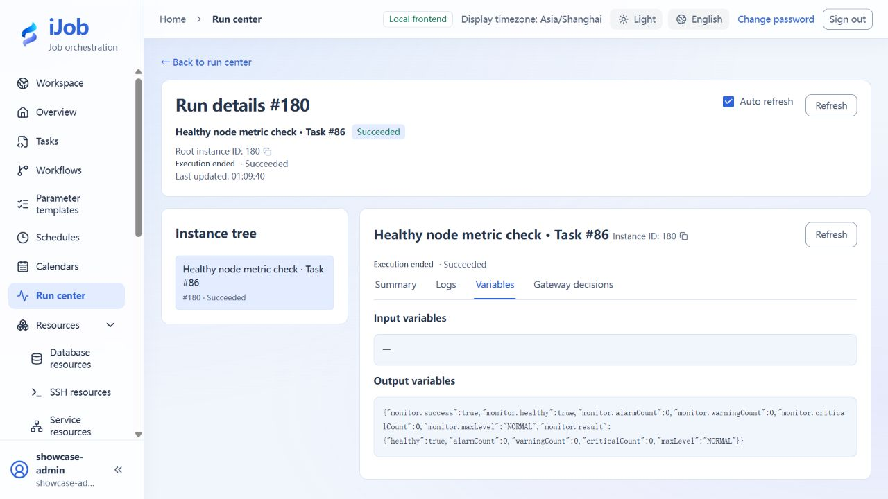

# Collect monitoring metrics and interpret threshold alarms

[简体中文](../../zh-CN/examples/monitoring.md) · [Manual home](../README.md)

Inspect fresh memory metrics and change a tutorial threshold to observe health-state changes.

## Audience and outcome

For users configuring health checks who need to distinguish collection completion, metric health and alarm severity.

## Before you start

Complete the [shared preparation](../examples.md), then prepare the resources below.

| Resource | Requirement |
| --- | --- |
| Agent | A dedicated test Agent/token, reachable only by permitted clients, with available memory metrics. |

## Configuration

| Field / setting | Example value |
| --- | --- |
| Collection | CPU, MEMORY and DISK |
| Baseline thresholds (warning / critical) | CPU 85% / 95%; memory 85% / 95%; disk 90% / 97% |
| Notifications | Disabled initially |

## Steps

### 1. Create and test the monitor resource

Start a dedicated Agent according to the deployment guide and record its address/port and independent token. Create/test a monitoring-server resource.

### 2. Configure one collection

Create SERVER_MONITOR with the resource, CPU/MEMORY/DISK collection and the thresholds in the table. Disable notifications, save and run manually.

### 3. Inspect data and health variables

Inspect collection time, freshness, percentage units and monitor.healthy/alarmCount/warningCount/criticalCount. SUCCESS means collection completed; health depends on measured values and thresholds.

### 4. Create an alarm by changing the threshold

Keep the baseline task and create a copy with memory warning/critical thresholds of 1%/2%; leave other rules unchanged. When current memory usage is above 2%, this rule should produce CRITICAL. Inspect healthy=false, criticalCount and the total alarm count without adding host load.

Create another copy for the healthy branch, temporarily setting CPU, memory and disk usage warning/critical thresholds to 99.9%/100%, with notifications disabled. When all three actual metrics are below their warning thresholds, expect healthy=true, alarmCount=0 and maxLevel=NORMAL. These relaxed values demonstrate the healthy branch; set production thresholds from your own capacity baseline.

Compare the copies: the baseline may already show WARNING, lower thresholds can produce CRITICAL, and relaxed thresholds can produce NORMAL. All three tasks can complete with SUCCESS.

### 5. Optional: distinguish unavailability from an alarm

Use an incorrect token in a copy, or normally stop the tutorial Agent before running. Expect connection/collection failure rather than a fabricated 0 usage value. Restore the Agent and run again.

## Expected results

| Check | Expected value |
| --- | --- |
| Collection completes | Instance SUCCESS, fresh timestamps and correct units; no zero substituted for missing data |
| Baseline health | Depends on actual metrics and thresholds; SUCCESS may already have healthy=false and a WARNING |
| Lower thresholds | Crossing a threshold yields healthy=false and matching counts/severity; crossing a critical threshold gives maxLevel=CRITICAL |
| Healthy-branch copy | When every enabled rule is satisfied: healthy=true, alarmCount=0 and maxLevel=NORMAL; this does not send a recovery notification |

## Common failures

| Symptom | Action |
| --- | --- |
| SUCCESS with an alarm | Collection success and health differ; inspect monitor.healthy. |

## Receiving service checks

In the [order reconciliation and report delivery](order-reconciliation.md) environment, connect `SCRIPT → SERVER_MONITOR` to check the receipt service first, then inspect its node's CPU, memory, and disks. Applies to iJob 1.0.0. The script below targets a Windows Worker with PowerShell installed.

### 1. Prepare the receiver and monitoring resource

Keep the order tutorial's receipt receiver running. Follow [standalone Agent configuration](../configuration/deployment-agent.md) to prepare your own Monitor Agent, port, and authentication token. Create an enabled monitoring-server resource:

| Field | Value |
| --- | --- |
| Name | Local practice node |
| Protocol / endpoint | HTTP / your Agent address; on the same machine, use `http://127.0.0.1:<agent-port>` |
| Authentication token | The token you configured for this Agent |
| Connect / read timeout | 5000 / 10000 milliseconds |
| Operating system / Agent version | WINDOWS / 1.0.0 |

The receipt receiver and Monitor Agent are different services; do not interchange their addresses or ports. This example places the Worker, receiver, and Agent on the same machine. For other topologies, configure addresses reachable from the relevant node.

### 2. Configure the health-check task

Create the SCRIPT task “Check receiving service health”: execution mode LOCAL, engine POWERSHELL, UTF-8 script and output encoding, a common timeout of 30 seconds, and retry count and interval both 0. Replace `<receipt-port>` below with the order receiver's actual port, then save:

```powershell
$ErrorActionPreference = 'Stop'
$r = Invoke-RestMethod -Uri 'http://127.0.0.1:<receipt-port>/health' -TimeoutSec 5
if ($r.status -ne 'ok') { throw 'Health check failed' }
Write-Output 'Delivery service: healthy'
Write-Output ('Receipt records: ' + $r.receiptCount)
```

The request runs on the Worker. Successful logs contain `Delivery service: healthy` and the current receipt-record count. The count depends on your completed deliveries and is not a fixed value. A connection failure or a status other than `ok` fails the script, so the downstream node does not execute.

### 3. Configure resource monitoring and connect the job

Create the SERVER_MONITOR task “Inspect node resources”:

| Field | Value |
| --- | --- |
| Monitoring server | Local practice node |
| Collection items | CPU, MEMORY, DISK |
| CPU rule | Enabled; warning 85%, critical 95% |
| Memory rule | Enabled; warning 85%, critical 95% |
| Disk rule | Enabled; warning 90%, critical 97% |
| Application collection / disk path overrides | None |
| Send monitoring alerts | Disabled |
| Common timeout / retry count / retry interval | 30 seconds / 0 / 0 |

Save the task. Create “Receiving service health and resource checks” with `health` referencing the health-check task and `monitor` referencing resource monitoring. Connect `health → monitor`, using ALL_SUCCESS / STOP. Enable, validate, save, and publish, then execute manually. This job does not need a business-date parameter.



### 4. Interpret availability and resource health

| Check location | Interpretation |
| --- | --- |
| `health` logs | Service status is `ok`; logs include the health message and current receipt-record count |
| `monitor` metrics | CPU, memory, and disks have current measurements, with correct percentages and timestamps |
| `monitor.healthy` | Expect `true` only when the collected values satisfy your rules; do not copy metric values from a screenshot |
| Alarm counts | Inspect `monitor.alarmCount`, `monitor.warningCount`, and `monitor.criticalCount` against the threshold results |
| Root run | SUCCESS when both tasks complete; distinguish resource threshold alarms from failed collection |

This example sends no notifications and creates no recurring schedule. Do not raise production thresholds simply to obtain a green status. Retire this section's job and tasks when finished. Stop only the Agent you prepared for this exercise and that nobody else is using; keep the order receiver until its other exercises are complete.

## Safety and cleanup

Disable tutorial schedules/notification bindings, restore thresholds and stop only the tutorial-created Agent.

## Version and limitations

Applies to 1.0.0 Agent collection and NORMAL, WARNING and CRITICAL health levels. Host load changes health results; relaxed demonstration thresholds are not production recommendations. Wrong tokens and an unreachable Agent are optional extensions. Notification delivery needs a separate receiver; recovery notifications and cross-run alarm deduplication are not supported.

The following image shows the actual tutorial run:



## Related pages

- [Server monitoring](../user-guide/plugins/server-monitor.md)

- [Launch variables, Compose and standalone Agent](../configuration/deployment-agent.md)

- [Publish three order messages and configure run notifications separately](push-and-notifications.md)
