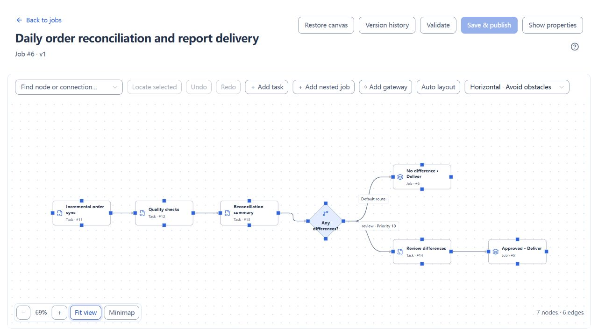
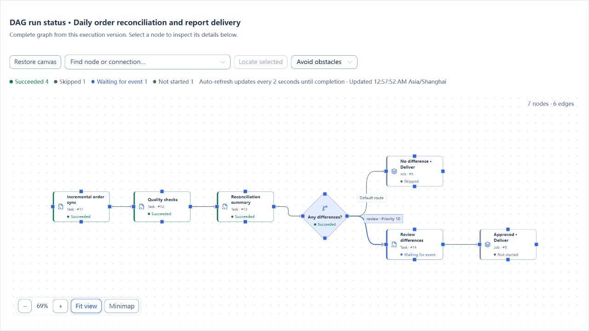
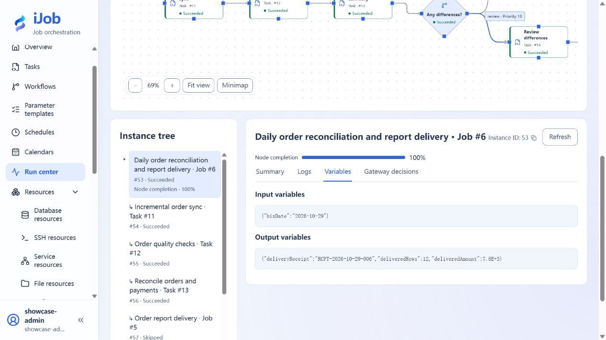

# Daily order reconciliation and report delivery

[简体中文](../../zh-CN/examples/order-reconciliation.md) · [Manual home](../README.md)

Synchronize orders for a business date and reconcile payments. Deliver the report automatically when there are no differences, request human review when there are differences, and block delivery when quality checks fail.

## Audience and use case

This tutorial is for configuration authors who have completed the [quickstart](../quickstart.md) and want to combine databases, approvals, and file delivery. Difficulty: intermediate. Allow 45–60 minutes, excluding service installation.

You will create seven tasks, a delivery subjob with three nodes, and a main job with seven nodes. Two branches reference the same published subjob, showing dependencies, conditional routing, version reuse, and result tracing.

## Prerequisites

Read the [shared tutorial prerequisites](../examples.md). Use your own isolated practice environment, without connecting real orders, payments, or customer delivery endpoints.

| Resource | Requirement |
| --- | --- |
| iJob | Version 1.0.0, with a working single-machine installation; complete the [DATABASE account-mode switch](../operations/account-mode-change.md), then sign in again as administrator |
| Configuration account | ADMIN; used to configure resources, tasks, parameter templates, and jobs, and to inspect logs and variables |
| Approval account | An enabled ADMIN or OPERATOR account whose initial password change is complete; select this account as an approver later |
| Order source database | A new dedicated PostgreSQL business database; the task account can SELECT the source table |
| Order reconciliation database | A second dedicated PostgreSQL business database; the task account can read payments and read, insert, and update target orders |
| File directories | Two different empty directories for generated and delivered reports; the execution Worker can read and write them |
| Receipt receiver | Python 3.9 or later, standard library only; on the same practice machine as the Worker, reading the delivery directory and listening on an available loopback port you choose |

Prepare the business databases separately from the iJob platform database. Initialize tables with an identity that has CREATE/INSERT permissions; the task account does not need database-creation privileges. Choose your own directories and port. Enter their actual values in resources, not the angle-bracket placeholders below.

## Steps

### 1. Prepare data for three business dates

The three dates exercise normal delivery, difference review, and quality blocking. Each date has 12 orders, normally with amounts 100, 200, …, 1200, totaling 7,800.

Create the source and target tables using the [case setup page](order-reconciliation-setup.md#initialize-business-data), then return here to check the following table.

| Business date | Sample data | Expected route |
| --- | --- | --- |
| 2026-10-28 | All 12 orders match their payments | Automatic delivery |
| 2026-10-29 | Order 1 has an amount of 100 and a payment of 0 | One difference totaling 100; request human review |
| 2026-10-30 | Order 1 has a null amount | Fail the quality check and block report generation and delivery |

The source table should contain 36 rows, the payments table 36 rows, and the target `orders` table should still be empty. If the tables already exist, use another dedicated database instead of overwriting data from another exercise.

### 2. Start a receipt receiver that checks the delivered file

Save the [Python code from the setup page](order-reconciliation-setup.md#local-receipt-receiver-code) as `receipt_receiver.py`. Create your delivery directory and receipt-record directory, then start it:

```text
python receipt_receiver.py --port <available-port> --delivered-root <absolute-delivery-directory> --records <absolute-receipt-record-file>
```

Replace the placeholders with actual values; quote paths containing spaces. The process listens only on `127.0.0.1`. Open `http://127.0.0.1:<available-port>/health`; it should return `status = "ok"` and the current `receiptCount`. Keep the process running.

`POST /receipts` reads the delivered CSV and calculates its row count and amount before returning a receipt. A success flag in the request does not determine the outcome. A container or remote Worker's `127.0.0.1` refers to that Worker itself; keep the Worker, directories, and receiver on the same practice machine for this tutorial.

### 3. Create five resources

Open Resources and create the following resources, checking their connections. You can use these display names, with identifiers dedicated to your own exercise.

| Name | Type | Key settings |
| --- | --- | --- |
| Order source database | Database / PostgreSQL | Source JDBC URL and the task's read account and password |
| Order reconciliation database | Database / PostgreSQL | Target JDBC URL and the task's read/write account and password |
| Generated reports | File / LOCAL | Absolute path to your generated-report directory |
| Delivered reports | File / LOCAL | Absolute path to a different delivery directory; it must match the receiver's `--delivered-root` |
| Report receiving service | Service / HTTP | `http://127.0.0.1:<your-chosen-port>`; NONE authentication for this local example; request timeout 10 seconds |

Enable all resources. Database, file, and HTTP endpoints must be accessible from the nodes using them. A successful connection test on the API node does not establish connectivity from a different Worker.

### 4. Define the business-date parameter

Create a parameter template named “Order reconciliation business date” with one parameter:

| Field | Value |
| --- | --- |
| Parameter name | `bizDate` |
| Type | ENUM |
| Required | Yes |
| Enumeration options | `2026-10-28`, `2026-10-29`, `2026-10-30`, one per line |
| Set default value | Enabled; `2026-10-28` |
| Sensitive | Disabled |

After publishing the main job, set this template as its default template. Choose one of the dates each time you execute the job; the template name is not a parameter value.

### 5. Create seven tasks

Open Tasks → New task. Enable all tasks below. Set automatic retries and the retry interval to 0. Set the common task timeout to 120 seconds except for the approval task. You may leave the execution group empty; if you specify one, it must match a Worker group in your environment.

Save each completed task to publish its version. Saving does not execute it. Finish all definitions before starting a run from the main job.

#### 5.1 Incremental order sync: ETL

| Field | Value |
| --- | --- |
| Source type / resource | DATABASE / Order source database |
| Query SQL | The source query below |
| Query parameters (JSON) | `{"bizDate":"${bizDate}"}` |
| Target type / resource / table | DATABASE / Order reconciliation database / `orders` |
| Write mode | UPSERT |
| Logical keys | `biz_date, order_id` |
| Field mappings | `biz_date → biz_date`, `order_id → order_id`, `amount → amount`, `customer_region → customer_region` |
| Transaction scope | RUN |
| Null policy | OVERWRITE |
| Enable incremental mode | Enabled |
| Checkpoint key | A new dedicated key, such as `tutorial-orders-${bizDate}` |
| Watermark field / type / initial value | `order_id` / LONG / `0` |
| Upper-bound query SQL | The upper-bound query below |
| Allow checkpoint to advance past invalid records | Disabled |

Source query:

```sql
SELECT biz_date, order_id, amount, customer_region
FROM source_orders
WHERE biz_date = :bizDate
  AND order_id > :etlLastWatermark
  AND order_id <= :etlUpperWatermark
ORDER BY order_id
```

Upper-bound query:

```sql
SELECT MAX(order_id)
FROM source_orders
WHERE biz_date = '${bizDate}'
```

Incremental execution supplies `etlLastWatermark` and `etlUpperWatermark`; do not create user parameters for them. Date-specific checkpoint keys prevent progress for one date from affecting another. The first run for each date extracts 12 rows. Subsequent runs do not extract those orders again when there are no new rows.

This watermark uses increasing order IDs to demonstrate **new orders**. Changing an older order whose ID is already behind the watermark does not synchronize it again. To capture updates, use an appropriate update timestamp and stable ordering strategy; see the [incremental synchronization tutorial](etl-full-incremental.md).

#### 5.2 Order quality checks: DATA_CHECK

Select Order reconciliation database, set the query timeout to 30 seconds, enable result variables, and disable notifications. Add three checks, all with ERROR severity:

| Name | Type | Comparison / expected value | Actual-value variable |
| --- | --- | --- | --- |
| Order count | Result row count COUNT | EQ / numeric `12` | `qualityRowCount` |
| Amounts present and valid | Empty result EMPTY | Not needed | Leave empty |
| Unique order keys | Empty result EMPTY | Not needed | Leave empty |

Use these three queries respectively:

```sql
SELECT order_id FROM orders
WHERE biz_date = '${bizDate}';
```

```sql
SELECT order_id FROM orders
WHERE biz_date = '${bizDate}'
  AND (amount IS NULL OR amount <= 0);
```

```sql
SELECT order_id FROM orders
WHERE biz_date = '${bizDate}'
GROUP BY order_id HAVING COUNT(*) > 1;
```

COUNT compares the number of rows returned, so the first query returns order rows. Do not replace it with `SELECT COUNT(*)` while retaining the COUNT check type. EMPTY passes when the query returns no rows. The primary key already prevents duplicates; the third check makes that quality rule explicit in the workflow.

#### 5.3 Reconcile orders and payments: SQL

| Field | Value |
| --- | --- |
| Database resource | Order reconciliation database |
| Transaction / continue on error | Enabled / disabled |
| Query timeout (seconds) | `30` |
| Result variable (optional) | `summary` |
| SQL content | The query below |

```sql
SELECT COUNT(*) AS order_count,
       SUM(o.amount) AS total_amount,
       SUM(CASE WHEN o.amount <> COALESCE(b.amount, 0)
                THEN 1 ELSE 0 END) AS difference_count,
       SUM(o.amount - COALESCE(b.amount, 0)) AS difference_amount
FROM orders o
LEFT JOIN bank_receipts b
  ON o.biz_date = b.biz_date AND o.order_id = b.order_id
WHERE o.biz_date = '${bizDate}';
```

The query returns one row. `summary` contains the order count, total amount, difference count, and difference amount for the immediately downstream gateway.

**The parameter syntax differs:** the ETL source query uses `:bizDate`, mapped to `${bizDate}` in query parameters and bound by the database driver. Do not put SQL string quotes around `:bizDate`. In the SQL plugin, DATA_CHECK queries, and this example's incremental upper-bound query, `${bizDate}` is text substitution; the SQL itself supplies string quotes. The three fixed ENUM options constrain the date in this tutorial. Do not accept arbitrary free text for interpolation into SQL. See the [variable reference](../reference/variables.md).

#### 5.4 Review order differences: EVENT

| Field | Value |
| --- | --- |
| Event action | Wait for approval WAIT_APPROVAL |
| Wait timeout (seconds) | `3600` |
| Approvers | Select an actual, enabled ADMIN or OPERATOR account in your environment |
| Common task timeout | Leave empty; confirm clearing it if prompted when changing the action |

The approver needs approval permission and must be on this task's allowed-operator list. Waiting for approval uses the plugin's wait timeout; a positive common task timeout cannot be set at the same time.

#### 5.5 Generate order delivery report: ETL

| Field | Value |
| --- | --- |
| Source type / resource | DATABASE / Order reconciliation database |
| Query parameters (JSON) | `{"bizDate":"${bizDate}"}` |
| Query SQL | The query below |
| Target type / resource | FILE / Generated reports |
| File path | `${bizDate}/orders.csv` |
| Field mappings | The same four columns as the synchronization task, in the same order |
| Encoding / delimiter / header row | UTF-8 / comma / enabled |
| Existing-file policy | OVERWRITE |
| Empty-data policy | CREATE_WITH_HEADER |
| Incremental mode | Disabled; export the complete report for the selected date |

```sql
SELECT biz_date, order_id, amount, customer_region
FROM orders
WHERE biz_date = :bizDate
ORDER BY order_id
```

#### 5.6 Deliver order report: FILE_TRANSFER

| Field | Value |
| --- | --- |
| Transfer mode | TRANSFER |
| Source / target file resource | Generated reports / Delivered reports |
| Source / target directory | `${bizDate}` for both |
| File pattern | `orders.csv` |
| Recursive | Disabled |
| Decompress after download / compress before upload | NONE for both |
| Remote publish mode | DIRECT, for the separate local directories in this tutorial |
| Overwrite existing files | Enabled |
| Delete source after success | Disabled |

The generated report remains in the source directory, and a CSV with the same name appears in the delivery directory. Do not point both resources at the same directory.

#### 5.7 Verify delivery receipt: API_CALL

| Field | Value |
| --- | --- |
| Service resource | Report receiving service |
| Method / request path | POST / `/receipts` |
| Request body (JSON) | The content below |
| Business success condition | Enabled; JSONPath `$.ok`, comparison EQ, expected value `true` |
| Response variable 1 | Name `deliveryReceipt`; JSONPath `$.receiptId` |
| Response variable 2 | Name `deliveredRows`; JSONPath `$.rows` |
| Response variable 3 | Name `deliveredAmount`; JSONPath `$.totalAmount` |

```json
{
  "bizDate": "${bizDate}",
  "fileName": "orders.csv",
  "rootInstanceId": "${ijob.instance.rootId}",
  "uploadedFileCount": "${fileTransfer.uploadedFileCount}"
}
```

The last value comes from the directly upstream file-transfer task. In addition to HTTP 200, the response must satisfy `$.ok = true`. A missing file or an incorrect row count or amount does not count as successful delivery.

### 6. Publish the reusable delivery subjob

Create a job named “Order report delivery” with three task nodes:

| Node ID | Node name | Referenced task | Upstream |
| --- | --- | --- | --- |
| `export` | Generate CSV report | Generate order delivery report | None |
| `transfer` | Deliver report file | Deliver order report | `export` |
| `receipt` | Verify receipt | Verify delivery receipt | `transfer` |

Use ALL_SUCCESS and STOP for all three nodes. Connect `export → transfer → receipt`. Enable the job, validate it, check its references, and save and publish.

### 7. Build and publish the main job

Create “Daily order reconciliation and report delivery” with the following nodes. Keep the node IDs as shown; conditions reference identifiers, not display names.

| Node ID | Node name | Type and reference |
| --- | --- | --- |
| `sync` | Incremental order sync | Task: Incremental order sync |
| `quality` | Quality checks | Task: Order quality checks |
| `reconcile` | Reconciliation summary | Task: Reconcile orders and payments |
| `difference` | Any differences? | Exclusive gateway |
| `auto_delivery` | No differences · automatic delivery | Subjob: Order report delivery |
| `approval` | Review order differences | Task: Review order differences |
| `reviewed_delivery` | Review approved · delivery | Subjob: Order report delivery |

Connect `sync → quality → reconcile → difference`, then add the two branches:

| From → to | Route key | Priority | Default route | Condition |
| --- | --- | --- | --- | --- |
| `difference → approval` | `review` | `10` | No | `nodes.reconcile.summary.difference_count` is greater than numeric `0` |
| `difference → auto_delivery` | `clear` | `100` | Yes | Leave empty |
| `approval → reviewed_delivery` | None | None | Not applicable | An ordinary dependency edge |

In the structured editor for the difference route, choose variable `nodes.reconcile.summary.difference_count` for the left operand, GT for the operator, and numeric `0` for the right operand. The equivalent advanced JSON is:

```json
{
  "op": "GT",
  "left": {"var": "nodes.reconcile.summary.difference_count"},
  "right": {"literal": 0}
}
```

The gateway must immediately follow `reconcile`, whose SQL result variable must be `summary`. Both delivery nodes reference **the same subjob** but have different node IDs. Do not combine them into a node that waits for both routes.

Keep ALL_SUCCESS / STOP for execution nodes and leave the main job timeout unset. Enable the main job, validate, and save and publish. Check that both delivery nodes reference the same subjob version. In the main job's parameter settings, select the template from step 4 as the default template.



### 8. Run the normal delivery date

Execute the main job with `bizDate = 2026-10-28`. Open the run. Synchronization, quality checks, and reconciliation should finish; the gateway should choose its default route; and all three delivery subjob nodes should succeed. The approval route should show SKIPPED: it was not selected, and has not failed.

Run this in the target database:

```sql
SELECT COUNT(*) AS order_count, SUM(amount) AS total_amount,
       COUNT(*) FILTER (WHERE amount IS NULL) AS null_amounts
FROM orders WHERE biz_date = '2026-10-28';
```

Expect `12 / 7800.00 / 0`. Open `2026-10-28/orders.csv` under the delivery directory: it should have one header row and 12 data rows totaling 7,800. Check the matching receipt record and the run outputs `deliveredRows = 12` and `deliveredAmount = 7800`. The receipt's root instance ID must match the current root run.

### 9. Run the difference date and approve the original instance

Execute the main job again, selecting `2026-10-29`. The reconciliation summary should show 12 orders, a total amount of 7,800, one difference, and a difference amount of 100. The root run and approval node enter WAITING_EVENT. There should be no report for this date in the delivery directory and no new delivery receipt for it yet.



Sign in as the account selected in step 5.4 and open Event approvals. Check the business date and root instance, enter a comment such as “Difference reviewed; sample report delivery approved,” and approve. Return to the **original root instance**: approval completes, the reviewed-delivery subjob continues, and the run finishes as SUCCESS without changing the root instance ID. The CSV and receipt for this date should also contain 12 rows totaling 7,800.



Approval permits delivery to continue in this example. It does not modify the payments table or reset the difference amount to zero. In a real workflow, use your own approval policy to determine whether delivery with differences is permitted.

### 10. Run the quality-failure date

Execute the main job with `2026-10-30`. Synchronization still writes 12 rows, but the quality check finds the null amount in order 1. One of the three checks fails; the quality node and root run become FAILED. Reconciliation and delivery must not execute.

```sql
SELECT COUNT(*) AS order_count,
       COUNT(*) FILTER (WHERE amount IS NULL) AS null_amounts
FROM orders WHERE biz_date = '2026-10-30';
```

Expect `12 / 1`. Neither the generated-report directory nor the delivery directory should contain `2026-10-30/orders.csv`, and the receiver should not record a receipt for this date. This is a **delivery gate after synchronization**: it does not roll back orders already written to the target database.

## Expected results

| Scenario | Platform result | Business result |
| --- | --- | --- |
| Normal date | Root SUCCESS; automatic delivery succeeds; approval route SKIPPED | Target has 12 rows totaling 7,800; CSV has 12 data rows; receipt count and amount match |
| Difference date, before approval | WAITING_EVENT; one difference totaling 100 | No report or receipt for this date yet |
| Difference date, after approval | The original root instance resumes and reaches SUCCESS | A 12-row report is generated and delivered; receipt references the same root instance |
| Quality-failure date | Quality node FAILED; root FAILED; downstream work does not run | Target contains one null amount; no generated file, delivered file, or receipt for this date |

Root run output usually contains the final delivery result. To inspect quality details and reconciliation summaries, select the corresponding topology node and open Variables. Intermediate variables do not all need to appear in the root output.

## Common failures

| Symptom | What to check |
| --- | --- |
| Incremental synchronization reads zero rows on an expected first run | Check the date, source data, and dedicated checkpoint key; that date may already have run. Do not clear checkpoints used by other tasks |
| Fixing the null amount in the source does not fix the next run | The old order ID is already behind the watermark and is not reread after an update. Repair this tutorial's target data through a separate repair workflow, or recreate the dedicated practice data with a new checkpoint |
| The order-count check returns 1 | COUNT counts returned rows. If the query uses COUNT(*), return order rows instead or use NORMAL to compare a scalar |
| The gateway takes the wrong route or rejects the condition | Check node ID `reconcile`, result variable `summary`, field `difference_count`, and numeric comparison; the gateway references only direct-upstream output |
| Approval controls are unavailable | Check DATABASE mode, account role, allowed operators, and the wait deadline. An ordinary WAIT_EVENT is not human approval |
| Approval waiting times out too soon | Leave the common task timeout empty and use the EVENT wait timeout of 3600 seconds. Do not set a root job deadline shorter than the intended human response time |
| The receipt says the file was not delivered | Ensure the receiver reads the same root directory as the target file resource; the previous task should upload one file |
| HTTP is reachable but the task fails | Inspect response `ok`, the CSV row count, and its amount. HTTP 200 alone does not establish business success |
| The main job still uses old task settings | Save the task, republish its referencing subjob, then republish the main job. Existing job versions retain their pinned references |

## Safety and cleanup

This example creates no automatic schedule. At the end, stop any of its instances that are still waiting. If you added a schedule or event binding yourself, disable it first. Once there are no active runs, retire this example's main job, subjob, and tasks, and remove its dedicated resources when no longer referenced.

Stop your receiver and remove this tutorial's generated files, delivered files, and receipt records. Database cleanup is limited to the dedicated business databases or the three sample tables you created for this tutorial. Keep checkpoints that are still in use; use a new dedicated checkpoint key when starting the exercise from scratch. Approval, stopping a run, and task failure do not automatically undo database writes or file deliveries that have already happened.

## Version and scope

Applies to **iJob 1.0.0**. This example covers a local single-machine installation, PostgreSQL source and target databases, extraction by increasing ID within each business date, three quality checks, reconciliation routing, DATABASE human approval, subjob reuse, LOCAL file delivery, and a local HTTP receipt.

It does not cover capturing updates to older orders, storage across multiple machines, SFTP/S3, real banking APIs, production approval policies, or coordinated rollback of external transactions. The receiver is for local practice, not a public business service. Display names and instance numbers may differ in your environment; compare results from your own matching root run.

## Local receipt receiver code

See [Case setup: receipt receiver](order-reconciliation-setup.md#local-receipt-receiver-code) for the complete code.

## Related pages

- [ETL: sources, transformations, targets, and incremental execution](../user-guide/plugins/etl.md)
- [Data checks](../user-guide/plugins/data-check.md)
- [SQL execution](../user-guide/plugins/sql.md)
- [Events, waiting, and approval](../user-guide/plugins/event.md)
- [File transfer and archiving](../user-guide/plugins/file-transfer.md)
- [API calls](../user-guide/plugins/api-call.md)
- [Job nodes, conditions, and gateways](../user-guide/job-nodes.md)
- [Subjobs and versions](subjobs-and-versions.md)
