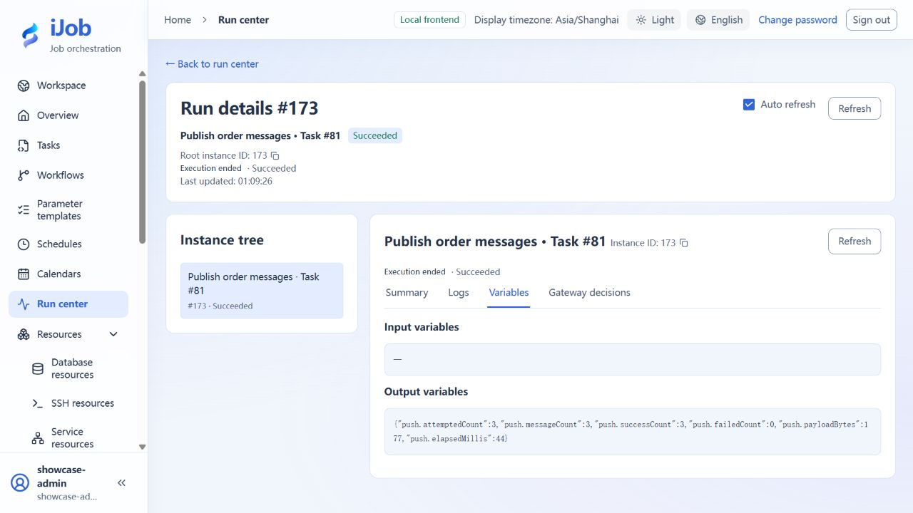

# Publish three order messages and configure run notifications separately

[简体中文](../../zh-CN/examples/push-and-notifications.md) · [Manual home](../README.md)

Verify order messages at a consumer and distinguish them from platform email notifications.

## Audience and outcome

For workflow authors who have completed the quick start.

## Before you start

Read the [shared tutorial preparation](../examples.md). Estimates exclude external-service installation. Use your own tutorial resources, paths and ports.

| Resource | Requirement |
| --- | --- |
| Source data | A dedicated PostgreSQL resource; the read-only VALUES query below produces three records without creating a business table. |
| Messaging service | A dedicated Kafka topic and a consumer restricted to it; Kafka is the main path in this tutorial. |
| Notification receiver | Optional: a dedicated SMTP sink/test mailbox without business recipients. |

## Configuration

| Field / setting | Example value |
| --- | --- |
| SQL | Use the VALUES query below with your own marker for each exercise |
| Serialization / compression | json / none |
| Destination | KAFKA / your dedicated topic; Kafka resource acks=all |
| Batch size / maximum in flight | 3 / 3 |
| Publish timeout / plugin retry count | 30 seconds / 0 |

## Steps

### 1. Create resources and the read-only source query

Create your PostgreSQL and Kafka resources. Set your reachable Kafka address and `acks=all`, and prepare a dedicated topic without unrelated messages. Start a consumer restricted to that topic. Use this source query, replacing `orders-demo-01` with your own exercise marker:

```sql
SELECT order_id, amount, 'orders-demo-01' AS tutorial_run
FROM (VALUES (1,100),(2,200),(3,300)) AS tutorial_orders(order_id,amount)
ORDER BY order_id;
```

### 2. Save the PUSH task

Create PUSH with the PostgreSQL source and query, then choose KAFKA, its resource, and the dedicated topic. Use json serialization, none compression, batch size 3, maximum in flight 3, publish timeout 30 seconds, and plugin retries 0. Set common timeout 120 seconds and automatic retry count/interval 0. Save, complete optional notification setup below, then execute once.

### 3. Optional: configure a success notification first

Prepare an SMTP receiver dedicated to this tutorial. Create an enabled mail channel with your own address, port, and sender. This example uses security NONE and authentication disabled, only within a restricted practice network. Create an EMAIL notification addressed to your dedicated receiver. Test connectivity, send a test message, and inspect what was received.

Bind the new PUSH task to this notification with policy **ON_SUCCESS**. Test messages and instance notifications are separate records: a successful test does not prove that task binding is active. If email is unnecessary, skip this step; business messages work independently.

### 4. Execute once and check messages and email separately

Execute PUSH. Expect `push.attemptedCount=3`, `push.messageCount=3`, `push.successCount=3`, and `push.failedCount=0`. The consumer should receive order_id 1, 2, and 3 with amounts 100, 200, and 300, totaling 600, and a matching `tutorial_run` marker.

If notification is configured, inspect the DELIVERED record linked to this PUSH instance and the received email; do not mistake the earlier test message for the run notification. Repeating execution may republish all three messages. Handle duplicates by business key and distinguish exercises with the marker.

### 5. Optional extensions: RabbitMQ and messaging ETL

RabbitMQ requires its own exchange, routing key, bound queue, and consumer. Messaging ETL additionally requires a target table and offset or acknowledgement policy. These extensions are outside the confirmed Kafka + SMTP main path. Follow the [messaging resource](../user-guide/resources-messaging.md) and [ETL](../user-guide/plugins/etl.md) references, checking message count, target data, and recovery in your own environment. PUSH and downstream writes are not one transaction.

## Expected results

| Check | Expected value |
| --- | --- |
| Initial delivery | SUCCESS; consumer receives 3 records totaling 600 with the matching marker |
| PUSH output | attempted/message/success counts 3; failed count 0 |
| ON_SUCCESS run notification | Send/delivery records for the same PUSH instance are DELIVERED; receiver has the matching message |

## Common failures

| Symptom | Action |
| --- | --- |
| PUSH succeeds without email | PUSH publishes business messages; email depends on separate channel/rules/bindings. |
| Duplicate messages | Deduplicate by business ID; no end-to-end exactly-once guarantee. |

## Safety and cleanup

Disable tutorial notification bindings/schedules, stop the dedicated consumer and clean only tutorial destinations/received data.

## Version and limitations

Applies to iJob 1.0.0. The main environment uses PostgreSQL, Kafka, and an unauthenticated SMTP receiver on a restricted network; both language variants cover three messages and a success notification. RabbitMQ, messaging-ETL failure recovery, SMTP TLS/authentication, automatic notification retries, and cross-run alarm deduplication are outside the confirmed scope.

The following image shows the actual tutorial run:



## Related pages

- [Push database results to messaging](../user-guide/plugins/push.md)

- [Mail channels, rules and delivery records](../user-guide/notifications.md)

- [ETL: source, transforms, target and increments](../user-guide/plugins/etl.md)

- [Query orders and add a data quality gate](sql-and-validation.md)
