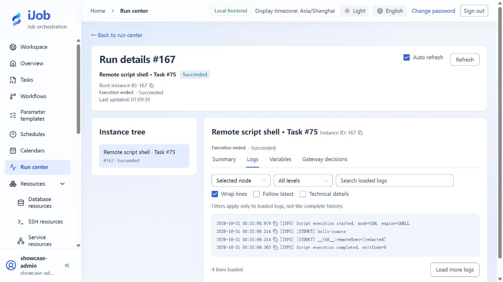

# Run a remote script over SSH

[简体中文](../../zh-CN/examples/remote-script.md) · [Manual home](../README.md)

Produce a message and variable remotely, then check the remote path and execution result.

## Audience and outcome

For workflow authors who have completed the quick start.

## Before you start

Read the [shared tutorial preparation](../examples.md). Estimates exclude external-service installation. Use your own tutorial resources, paths and ports.

| Resource | Requirement |
| --- | --- |
| SSH environment | A dedicated Linux SSH host, restricted account, empty practice directory and independently verified host fingerprint. |
| Interpreter | Remote /bin/sh; use the Python variant only when its interpreter exists remotely. |

## Configuration

| Field / setting | Example value |
| --- | --- |
| Mode | SSH |
| Engine / working directory | SHELL / the dedicated remote directory |
| Script | Use the SHELL code below |

## Steps

### 1. Create the SSH resource

Create an SSH resource with your host, port, restricted account, and independently verified host key. For key authentication, the Private key field (`privateKey`) takes **a private-key file path readable by the execution Worker**, not pasted PEM content or a path on the remote host. Enter its passphrase separately. If API and Worker run separately, the API node performing a connection test must also be able to read the configured path. Restrict file access before testing; keep authentication material out of scripts and logs.

### 2. Configure the remote task

Create SCRIPT with execution mode SSH and select the resource. Choose SHELL and set an absolute working-directory path on the remote host. SHELL has no editable interpreter field; the host must provide `/bin/sh`. Set retry count and interval to 0, timeout to 60 seconds, and enter:

```sh
echo hello-remote
echo __VAR__:remoteRows=3
printf '3\n' > remote-result.txt
exit 0
```

Save/publish. Values after `__VAR__:` are strings; this output is the string `"3"`, not numeric 3.

### 3. Run and inspect output

Use an ADMIN session to inspect hello-remote in the logs, output variable `remoteRows` containing the string `"3"`, and the claiming Worker. Variable values are redacted from script logs; inspect the actual value in output variables.

The working directory belongs to the SSH host, not the browser machine or local Windows Worker. Its `remote-result.txt` should contain one line, `3`; repeating this sample overwrites that file.

### 4. Exercise failures separately

Create a differently named task with the same settings and exit code 7; the run should be FAILED. Create a separate SSH resource with a mismatching host key; its connection test must be rejected rather than bypassing verification. An incorrect interpreter path applies to the PYTHON configuration below; SHELL has no such field. An inaccessible working directory is a separate failure condition to check against your own remote permissions.

### 5. Use remote Python

Create another task using SSH and the same resource, and change the engine to PYTHON. Set Python interpreter to an installed remote command or absolute path, such as `/usr/bin/python3`. Keep a remote working directory, retries 0, and timeout 60 seconds.

```python
print("hello-remote-python")
print("__VAR__:remoteRows=3")
```

After saving and executing, expect SUCCESS, `hello-remote-python` in logs, and `remoteRows` as the string `"3"`.

## Expected results

| Check | Expected value |
| --- | --- |
| Message and variable | Logs contain hello-remote; remoteRows is the string "3" |
| Exit code 7 | FAILED despite successful SSH connection |
| Remote file | `remote-result.txt` contains one line, `3` |
| Python task | SUCCESS; `remoteRows` is the string `"3"` |
| Mismatching host key | Connection test rejected before script execution |

## Common failures

| Symptom | Action |
| --- | --- |
| Platform timeout with remote work continuing | Closing SSH does not guarantee remote termination. Implement remote deadlines, cancellation and idempotency, and inspect the remote process separately. |

## Safety and cleanup

Remove tutorial-created files and failing copies; confirm any long-running remote process has exited first.

## Version and limitations

Applies to iJob 1.0.0. The example uses a Windows Worker with key authentication to a Linux SSH host and covers successful SHELL/PYTHON runs, exit-code-7 failure, rejection of a mismatching host key, and checking a remote file. Password authentication, jump hosts, and termination of arbitrary long-running remote processes are outside the confirmed scope. Platform stop does not roll back remote transactions.

The following image shows the actual tutorial run:



## Related pages

- [Script](../user-guide/plugins/script.md)

- [SSH resources and host trust](../user-guide/resources-ssh.md)
