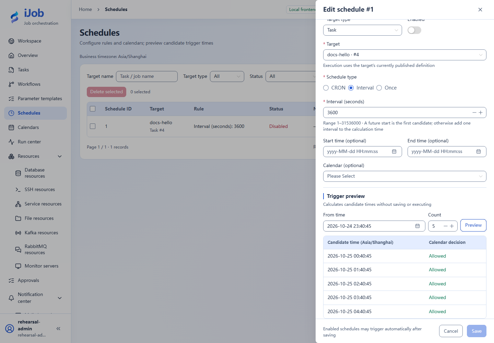

# Preview schedules and understand missed-run recovery

[简体中文](../../zh-CN/examples/schedules-and-calendars.md) · [Manual home](../README.md)

Inspect timezone/calendar candidates, then compare missed-run policies in a dedicated installation.

## Audience and outcome

For workflow authors who have completed the quick start.

## Before you start

Read the [shared tutorial preparation](../examples.md). Estimates exclude external-service installation. Use your own tutorial resources, paths and ports.

| Resource | Requirement |
| --- | --- |
| Task | Published harmless docs-hello with an eligible Worker. |
| Recovery exercise | A dedicated installation that may be stopped, separate from business operations. |

## Configuration

| Field / setting | Example value |
| --- | --- |
| Preview schedule | INTERVAL=3600 seconds, disabled, next 5 candidates |
| Recovery schedule type / expression | CRON / `0 * * * * *`, on each minute boundary |
| Misfire policies | SKIP / FIRE_ONCE / CATCH_UP_BOUNDED |
| Bounded catch-up limit | 2 |

## Steps

### 1. Create and preview a disabled schedule

Create a disabled 3600-second interval schedule for docs-hello. Preview 5 candidates and inspect business timezone/start/end. The UI display timezone does not change the business timezone.

### 2. Exclude a date with a calendar

Create a calendar excluding a future date in the preview range, bind it and preview again. Confirm that date is excluded from eligible execution times.

### 3. Prepare three recovery schedules

Only in the dedicated stoppable installation, create three harmless tasks with the same content as docs-hello and different task names identifying SKIP, FIRE_ONCE, and CATCH_UP_BOUNDED. Add a CRON schedule for each, using `0 * * * * *` and its corresponding recovery policy. **Schedules have no name field**; identify each record by its target task and schedule ID.

Set grace to 5 seconds and queue delay to 600 seconds on each; set the bounded catch-up count to 2. Check that the deployment catch-up window covers the planned downtime; do not assume an arbitrary per-schedule window field.

Choose a future minute boundary T0 with enough preparation time. Set all three schedules to start at T0 and end two minutes later; the end tick is included in this example. Remove the calendar binding or ensure the date is allowed. Preview from one second before T0 and confirm exactly T0, T0+1 minute, and T0+2 minutes. Then **enable all three schedules and confirm their state**, and finish a normal shutdown before T0. T0 means a future date/time you choose, not text to enter literally.

### 4. Record a controlled downtime window

Stop the dedicated installation normally before T0 and resume after T0+2 minutes+6 seconds, so all three ticks exceed the 5-second grace. Resume within the 600-second queue deadline and configured catch-up window. Record actual stop/recovery times and confirm Worker readiness without terminating other instances. The finite end time prevents additional regular minute ticks after recovery.

### 5. Count recovered runs by planned time

Count only planned times inside that downtime window, excluding normal future runs. With all three within catch-up/queue deadlines, expect SKIP=0, FIRE_ONCE=1 and bounded catch-up=2. Inspect linked instances/logs, then disable all three schedules.

## Expected results

| Check | Expected value |
| --- | --- |
| Calendar preview | Excluded date is not eligible; preview itself does not execute |
| SKIP | No recovery triggers; count 0 |
| FIRE_ONCE | One recovery trigger with a SUCCESS instance |
| CATCH_UP_BOUNDED, limit 2 | Two recovery triggers, both linked instances SUCCESS |

## Common failures

| Symptom | Action |
| --- | --- |
| Unexpected count | Inspect actual downtime, grace, queue deadlines and Worker groups; separate future regular runs from catch-up. |
| SKIPPED trigger without an instance | A queue deadline may have expired; this is different from a running task failing. |

## Safety and cleanup

Disable all practice schedules, inspect pending triggers and restore the dedicated installation's prior settings.

## Version and limitations

Applies to iJob 1.0.0. The example uses a separate Windows installation, Asia/Shanghai business time, and a finite three-tick CRON window; policy results are 0 / 1 / 2 in both interface languages. Calendar preview is a preliminary exercise, not coverage of every calendar/recovery-policy combination. Other timezones, DST, and multi-node outages require separate checks. The image below shows candidate preview rather than recovered runs.

## Interface reference

These are actual interface references for this capability. Names and instance IDs may differ from your run; follow the steps and expected results for extensions.

## Related pages

- [Schedules, preview and catch-up](../user-guide/schedules.md)

- [Calendars and exceptions](../user-guide/calendars.md)

- [Scheduling, events, notifications and retention](../configuration/scheduling-retention.md)
