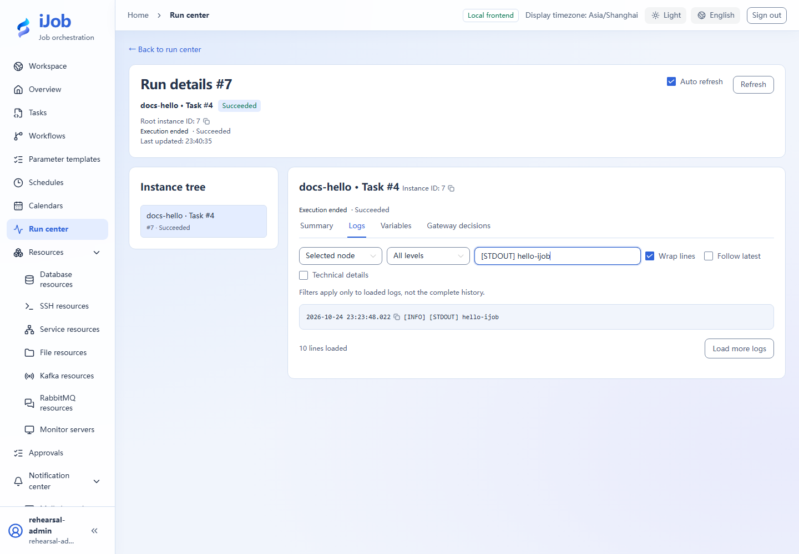

# Run a script and distinguish success, failure and stop

[简体中文](../../zh-CN/examples/script-lifecycle.md) · [Manual home](../README.md)

Use three harmless scripts to distinguish trigger acceptance from actual execution results.

## Audience and outcome

For first-time script users who need to distinguish success, nonzero exit, stop and timeout.

## Before you start

Complete the [shared preparation](../examples.md), then prepare the resources below.

| Resource | Requirement |
| --- | --- |
| Worker | The main steps use Windows PowerShell with the POWERSHELL engine. BAT and Linux SHELL require their own syntax and interpreter. |

## Configuration

| Field / setting | Example value |
| --- | --- |
| Execution mode | LOCAL |
| Retries / timeout | 0 / 60 seconds |
| Success script | Use the copyable code below |

## Steps

### 1. Create and publish the success task

Create SCRIPT named docs-hello with LOCAL execution and the POWERSHELL engine. Set script/output encoding to UTF-8, retries to 0 and timeout to 60 seconds:

```powershell
Write-Output 'hello-ijob'
Write-Output '__VAR__:greeting=hello'
exit 0
```

Saving publishes a version without running it. Values emitted with `__VAR__:` are strings; this example produces `greeting="hello"`. For BAT or Linux SHELL, use the corresponding `echo hello-ijob` and `exit 0` syntax and check that interpreter separately.

### 2. Run manually and inspect logs

Trigger manually and confirm the input dialog. Open the run center, wait for SUCCESS and find hello-ijob in STDOUT plus the actual Worker.

### 3. Observe a nonzero exit

Create docs-failure with POWERSHELL, retries 0 and timeout 60 seconds:

```powershell
Write-Output 'tutorial-failure'
exit 7
```

Save/publish and run manually. Expect FAILED; trigger acceptance and script success are separate results.

### 4. Stop a long-running task

Create docs-stop with POWERSHELL, retries 0 and timeout 120 seconds:

```powershell
Write-Output 'started'
Start-Sleep -Seconds 45
Write-Output 'finished'
```

Save/publish and run. Once the instance is running and the log contains `started`, request stop. Wait for STOPPED and check that this run did not print `finished`; acceptance of the stop request is not completion.

### 5. Optional: inspect timeout and retries

In a separate copy, use `Start-Sleep -Seconds 10`, a task timeout of 2 seconds and retries 0. Run it and check TIMED_OUT.

Retries are a separate optional extension: set the nonzero-exit copy to one retry and inspect its attempts. Eligibility depends on the plugin result and cannot be inferred for HTTP errors from a script run.

## Expected results

| Check | Expected value |
| --- | --- |
| Success | SUCCESS, hello-ijob in logs, and greeting as the string hello |
| Failure | FAILED with a nonzero exit |
| Stop | STOPPED after started; no finished output |
| Timeout copy | A 10-second wait with a 2-second task timeout reaches TIMED_OUT |

## Common failures

| Symptom | Action |
| --- | --- |
| No instance | Inspect the trigger, Worker readiness and routing groups before retriggering. |
| Writes after stop | Stopping does not undo completed external effects; these scripts do not write business data. |

## Safety and cleanup

Disable tutorial schedules if created, and remove unwanted practice tasks after active instances finish.

## Version and limitations

Applies to 1.0.0. The main path uses Windows PowerShell for success, exit code 7, stop and a 2-second task timeout. BAT/Linux SHELL and automatic retries are separate extensions to check on their own interpreters.

## Interface reference

These are actual interface references for this capability. Names and instance IDs may differ from your run; follow the steps and expected results for extensions.



## Related pages

- [Script](../user-guide/plugins/script.md)

- [Run center, logs, graphs and stop](../user-guide/runs.md)
