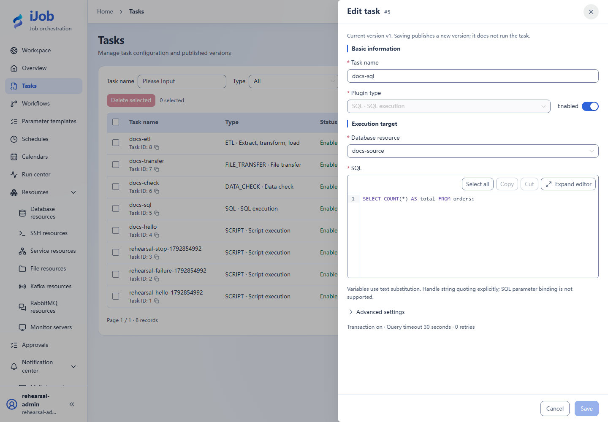
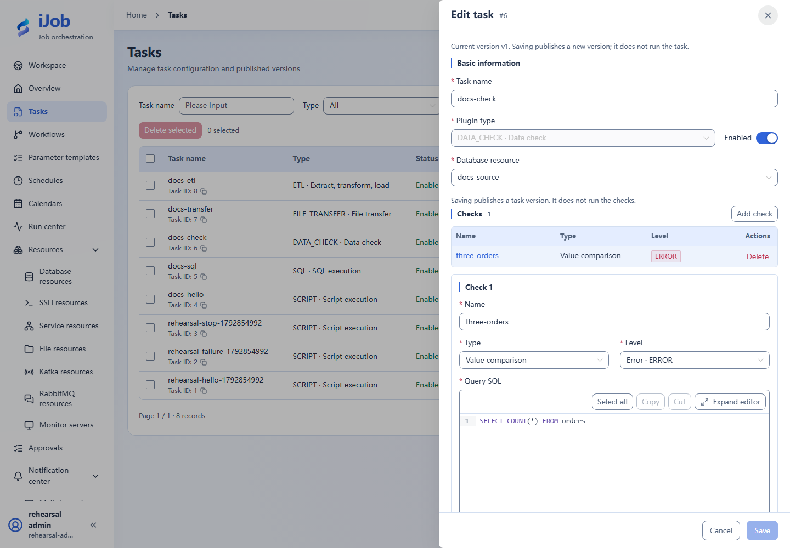

# SQL and data-quality checks

[简体中文](../../zh-CN/examples/sql-and-validation.md) · [Manual home](../README.md)

**Verification: the baseline path was exercised in isolation; extensions do not inherit that result.**

Fields: [SQL execution](../user-guide/plugins/sql.md).

## Prepare, configure and run

Use an independent PostgreSQL business database with three rows:

```sql
CREATE TABLE orders(id INTEGER PRIMARY KEY, amount INTEGER, updated_at TEXT);
INSERT INTO orders VALUES
 (1,100,'2026-01-01'),(2,200,'2026-01-02'),(3,300,'2026-01-03');
```

For SQL select the resource, run `SELECT COUNT(*) AS total FROM orders;`, use resultVariable=ordersResult and a 30-second timeout. For DATA_CHECK use the same resource, NORMAL/EQ/expected=3 and `SELECT COUNT(*) FROM orders`, severity ERROR.

Run both and expect success with scalar 3. A downstream job can use the check as a quality gate. Verify the two-row failure variant on another copy, preserving the evidence source. COUNT type is not SQL COUNT(*). Retain the read-only sample; do not practice on the platform database.

## Finish

Retain inputs, definition versions, trigger/instance IDs, sanitized logs and target checks. Stop only processes/schedules owned by this case; other environments and historical evidence are not cleanup targets.

## Real page examples

Exercised query configuration.



Check configuration; see the copyable comparison rule above.


