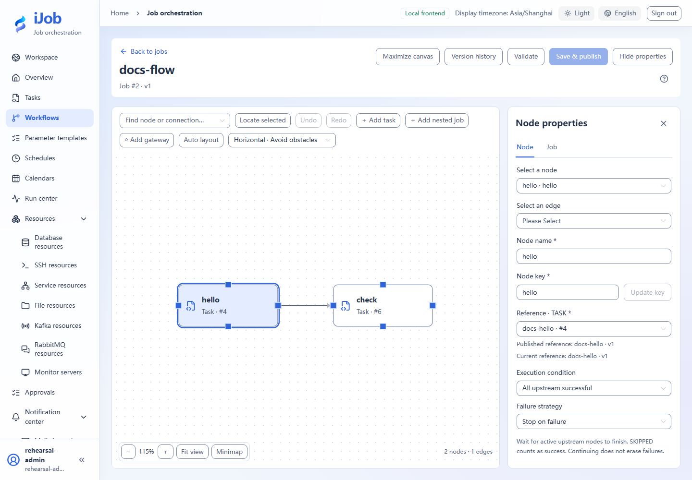

# Control which child version a parent job uses

[简体中文](../../zh-CN/examples/subjobs-and-versions.md) · [Manual home](../README.md)

Observe a parent's pinned child version and adopt a new version by publishing each level.

## Audience and outcome

For users reusing child jobs and controlling when changes take effect through pinned version snapshots.

## Before you start

Complete the [shared preparation](../examples.md), then prepare the resources below.

| Resource | Requirement |
| --- | --- |
| Environment | A Worker for local SCRIPT and three dedicated objects: task, child job and parent job. |

## Configuration

| Field / setting | Example value |
| --- | --- |
| Task v1 output | Use the script in step 1 |
| Task v2 output | Use the script in step 3 |

## Steps

### 1. Create the task

Create SCRIPT docs-version with LOCAL execution, using Windows POWERSHELL with UTF-8 script and output encoding. Enter this script, save/publish and note the definition version:

```powershell
Write-Output 'version-one'
Write-Output '__VAR__:buildLabel=version-one'
exit 0
```

### 2. Create child and parent jobs

Publish docs-child containing the task, then docs-parent containing a child-job node referencing docs-child. Inspect both published references. Run the parent and expect version-one in logs.

### 3. Update only the task

Edit the original task and replace its script with:

```powershell
Write-Output 'version-two'
Write-Output '__VAR__:buildLabel=version-two'
exit 0
```

Save/publish the task without publishing either job. Run the parent again: expect version-one.

### 4. Update the child job reference

Republish the child and confirm its new task reference. Do not republish the parent yet; the parent still outputs version-one through its pinned old child snapshot.

### 5. Republish the parent

Republish the parent and confirm the new child version. Execute it and expect version-two. Historical snapshots remain read-only with unchanged references.

## Expected results

| Check | Expected value |
| --- | --- |
| Task-only publication | Parent outputs version-one |
| Then publish child | Old parent still outputs version-one |
| Finally publish parent | Parent outputs version-two |
| Locate the version | Logs match the buildLabel string; task, child and parent use the corresponding definition snapshots |

## Common failures

| Symptom | Action |
| --- | --- |
| Preflight differs from final reference | Preflight does not lock versions; publication uses current references in its transaction. Inspect the final snapshot. |

## Safety and cleanup

Keep useful history if needed. Check parent/child references before removal; do not delete a still-referenced task first.

## Version and limitations

Applies to 1.0.0 one-level parent/child references with a Windows PowerShell task. Compare the initial run, task-only update, child publication and final parent publication. Concurrent editing and multilevel cycles are outside these steps.

## Interface reference

These are actual interface references for this capability. Names and instance IDs may differ from your run; follow the steps and expected results for extensions.



## Related pages

- [Tasks: shared configuration and versions](../user-guide/tasks.md)

- [Workflows: composition, publication and versions](../user-guide/jobs.md)
