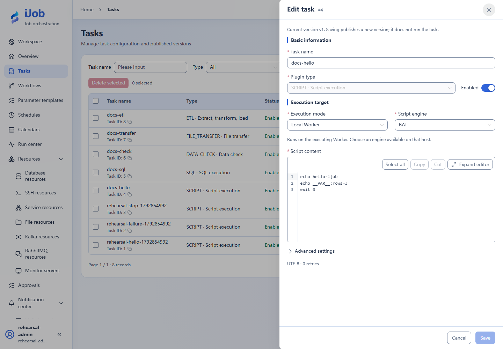
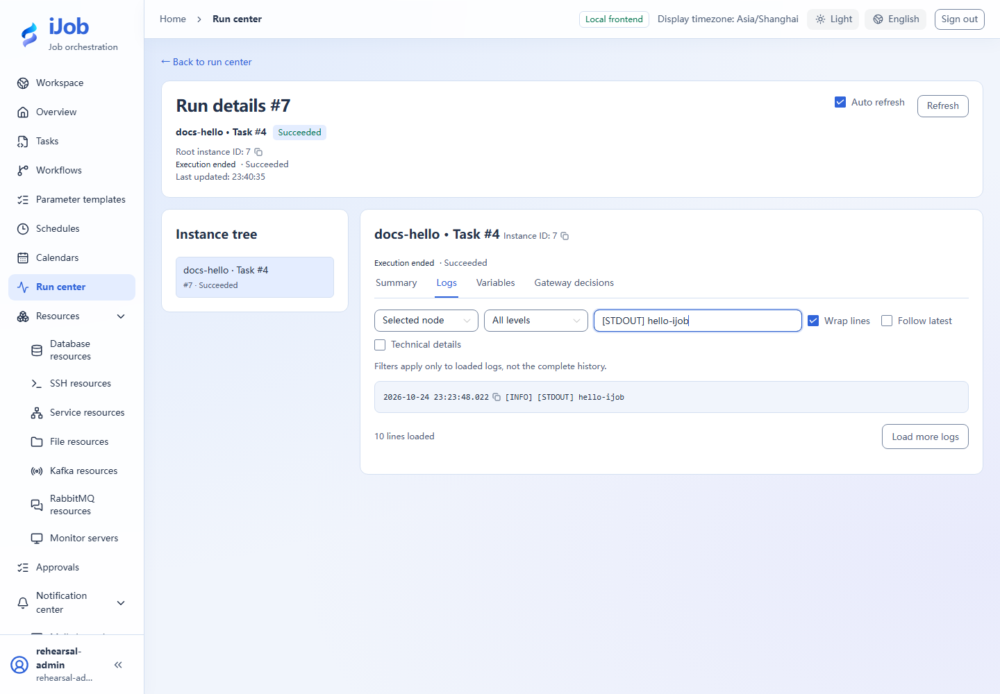
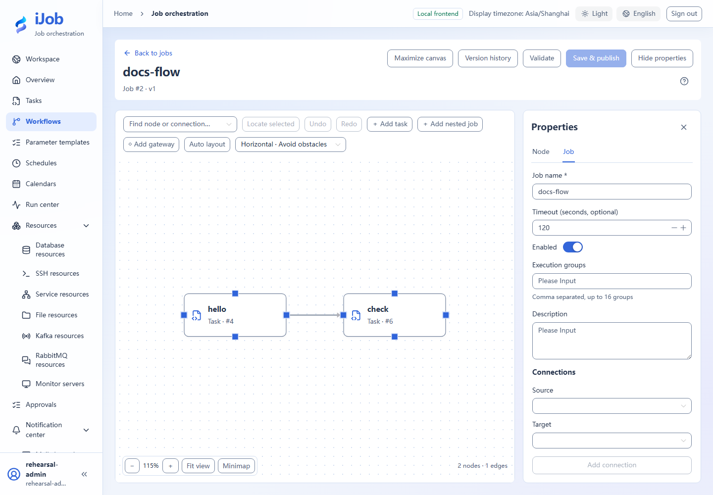
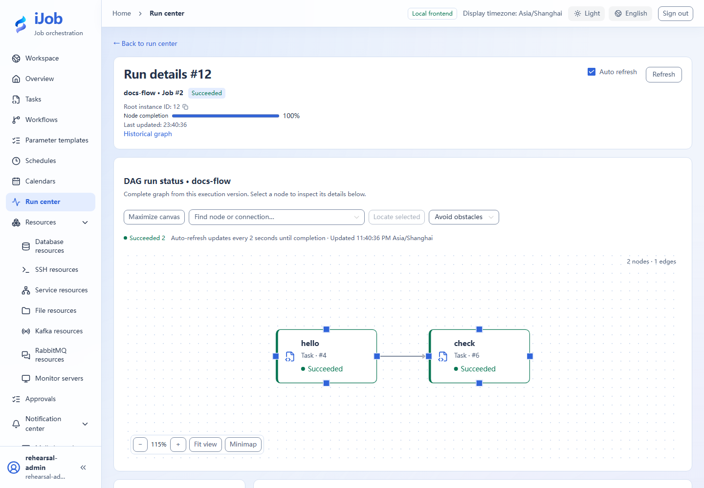
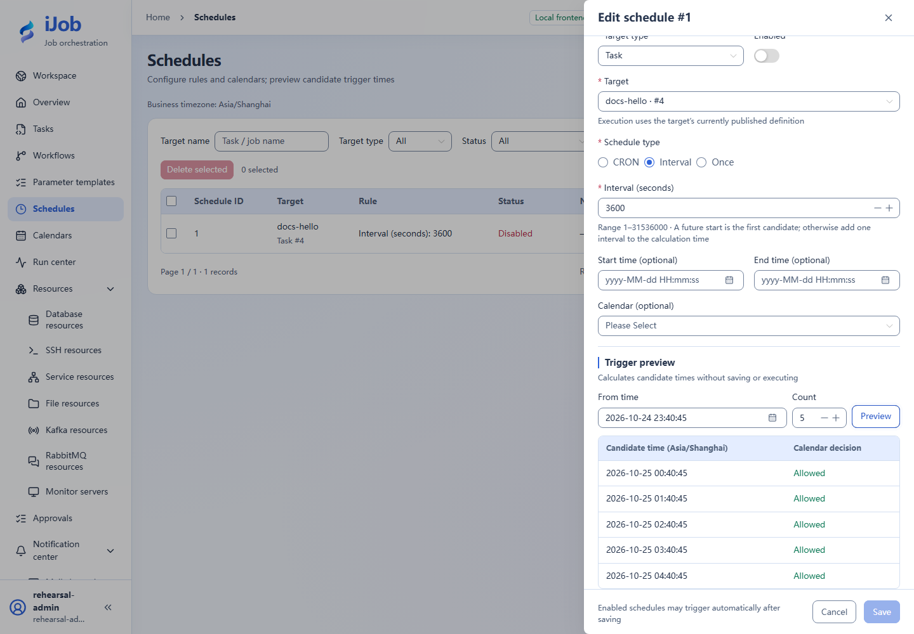

# Quick start: from a task to a workflow

[简体中文](../zh-CN/quickstart.md) · [Manual home](README.md)

## Prepare

Start an independent installation and log in using [Installation](installation.md). The default administrator can complete this chapter; a viewer cannot create or execute. Confirm an eligible Worker in the dashboard. The example does not access business systems.

## 1. Create and save a script task

Tasks → New: name `docs-hello`, plugin SCRIPT, execution LOCAL. Choose BAT on Windows or SHELL with `/bin/sh` on Linux. Keep 0 retries, interval 1 and timeout 60 seconds; initially leave groups unrestricted.

```sh
echo hello-ijob
echo __VAR__:rows=3
exit 0
```

Saving publishes the first version and **does not run the task**. This real screenshot uses Windows BAT; select the matching engine on Linux.



## 2. Run and inspect the result

Click Run and confirm the parameter dialog. After trigger acceptance, open Run center → Instances and this docs-hello instance. Expect SUCCESS and `[STDOUT] hello-ijob` in Logs. Verify output rows=3 in Variables; the declaration value is redacted in logs. stdout/stderr are recorded with size bounds, not as file-output storage.

The screenshot uses the UI search to show the hello output; complete logs are retained.



## 3. Compose a two-node workflow

This script alone is sufficient: create `docs-flow`, add first/second task nodes both referencing docs-hello, connect first→second and use ALL_SUCCESS/STOP. Validate, save/publish, review reference versions and run.

The screenshot uses the advanced hello→check example, whose second node is DATA_CHECK with an independently configured database. For this basic walkthrough, select docs-hello again; canvas/dependency operations are the same.



Inspect the run graph and confirm ordered completion. Later child-task updates do not change existing published job references; republish the job to adopt new versions.



## 4. Preview scheduling

Schedules → New: TASK/docs-hello, INTERVAL=3600, disabled. Preview five future candidates and check business time zone. Preview neither saves nor executes. Enable only when ready, verify a real trigger/instance, then disable the practice schedule. See [Schedules](user-guide/schedules.md).



## Completion check

You should now distinguish publication, trigger acceptance, execution instances and business outcomes. Continue with [Page reference](user-guide/README.md) or [Scenarios](examples.md). Use platform lifecycle commands to stop; do not delete the database to reset an exercise.
