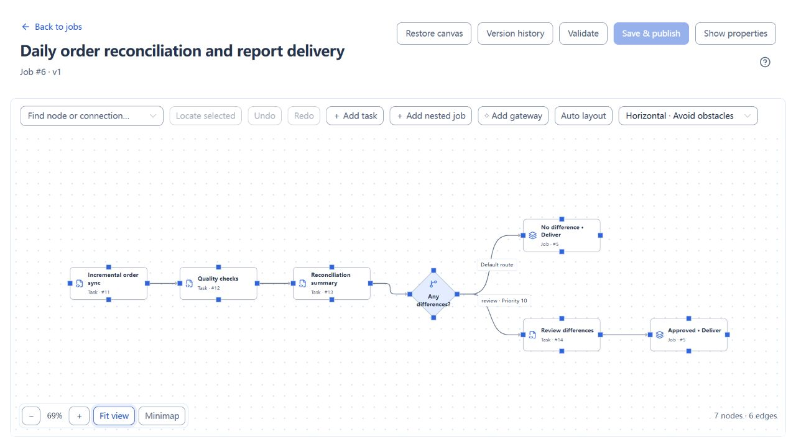
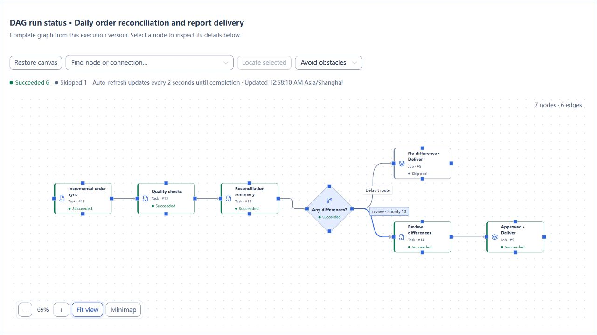

# Workflow nodes, conditions and gateways

[简体中文](../../zh-CN/user-guide/job-nodes.md) · [Manual home](../README.md)

## Entry and workflow

Workflow editor → select node/edge. ADMIN can create, edit and delete configuration. OPERATOR and VIEWER can read summaries but cannot modify configuration. See the [role matrix](users-audits.md) for all actions.

## Configuration and actions

Field names follow the English interface. Initial values are those inserted when a node or connection is created. Tasks and nested jobs are execution nodes; the add action determines the reference type. Gateways use exclusive routing.

### Node properties

| Field | Required | Initial form value | Shown when | Description |
| --- | --- | --- | --- | --- |
| Node name | Required | Name based on the add action | A node is selected | Display name on the canvas, up to 128 characters. |
| Node key | Required | Generated key with a `node-` prefix | A node is selected | Unique within the job, up to 64 characters. Click Update key to apply a change to connections and parsed condition references. |
| Reference | Required | Not selected | Execution node | Select a published task or nested job. Publication captures its current version. |
| Published reference | Read-only | No published reference yet | Execution node has a reference version | Name and version recorded in the current snapshot. |
| Current reference | Read-only | Read from the selected object | Editing an execution node with an available current version | Version available for the next publication; compare it with the published reference. |
| Execution condition | Initially set | All upstream successful (`ALL_SUCCESS`) | Execution node | After participating upstreams reach terminal states, require all success, Any upstream successful (`ANY_SUCCESS`), or After upstream completes (`ALWAYS`). `SKIPPED` counts as success. |
| Failure strategy | Initially set | Stop on failure (`STOP`) | Execution node | Continue evaluation (`SKIP`) allows further evaluation while retaining this node's failure result. |

### Connections and gateway routes

Ordinary connections define dependencies. Business conditions appear only on connections leaving a gateway; the execution node's Execution condition evaluates upstream states instead. Each gateway needs at least two routes and exactly one default.

| Field | Required | Initial form value | Shown when | Description |
| --- | --- | --- | --- | --- |
| Source | Required to connect | Not selected | Connections area while editing | Upstream node. It must differ from the target; duplicate edges and cycles are not allowed. |
| Target | Required to connect | Not selected | Connections area while editing | Downstream node. |
| Route key | Required | `fallback` for the default, otherwise `route-` plus sequence number | Gateway outgoing edge selected | Unique within the gateway, up to 64 characters; identifies the route. |
| Priority | Required | 10, 20, 30… in outgoing-edge order | Gateway outgoing edge selected | Integer from 0 to 10000, unique within the gateway. Non-default routes are checked from smallest to largest; the first match wins. |
| Default route | Initially set | On if no default exists; otherwise off | Gateway outgoing edge selected | Turning it on clears the default flag on other routes of this gateway. Selected only when all non-default conditions are false; no condition is entered. |
| Condition | Required for non-default routes | `EXISTS` check on `input.value` | Non-default gateway outgoing edge selected | Selects a business path using inputs, direct upstream outputs or `trigger` metadata. Replace the initial check with your business condition. |

### Condition editor

| Field | Required | Initial form value | Shown when | Description |
| --- | --- | --- | --- | --- |
| Operator | Required | `EXISTS` on a new non-default route | Structured editor | Comparisons include `EQ` and `GT`. `AND` and `OR` combine at least two conditions; `NOT` contains one condition. |
| Left value | Depends on operator | Variable `input.value` on a new non-default route | Leaf condition | Choose Variable or Literal (JSON). Existence and null checks use a variable. Variables are limited to inputs, direct upstream outputs and trigger metadata. |
| Right value | Required for binary comparisons | Literal `0` when switching to a regular comparison | Leaf condition other than a unary check | Literals must be valid JSON, such as number `0` or string `"review"`. `IN` and `NOT_IN` take an array. Hidden for `EXISTS`, `IS_NULL` and `IS_NOT_NULL`. |
| Advanced JSON | Required | JSON of the current condition | Advanced JSON mode | Edit the expression directly. Check types and references after returning to the structured editor, then validate again. |

Check missing variables with `EXISTS` first. The default route does not catch condition evaluation errors. See [Variables and expressions](../reference/variables.md) for the syntax.

### Node and route actions

| Action | Roles | Available when | Result |
| --- | --- | --- | --- |
| Update key | ADMIN | Editing a node; new key is unique and related conditions can be parsed | Updates the node, edges and parsed condition references. Validate again afterwards. |
| Add connection | ADMIN | Distinct source and target selected; connection is valid | Adds a dependency and initializes route fields if the source is a gateway. |
| Expand condition editor | ADMIN | Editing a non-default gateway route | Opens a larger editor for the same condition. |
| Add condition | ADMIN | In an `AND` or `OR` group below the nesting limit | Adds a child condition to the group. |
| Remove condition | ADMIN | The group contains more than two child conditions | Removes a child while retaining the minimum of two. |
| Delete edge | ADMIN | Editing a job with an edge selected | Removes the dependency and its route condition. Check the default route and route count again. |
| Delete node | ADMIN | Editing a job and confirming deletion | Removes the node and connected edges. Revalidate related condition references. |
| Open published child graph | ADMIN | A node in the current snapshot references a published nested job | Shows the child graph fixed by that snapshot. |
| Validate | ADMIN | Draft and reference metadata are available | Checks topology, references and conditions. Save & publish is still required afterwards. |

See [Jobs: orchestration, publication and versions](jobs.md) for saving and publication.

## Use and verify

The screenshots use the [Order reconciliation and review](../examples/order-reconciliation.md) tutorial. After synchronization, quality checks and reconciliation, the gateway selects a delivery path. The reconciliation node is the gateway's direct upstream and produces the `summary` variable.

| Route | Route key | Priority | Condition | Expected path |
| --- | --- | --- | --- | --- |
| Difference review | `review` | 10 | `nodes.reconcile.summary.difference_count` greater than numeric `0` | Wait for manual review, then run the delivery child job. |
| Default delivery | `clear` | 100 | Default route, without a condition | Run the delivery child job directly when there are no differences. |

Run data with and without differences. Check the selected route, approval state, child job result and business outputs. An unselected route is skipped, which differs from task failure. Revalidate condition references after changing node keys or connections.

## Real page examples

The diamond is the conditional gateway. The upper path delivers automatically; the lower path requires review. Both delivery nodes reuse the same child job. Select an outgoing gateway edge to edit its route key, priority and condition.

This completed run contains differences: the review path and subsequent delivery completed, while the unselected automatic-delivery node on the upper path was skipped.

