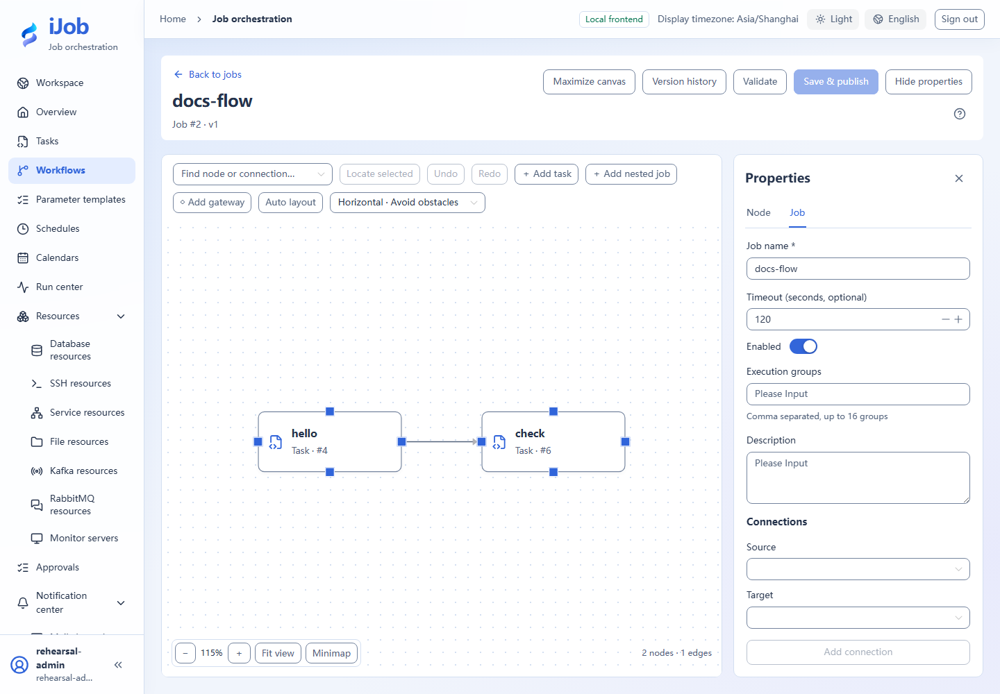

# Workflows: composition, publication and versions

[简体中文](../../zh-CN/user-guide/jobs.md) · [Manual home](../README.md)

## Entry and workflow

Workflows → New workflow. ADMIN can design, save and publish workflows. ADMIN or OPERATOR can execute published versions. VIEWER reads summaries and cannot execute. See the [role matrix](users-audits.md) for all actions.

## Configuration and actions

Obstacle avoidance/simple curves are display preferences. Auto layout changes node positions and is saved with the version. Neither changes dependencies, but their persistence differs.

### Job fields

| Field | Required | Initial form value | Shown when | Description |
| --- | --- | --- | --- | --- |
| Job name | Required | Empty | Always | Identify the business workflow, up to 128 characters. |
| Description | Optional | Empty | Always | Describe its purpose, inputs and external results. |
| Enabled | Initialized | On | Always | Disabled jobs reject new execution requests. |
| Timeout (seconds, optional) | Optional | Empty | Always | Set an execution deadline for the job. |
| Execution groups | Optional | Empty | Always | Up to 16 groups, restricting root-job claims rather than account permissions. |

### Graph and publication actions

| Action | Roles | Available when | Result |
| --- | --- | --- | --- |
| Add task | ADMIN | Editing the current job; the referenced task is available | Add a node referencing a published task. |
| Add nested job | ADMIN | Editing the current job; the referenced job is available | Reuse a published job; publication fixes the referenced version. |
| Add gateway | ADMIN | Editing the current job | Configure exclusive routing with at least two routes and exactly one default. |
| Add connection | ADMIN | Nodes exist; no self-links, duplicates or cycles | Connect upstream to downstream to define execution dependencies. |
| Auto layout | ADMIN | Editable graph with nodes | Rearrange nodes. Layout is published with the job version and this creates unpublished changes. |
| Validate | ADMIN | Job draft and reference metadata are available | Check graph and references. Passing does not save the job or lock reference versions. |
| Save & publish | ADMIN | Validation passes, references are confirmed and no version conflict remains | Capture current child versions transactionally; do not execute automatically. |
| Version history | ADMIN / OPERATOR / VIEWER | Published versions exist | Read the version list; opening the read-only graph additionally requires ADMIN. Later child edits do not change old snapshots. |
| Open published child graph | ADMIN | The snapshot node references a nested job | View the nested graph fixed by the snapshot reference. |

## Use and verify

For a minimal flow, add hello/check task nodes, connect hello→check and use ALL_SUCCESS/STOP. Publish and run, then inspect the [run graph](runs.md). Multiple nodes cannot be isolated or cyclic; bounds are 1–500 nodes and 5000 edges. See [Nodes/gateways](job-nodes.md).

## Real page examples

Two-node workflow and job properties.

