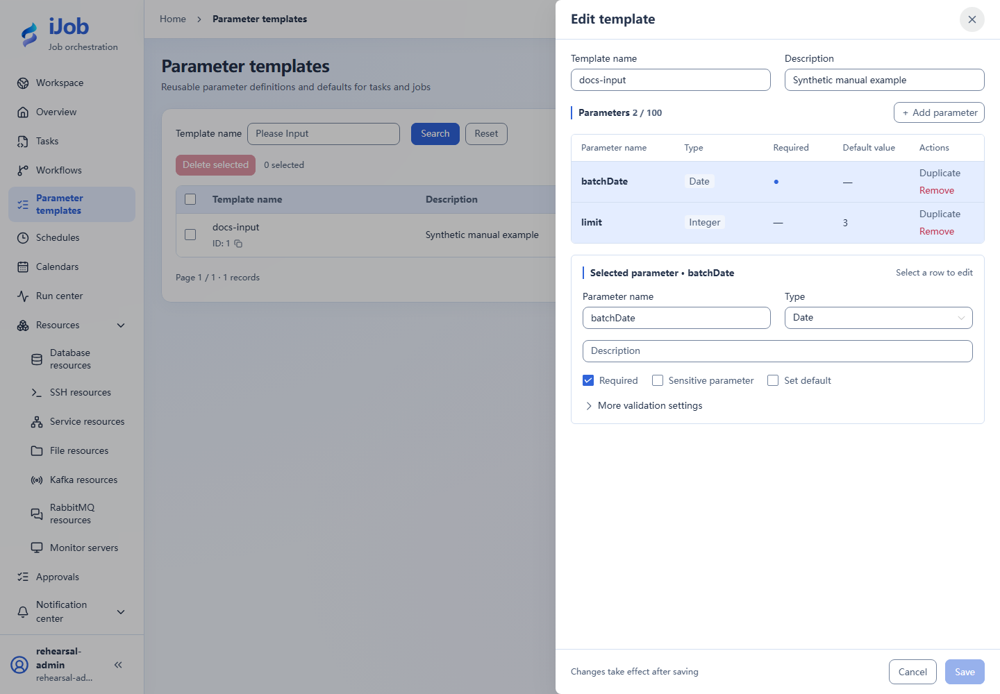

# Parameter templates, inputs and variables

[简体中文](../../zh-CN/user-guide/parameters.md) · [Manual home](../README.md)

Use ADMIN for the full tutorial, including logs and variable details. OPERATOR can execute configured tasks and inspect summary states, but cannot read those details.

Define two inputs, run a task and inspect its input snapshot and script output. Applies to 1.0.0; see the [variable reference](../reference/variables.md) for syntax.

## 1. Create a parameter template

Open Parameter templates and add:

| Name | Type | Required | Default | Purpose |
| --- | --- | --- | --- | --- |
| batchDate | DATE | Yes | None | Business date for this execution |
| limit | INTEGER | No | 3 | Quantity limit for the example |

Required and default are separate settings. Empty, missing, 0 and false differ. Sensitive inputs cannot store defaults. Configure enum, range and length limits for the selected type; at most 100 fields.



## 2. Reference the input from a task

Use SCRIPT with local execution: BAT on Windows or SHELL on Linux.

```text
echo limit=${limit}
echo __VAR__:rows=3
exit 0
```

Keep limit typed as INTEGER. Saving publishes a version without executing. Use ADMIN to create/edit templates and tasks; ADMIN or OPERATOR can manually execute.

## 3. Supply values and execute

1. Click Execute and select the template in the execution form.
2. Set batchDate to the intended date and limit to integer 3. The template name is not an input value.
3. Review supplied fields and values, then submit.
4. Open the corresponding instance and inspect its input snapshot.

Execution inputs do not update templates or saved schedules. Reload replaces the current editing draft; review changes you need to keep first.

## 4. Check results

| Check | Expected |
| --- | --- |
| Inputs | Submitted batchDate and numeric limit=3 |
| Logs | A line containing limit=3 |
| Outputs | rows is the string `"3"`, not the number 3 |
| State | SUCCESS after a normal script exit |

Variable output values are hidden in logs. Inspect instance outputs rather than treating their absence from logs as failure. Variable details remain subject to account permissions.

## SQL and ETL use different mechanisms

SQL `${limit}` uses text replacement. ETL uses `:limit` with query parameters. See [variable reference](../reference/variables.md) for dates, native script escaping and upstream merging. Store passwords and tokens in resources.
