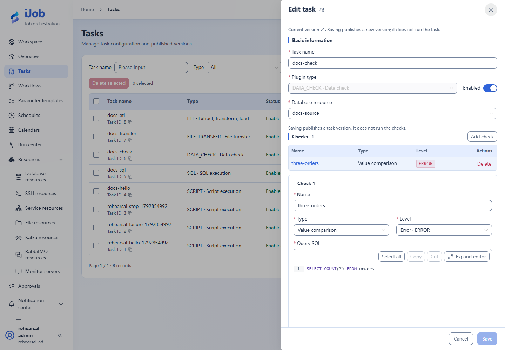

# Data checks

[简体中文](../../../zh-CN/user-guide/plugins/data-check.md) · [Manual](../../README.md)

Applies to **1.0.0**. Tasks → New/Edit → plugin `DATA_CHECK`.

## Before you start

Use ADMIN to create, configure and save tasks. ADMIN or OPERATOR can execute published definitions; ADMIN reads detailed logs and input/output variables. Resources must be enabled and reachable from the execution node. See [tasks](../tasks.md) for common timeout, retry and version settings, and the [permission matrix](../users-audits.md).

## Field reference

“Default” means the **initial value of a new 1.0.0 form**. An empty value means the field has not been filled in; required fields still need a value. Visibility follows the selected branch; conditional requirements apply only to that branch.

### Query

| Field | Required | Default | Visible when | Scope |
| --- | --- | --- | --- | --- |
| Database resource | Required | None | Always | Current task version |
| Query timeout (seconds) | Has a default | 30 | Always | Current task version |

- **Database resource**: Business database resource used to run check SQL.
- **Query timeout (seconds)**: 1–3600 seconds per check query.

### Checks

| Field | Required | Default | Visible when | Scope |
| --- | --- | --- | --- | --- |
| Name | Required | Empty | Each check | Current task version |
| Query SQL | Required | Empty | Each check | Current task version |
| Type | Select | NORMAL | Each check | Current task version |
| Level | Select | ERROR | Each check | Current task version |
| Comparison | Conditionally required | EQ | Except EMPTY | Current task version |
| Expected value | Conditionally required | Empty | Except EMPTY and BETWEEN | Current task version |
| Lower bound (inclusive) | Conditionally required | Empty | BETWEEN | Current task version |
| Upper bound (inclusive) | Conditionally required | Empty | BETWEEN | Current task version |
| Actual-value variable (optional) | Optional | Empty | Each check | Current task version |

- **Name**: Names must be unique; 1–100 checks.
- **Query SQL**: Read-only query.
- **Type**: NORMAL compares the first value; COUNT compares the number of returned rows, not the scalar value of SQL COUNT(*).
- **Level**: ERROR/WARN。
- **Comparison**: EXISTS supports only EQ/NE.
- **Expected value**: EXISTS uses booleans; preserve numeric and boolean value types.
- **Lower bound (inclusive)**: Inclusive lower bound.
- **Upper bound (inclusive)**: Inclusive upper bound.
- **Actual-value variable (optional)**: Publish the actual value when variable result handling is enabled.

### Result handling

| Field | Required | Default | Visible when | Scope |
| --- | --- | --- | --- | --- |
| Export result variables | Optional | false | Always | Current task version |
| Send notification | Optional | false | Always | Current task version |
| Send notification | Conditionally required | null | Notifications enabled | Current task version |
| Also notify when all checks pass | Optional | false | Notifications enabled | Current task version |

- **Export result variables**: When enabled, add a result handler with type=VARIABLE to export actual check values.
- **Send notification**: When enabled, add a result handler with type=NOTIFY to send check-result notifications.
- **Send notification**: Select the notification configuration for the handler with type=NOTIFY.
- **Also notify when all checks pass**: For type=NOTIFY, choose whether to notify when all checks pass.

## Behavior and boundaries

- NORMAL compares the first query value; COUNT compares result-set row count. Use NORMAL for a business count returned by SELECT COUNT(*).
- handlers is an array. Exporting variables adds an item with type=VARIABLE; notifications add type=NOTIFY. Notification configuration and notify-on-success settings are in that NOTIFY item's params.

## Typical configuration: Check that the orders table has exactly three rows

Fill in the form below, replacing resource names with your enabled resources. This is a configuration guide, not importable JSON. Follow the tutorial linked below for data preparation and execution.

Prepare three orders; use the separate orders_short table for the failure variant without deleting the original rows.

| Setting | Value |
| --- | --- |
| Database resource | Tutorial business database containing three orders |
| Check name | three-orders |
| Query SQL | SELECT COUNT(*) FROM orders |
| Type | NORMAL |
| Comparison | EQ |
| Expected value type | Number |
| Expected value | 3 |
| Severity | ERROR |

**Expected result:** Passes with three rows; fails after an isolated copy is changed to two rows.

[Follow the full tutorial](../../examples/sql-and-validation.md). Save the definition before running it; inspect execution state and business results separately.

## Actual interface

## Configuration keys

Use these keys when inspecting imported configuration, API payloads or errors. `[]` denotes a collection item; the form does not require you to enter key names.

| Category / field | Configuration key |
| --- | --- |
| Query / Database resource | `resourceId` |
| Query / Query timeout (seconds) | `queryTimeoutSeconds` |
| Checks / Name | `checks[].name` |
| Checks / Query SQL | `checks[].sql` |
| Checks / Type | `checks[].type` |
| Checks / Level | `checks[].level` |
| Checks / Comparison | `checks[].compareType` |
| Checks / Expected value | `checks[].expected` |
| Checks / Lower bound (inclusive) | `checks[].minValue` |
| Checks / Upper bound (inclusive) | `checks[].maxValue` |
| Checks / Actual-value variable (optional) | `checks[].variable` |
| Result handling / Export result variables | `handlers[].type` |
| Result handling / Send notification | `handlers[].type` |
| Result handling / Send notification | `handlers[].params.notifyConfigId` |
| Result handling / Also notify when all checks pass | `handlers[].params.notifyOnSuccess` |

## Related pages

[Tasks and versions](../tasks.md) · [Parameters and expressions](../../reference/variables.md) · [Scenario tutorials](../../examples.md)
