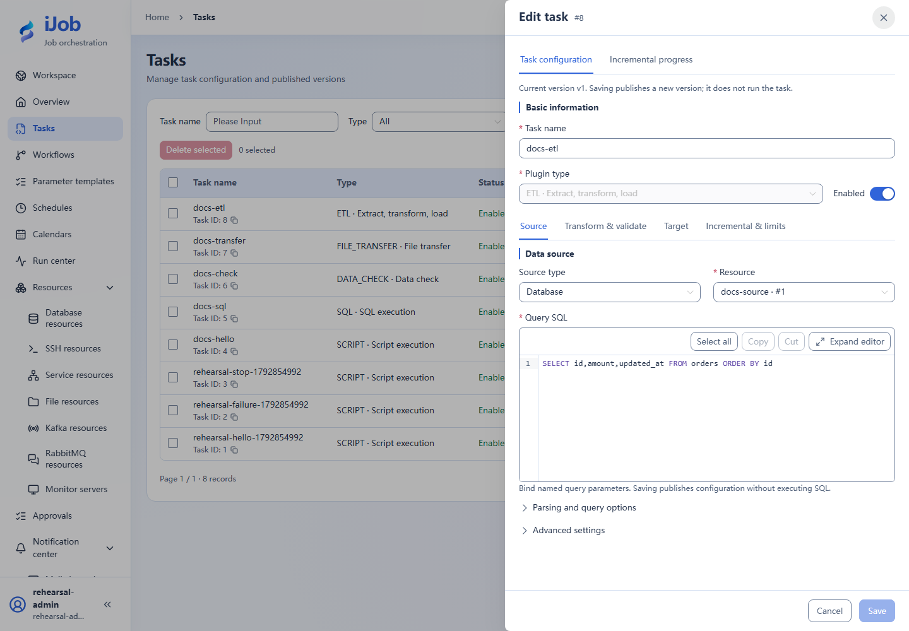
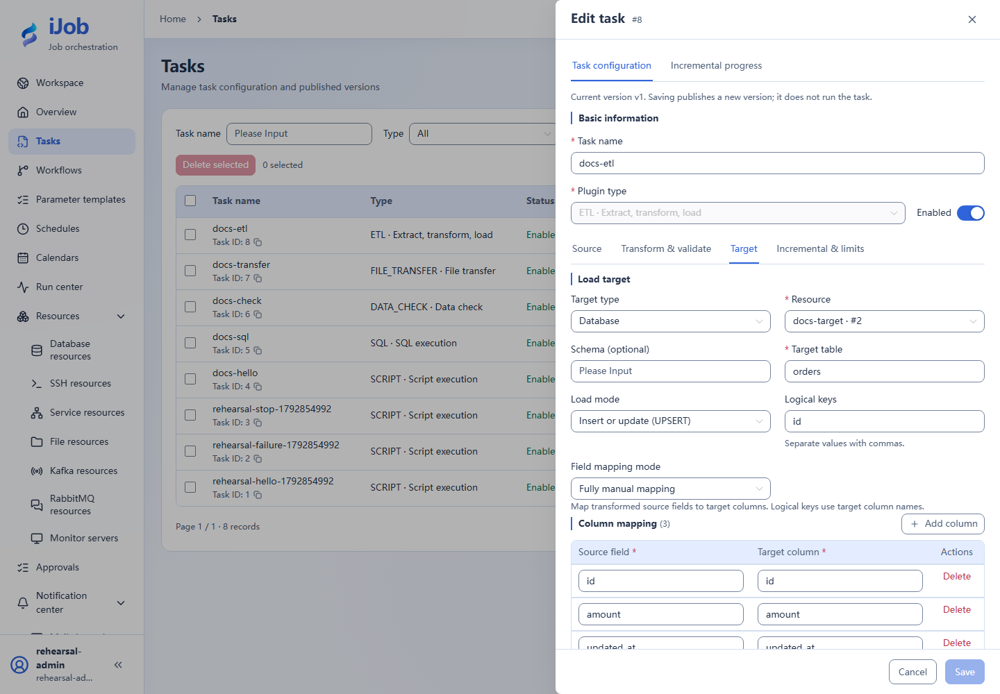

# ETL: source, transforms, target and increments

[简体中文](../../../zh-CN/user-guide/plugins/etl.md) · [Manual home](../../README.md)

## Entry and prerequisites

Tasks → New/Edit → plugin `ETL`. Prepare the resources, permissions and execution-node dependencies listed below. See [Tasks](../tasks.md) for shared timeout/retry/publication behavior.

## Fields and behavior

| Field/action | Purpose and rules |
| --- | --- |
| `source.type / resourceId` | DATABASE/FILE/KAFKA/RABBITMQ; match the resource type. |
| `source.sql / parameters / beforeSql / fetchSize` | Read SQL, bound parameters, beforeSql and fetch size (2000). beforeSql may write data. |
| `source.path / format / readMode` | FILE formats CSV/TXT/EXCEL/REGEX/SQLITE/MDB; DIRECT and SQL expose different fields. A SQLite file source is not a DB resource. |
| `source.charset / delimiter / quote / escape / header / skipLines` | File decoding/delimiters; defaults UTF-8, comma, double quote, header enabled, zero skipped lines. |
| `source.sheetName / sheetIndex / sheets / headerRow / startRow` | Excel single/multiple sheets and row selection; headerRow defaults 0. Follow index hints in the form. |
| `source.regexMode / pattern / blockStart / blockEnd / regexFields` | Regex line/block parsing; map fields to groups/defaults and bound block lines/characters. |
| `source.stagingTable / stagingColumns` | Staging table/columns for file SQL mode, separate from platform tables. |
| `transforms / validations` | Apply ordered transforms and validations; preview samples and check types, nulls and rejection behavior. |
| `target.type / resourceId / schema / table / path` | DATABASE or FILE target; supply the matching table/file path. |
| `target.mappingMode / columns / excludedFields / logicalKeys` | Manual/automatic mapping; verify source-to-target columns. UPSERT and similar modes need valid logical keys. |
| `target.mode / transactionScope / nullPolicy / columnNullPolicies` | APPEND/UPSERT/INSERT_ONLY/UPDATE_ONLY/SCD2; defaults APPEND, BATCH, KEEP_TARGET. Column null policies override the overall policy. |
| `target.beforeSql / afterSql / protection / scd2` | Before/after SQL, protected records and history settings affect writes. SCD2 needs business keys, comparison fields, effective time and validity/current-flag columns. |
| `target.existingFilePolicy / emptyFilePolicy` | Defaults FAIL / CREATE_WITH_HEADER; choose overwrite/skip/empty output deliberately. |
| `incremental.enabled / checkpointKey / watermarkField / watermarkType` | Enable increments with explicit checkpoint ownership, watermark field/type; disabled by default, type STRING. |
| `incremental.tieBreakerFields / initialTieBreakerValues / upperBoundSql / initialWatermark` | Use stable tie breakers for equal watermarks; initial values and upper-bound SQL must match predicates/order. |
| `incremental.allowCheckpointPastInvalidRecords / file` | Default allows checkpoint advancement past invalid records; decide whether skipping is acceptable. File increments also need marker location/template or regex/zone/lookback/stability/change policy. |
| `execution / message / allowNonIdempotentRetry` | Bound read/write batches, query time, records/files/text/Excel. Message sources also bound intake/idle time, batches/buffers/bytes and JSON depth. Non-idempotent retry is not enabled by default. |

## Minimal example and verification

```sql
SELECT id, amount, updated_at FROM orders ORDER BY id;
```

Begin with three-row full DATABASE→DATABASE transfer to orders, map id/amount/updated_at, use logical key id and UPSERT. Verify three target rows and amount sum 600. Exercise increments separately with equal watermarks, retries, failures, invalid rows and checkpoints; a maximum timestamp alone does not prove completeness. BATCH transactions may partially commit. Inspect target/checkpoint before retrying; message acknowledgments and target writes are separate boundaries.

Snippets require your resource IDs/paths. See the [case index](../../examples.md) for actual external-protocol verification status.

## Real page examples

Database source and read-only extraction SQL.



Target table, UPSERT, logical key and same-name column mappings.


