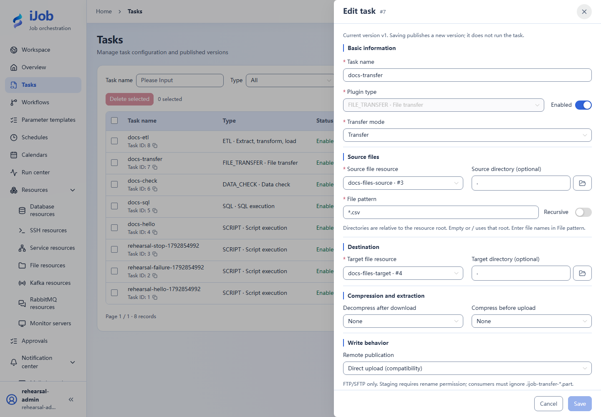

# File transfer and archives

[简体中文](../../../zh-CN/user-guide/plugins/file-transfer.md) · [Manual home](../../README.md)

## Entry and prerequisites

Tasks → New/Edit → plugin `FILE_TRANSFER`. Prepare the resources, permissions and execution-node dependencies listed below. See [Tasks](../tasks.md) for shared timeout/retry/publication behavior.

## Fields and behavior

| Field/action | Purpose and rules |
| --- | --- |
| `mode / sourceResourceId / targetResourceId` | Select transfer/supported archive mode and source/target file resources; default TRANSFER. |
| `sourcePath / targetPath / filePattern / recursive` | Paths under resource roots, pattern and recursion; defaults * and nonrecursive. Start with one CSV. |
| `overwrite / deleteSource / remotePublishMode` | Defaults overwrite=true, deleteSource=false and DIRECT publication. Use overwrite=false and preserve source for the first exercise. |
| `decompressType / compressType / archiveName / compressionLevel` | Select decompression/compression format, archive name and level; defaults NONE/NONE/DEFAULT. |
| `maxArchiveEntries / maxExtractedEntryBytes / maxExtractedTotalBytes / maxCompressionRatio` | Defaults 10000 / 256 MiB / 1 GiB / 100; bound archive expansion. |
| `maxScanDepth / maxScannedEntries / maxSourceFileBytes / maxSourceTotalBytes / maxStagingBytes` | Defaults 32 / 10000 / 256 MiB / 1 GiB / 2 GiB; account for Worker staging disk. |

## Minimal example and verification

```json
{"sourcePath":".","targetPath":".","filePattern":"*.csv","overwrite":false,"deleteSource":false}
```

Add source/target resources, compare target names, sizes and SHA-256, and confirm sources remain. Test FTP/SFTP/S3 connectivity/permissions first; remote publication/rename capabilities differ. Inspect existing targets before retrying a failure; logs alone do not prove no files were copied.

Snippets require your resource IDs/paths. See the [case index](../../examples.md) for actual external-protocol verification status.

## Real page examples

Source/target resources and CSV matching; write options continue below.


