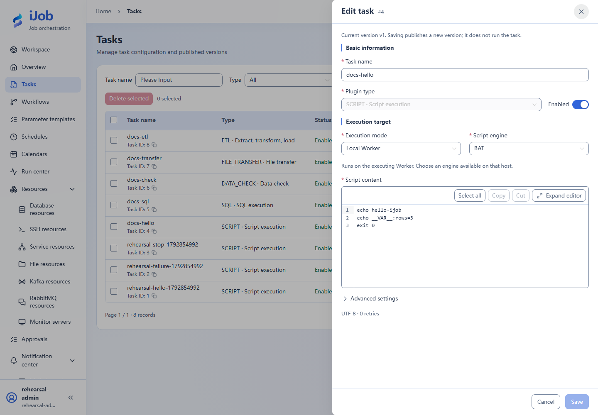

# Script

[简体中文](../../../zh-CN/user-guide/plugins/script.md) · [Manual home](../../README.md)

## Entry and prerequisites

Tasks → New/Edit → plugin `SCRIPT`. Prepare the resources, permissions and execution-node dependencies listed below. See [Tasks](../tasks.md) for shared timeout/retry/publication behavior.

## Fields and behavior

| Field/action | Purpose and rules |
| --- | --- |
| `executionMode / sshResourceId` | LOCAL executes on the Worker/container; SSH uses an SSH resource and executes remotely. |
| `engine / interpreter` | Match the execution OS; provide an installed interpreter path where needed. Use BAT on Windows and SHELL /bin/sh on Linux. |
| `script / workingDir / env` | Script text, working directory and environment. Paths belong to the execution machine, not the browser. Store secrets in resources. |
| `scriptCharset / outputCharset` | Configure script-file encoding and output decoding independently; prefer UTF-8. charset is a compatibility field. |

## Minimal example and verification

```bat
echo hello-ijob
echo __VAR__:rows=3
exit 0
```

Choose LOCAL/BAT for the example; on Linux use SHELL with /bin/sh and the same echo/exit commands. A nonzero exit code fails the task. stdout/stderr are recorded in instance logs with STDOUT/STDERR labels. Limits include 16 KiB per line, 256 KiB capture/log budgets, up to 1000 captured lines, 16 KiB per variable and 100 variables. `__VAR__:rows=3` creates an output variable whose value is redacted in logs. Truncated output is not a large-file store. Stop requests terminate the process but cannot undo completed writes.

Snippets require your resource IDs/paths. See the [case index](../../examples.md) for actual external-protocol verification status.

## Real page examples

Windows LOCAL/BAT example.


