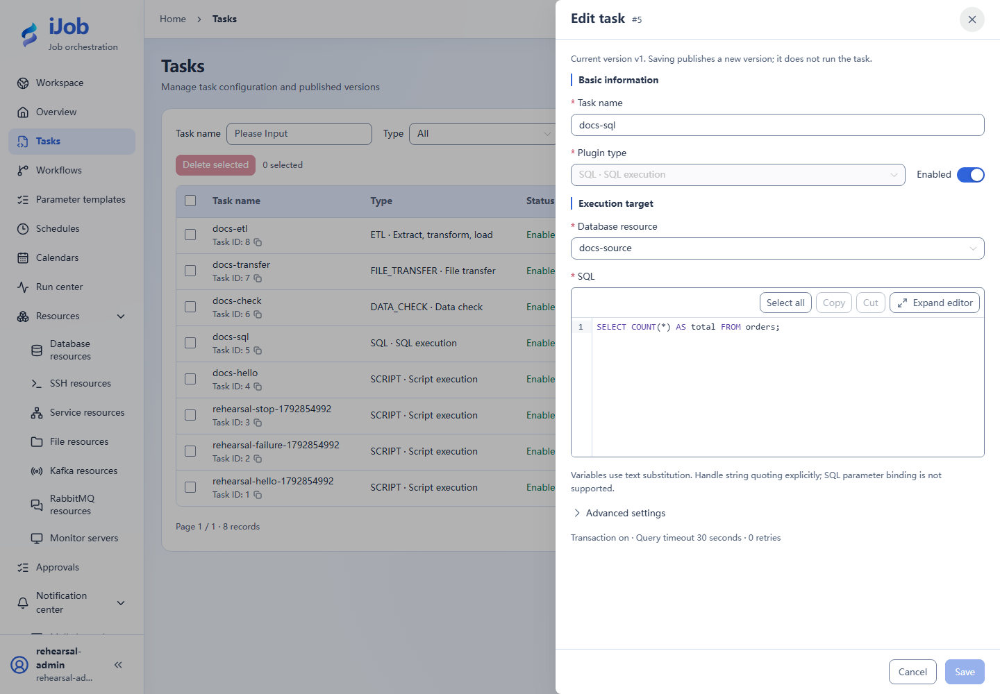

# SQL execution

[简体中文](../../../zh-CN/user-guide/plugins/sql.md) · [Manual home](../../README.md)

## Entry and prerequisites

Tasks → New/Edit → plugin `SQL`. Prepare the resources, permissions and execution-node dependencies listed below. See [Tasks](../tasks.md) for shared timeout/retry/publication behavior.

## Fields and behavior

| Field/action | Purpose and rules |
| --- | --- |
| `resourceId / script` | Choose an enabled business database resource and SQL. Do not practice against the platform DB. Resources support MySQL/PostgreSQL/SQL Server/Oracle; platform SQLite does not imply a SQLite business-resource type. |
| `delimiter / transaction` | Default delimiter ; and transaction=true; transaction behavior depends on the DB and statement types. |
| `continueOnError / queryTimeoutSeconds` | Defaults false / 600 seconds; continuing does not make failed statements successful. Inspect logs/commit scope. |
| `minRows / maxRows / resultVariable` | Set result-row bounds as needed; use a result variable for downstream references, not unbounded result sets. |

## Minimal example and verification

```sql
SELECT COUNT(*) AS total FROM orders;
```

Prepare an independent orders table, save and run manually, inspect SQL results/logs and query actual writes in the database. This SQL plugin uses text substitution, not SQL parameter binding; validate inputs and handle string quoting explicitly. For reads with named binding, see the ETL source configuration. DDL/nontransactional engines may not roll back; design unique keys/idempotency before retrying INSERT.

Snippets require your resource IDs/paths. See the [case index](../../examples.md) for actual external-protocol verification status.

## Real page examples

Read-only SQL, resource selection and transaction/timeout summary.


