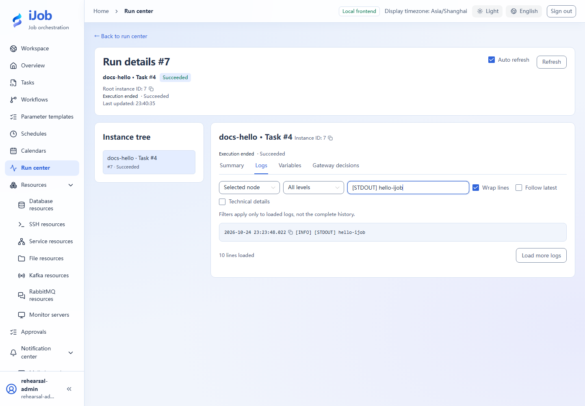
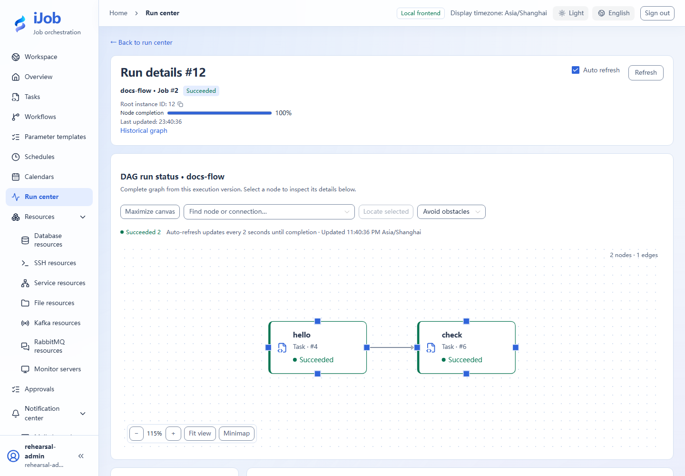

# Run center, logs, graphs and stop

[简体中文](../../zh-CN/user-guide/runs.md) · [Manual home](../README.md)

## Entry and workflow

Run center → trigger/instance details. All three roles can read run summaries. Stop, pause, resume and retry require ADMIN or OPERATOR and an instance state that allows the action. Logs and input/output details require ADMIN. See the [role matrix](users-audits.md) for all actions.

## Configuration and actions

### Run information

| Display | Meaning | Shown when |
| --- | --- | --- |
| Trigger ID | Identifies a request. Acceptance does not imply an instance exists or execution succeeded. | Always |
| Root instance ID | Identifies a root run; retries reuse it. | Root instance has been created |
| Task definition ID | Task definition snapshot used by this run, not the current draft. | Task instance summary |
| Job definition ID | Job definition snapshot and fixed references used by this run. | Job instance summary |
| Started | Actual execution start time; may be absent while waiting. | Always |
| Ended | Time when execution reached a terminal state. | Always |
| Duration (ms) | Recorded elapsed time in milliseconds. | Always |
| Status | Distinguish waiting, running, paused and terminal states. SUCCESS still requires business verification. | Always |
| Logs | Read context for the selected root or node; the view contains up to the latest 5000 lines. | ADMIN; logs are readable for the selected instance |
| Input variables | Inputs used by this run, not later template defaults. | ADMIN; Variables tab |
| Output variables | Selected-node outputs. Redaction, truncation and unavailable notices mean the preview is not complete raw data. | ADMIN; Variables tab |
| Instance tree | Relationship of root, node and child instances; selection changes the information scope. | Always |

### Instance controls

| Action | Roles | Available when | Result |
| --- | --- | --- | --- |
| Pause | ADMIN / OPERATOR | Root instance is RUNNING | Submit a pause command, effective at execution checkpoints. |
| Resume | ADMIN / OPERATOR | Root instance is PAUSED | Continue the same root run. |
| Stop | ADMIN / OPERATOR | Root instance is nonterminal, such as waiting, running, paused or waiting for an event | Request stop and verify final status. Already completed external writes are not undone. |
| Retry | ADMIN / OPERATOR | Root instance is FAILED or TIMED_OUT | Reuse the original version and root instance. The server selects failed job branches; external operations may repeat. |

## Use and verify

docs-hello should show SUCCESS and `[STDOUT] hello-ijob`; inspect output variable rows. The workflow graph should complete hello→check. Log pagination/truncation does not limit actual execution. Supported pause acts at step boundaries; current external work may finish and pause time still counts toward timeout.

## Real page examples

Actual logs filtered through the UI to the hello output; clear search to view other loaded lines.

Both nodes of the actual workflow run succeeded.

