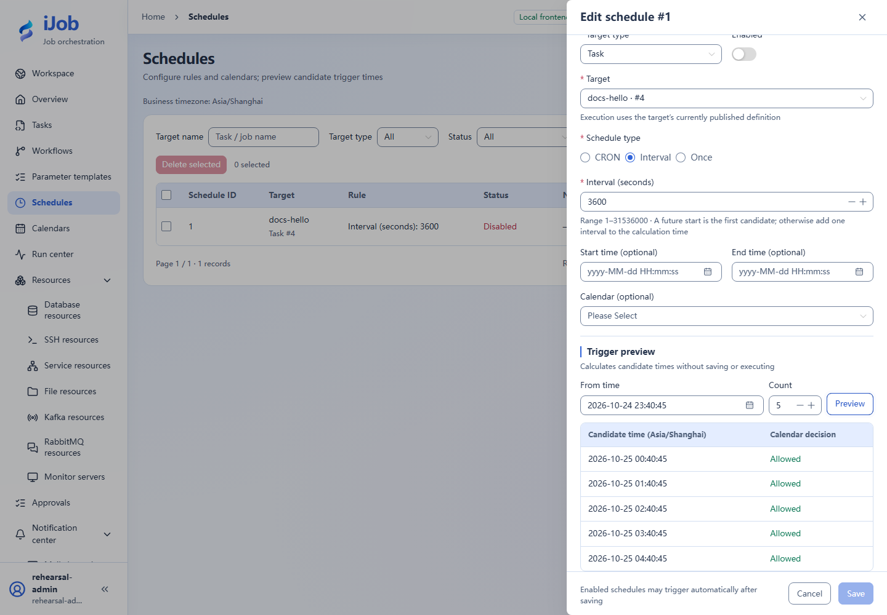

# Schedules, preview and catch-up

[简体中文](../../zh-CN/user-guide/schedules.md) · [Manual home](../README.md)

## Entry and workflow

Schedules → New schedule. ADMIN can create, edit and delete configuration. OPERATOR and VIEWER can read summaries but cannot modify configuration. See the [role matrix](users-audits.md) for all actions.

## Configuration and actions

### Schedule fields

| Field | Required | Initial form value | Shown when | Description |
| --- | --- | --- | --- | --- |
| Target type | Required | Task | Always | Choose a task or job. |
| Target | Required | Empty | Always | Search for a published object; admission uses its current published version. |
| Schedule type | Required | CRON | Always | Choose CRON, Interval or Once. |
| CRON expression | Required | Empty | Schedule type is CRON | Six fields: second, minute, hour, day, month and weekday; validated by the server. |
| Interval (seconds) | Required | Empty | Schedule type is Interval | Seconds between candidate triggers. |
| Execution time | Required | Empty | Schedule type is Once | Enter a complete valid time in the business timezone. |
| Start time (optional) | Optional | Empty | CRON or Interval | Set the earliest allowed candidate time. |
| End time (optional) | Optional | Empty | Always | Must not precede the start; combines with the calendar to filter candidates. |
| Calendar (optional) | Optional | None | Always | Filter using saved weekday rules and exception dates. |
| Select template | Optional | Empty when no template is bound | Parameter form | Load parameter definitions and defaults. The schedule saves these values and does not follow later template edits. |
| Input variables (JSON object) | Optional | {}; a default template loads its values | When using advanced JSON input | Up to 100 variables and 65536 bytes total; names cannot start with ijob. |
| Misfire policy | Optional | Use backend default | Advanced policies | Skip, fire latest once or bounded catch-up. Explicit overrides are independent of backend defaults. |
| Grace period (seconds) | Optional | Use backend default | Advanced policies | Apply misfire policy after this grace period; the backend supplies allowed bounds. |
| Catch-up limit | Optional | Use backend default | Advanced policies | Bound the catch-up count; the backend catch-up window also applies. |
| Queue deadline (seconds) | Optional | Empty | Advanced policies | Empty means no deadline. Measured from planned fire time, not task execution start. |
| Enabled | Initialized | Off | Always | An enabled saved schedule participates in automatic scheduling. |

### Page information

| Display | Meaning | Shown when |
| --- | --- | --- |
| Business timezone | Provided by the backend; changing the header display timezone does not change it. | Always |

### Actions

| Action | Roles | Available when | Result |
| --- | --- | --- | --- |
| Preview | ADMIN | Business timezone is loaded; rules and parameters are valid | Calculate candidates without saving or executing. Preview again after changing conditions. |
| Save | ADMIN | Complete configuration is loaded and required fields/ranges validate | Save the schedule and current parameter snapshot; an enabled schedule may trigger according to its rule. |
| Enable | ADMIN | Valid saved schedule and available target | Allow subsequent automatic scheduling; this does not mean a run has already succeeded. |

## Use and verify

Start with docs-hello, INTERVAL=3600 and disabled state. Preview five candidates and check zone/calendar. Enable only in a controlled window to verify trigger→instance→result, then disable. If no candidates appear, inspect bounds/calendar before shortening the interval.

## Real page examples

Five candidates for a disabled schedule; preview only, automatic running remains off.

