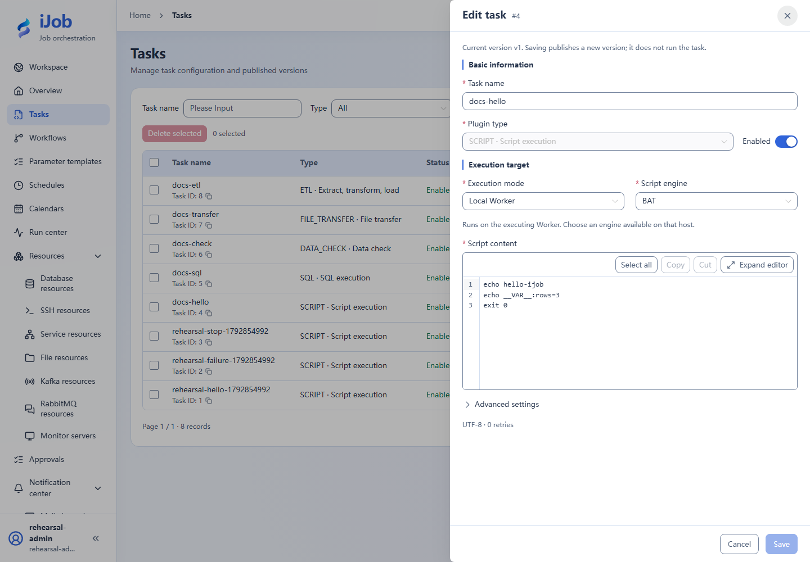

# Tasks: shared configuration and versions

[简体中文](../../zh-CN/user-guide/tasks.md) · [Manual home](../README.md)

## Entry and workflow

Tasks → New task/Edit. ADMIN can create, edit and save/publish task versions. ADMIN or OPERATOR can execute them. VIEWER reads summaries; detailed logs and input/output values require ADMIN. See the [role matrix](users-audits.md) for all actions.

## Configuration and actions

See [task plugins](plugins/README.md) for plugin-specific forms. Initial values here describe a new form; a tutorial value such as a 1-second retry interval or 60-second timeout is an example, not a default.

### Task fields

| Field | Required | Initial form value | Shown when | Description |
| --- | --- | --- | --- | --- |
| Task name | Required | Empty | Always | Searchable business name, up to 128 characters. |
| Plugin type | Required | SQL | Always | Choose one of 11 plugins; configuration fields depend on the plugin. |
| Enabled | Initialized | On | Always | Controls acceptance of new execution requests. Saving does not run the task. |
| Automatic retries | Initialized | 0 | Advanced settings | 0 disables automatic retry; maximum 100. Retries may repeat external writes. |
| Retry interval (seconds) | Initialized | 0 | Advanced settings | Delay between automatic retries; maximum 3600 seconds, with total delay no greater than 86400 seconds. |
| Task timeout (seconds, optional) | Optional | Empty | Advanced settings; event/approval waits use the plugin wait settings | Task execution deadline, distinct from SQL query timeout and schedule queue deadline. |
| Execution groups | Optional | Empty | Advanced settings | Up to 16 groups. Empty means no group restriction; otherwise a Worker must match a group. These are not account groups. |
| Description (optional) | Optional | Empty | Advanced settings | Describe the business purpose and external effects. |

### Actions

| Action | Roles | Available when | Result |
| --- | --- | --- | --- |
| Save | ADMIN | Required fields and plugin configuration are valid; no unresolved version conflict or uncertain write outcome | Publishes the first or next task version without executing it. |
| Version history | ADMIN / OPERATOR / VIEWER | The task has published versions | View version numbers and publication times; opening a definition snapshot additionally requires ADMIN. |
| Run | ADMIN / OPERATOR | Task is enabled, a published executable version exists and input values are valid | Submits a trigger request; inspect its instance and business outcome. |
| Run history | ADMIN / OPERATOR / VIEWER | The task exists and run summaries are readable | Read acceptance and instance status. Logs and input/output details additionally require ADMIN. |
| Task concurrency | ADMIN | No active instances or unreleased permits; the policy version has not conflicted | Updates concurrency policy without publishing or executing the task. |

## Use and verify

Create docs-hello with [SCRIPT](plugins/script.md), save, run and confirm the parameter dialog. Updating a task does not rewrite references pinned in published jobs; republish the parent to adopt it. If submission outcome is uncertain, inspect the latest version before resubmitting.

## Real page examples

Saved SCRIPT form; saving publishes a version without running it.

