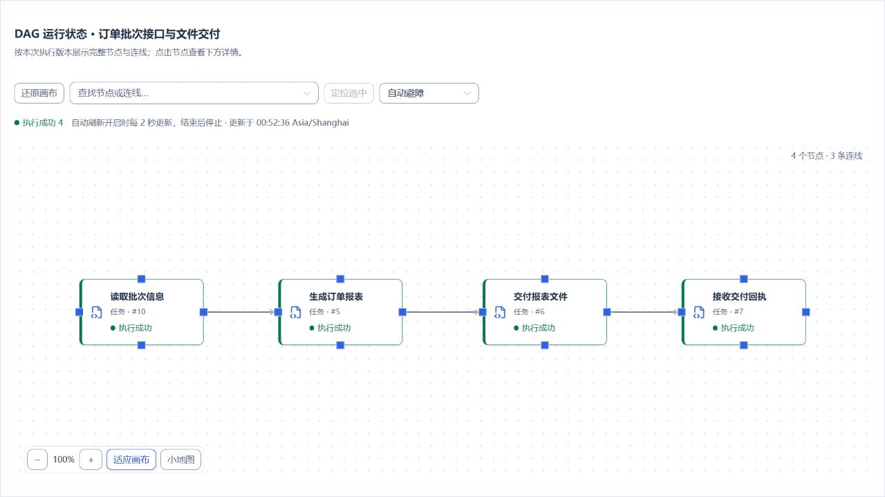
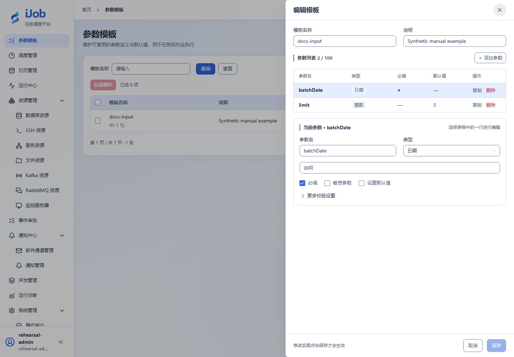

# 调用订单接口并提取结果变量

[English](../../en/examples/api-and-parameters.md) · [手册首页](../README.md)

向只读接口传入日期和数量参数，再提取total与amount供后续使用。

## 适用场景与读者

适合需要向接口传入业务参数、提取响应变量并判断失败的用户。

## 开始前准备

先完成[教程公共准备](../examples.md)，再准备下表中的资源。

| 资源 | 要求 |
| --- | --- |
| HTTP服务 | 由Worker可达的专属只读服务；GET /orders/summary?batchDate=2026-01-03&limit=3返回total=3、amount=600。可用本页的Python 3标准库样例服务自建。 |
| 样例运行时 | 已安装Python 3，无需额外Python包。 |
| 参数模板 | batchDate：DATE必填；limit：INTEGER、默认3、最小1最大3。 |

## 配置一览

| 界面字段 / 配置项 | 本例填写值 |
| --- | --- |
| 请求方法 | GET |
| 路径 | /orders/summary?batchDate=${batchDate!}&limit=${limit!} |
| 提取 | total→$.total；amount→$.amount |
| 请求体 / 响应上限 | 留空 / 1048576字节 |

## 样例文件：http-summary.py

将下列内容保存到自己的新教程目录。

```python
# Copyright (c) 2026 ifielsc
# SPDX-License-Identifier: MIT
import argparse
import json
import time
from http.server import BaseHTTPRequestHandler, ThreadingHTTPServer
from urllib.parse import parse_qs, urlsplit

class Handler(BaseHTTPRequestHandler):
    def do_GET(self):
        request = urlsplit(self.path)
        query = parse_qs(request.query)
        status = 200
        if request.path in ("/", "/health"):
            result = {"status": "ok"}
        elif request.path == "/orders/summary":
            mode = query.get("mode", ["success"])[0]
            if mode == "slow":
                time.sleep(5)
            if mode == "unavailable":
                status, result = 503, {"error": "tutorial unavailable"}
            elif mode == "missing":
                result = {"amount": 600}
            else:
                try:
                    limit = int(query.get("limit", ["3"])[0])
                    if not 1 <= limit <= 3:
                        raise ValueError("limit")
                    result = {
                        "total": limit,
                        "amount": sum([100, 200, 300][:limit]),
                        "batchDate": query.get("batchDate", ["2026-01-03"])[0],
                    }
                except ValueError:
                    status, result = 400, {"error": "limit must be 1..3"}
        else:
            status, result = 404, {"error": "not found"}
        body = json.dumps(result).encode("utf-8")
        try:
            self.send_response(status)
            self.send_header("Content-Type", "application/json; charset=utf-8")
            self.send_header("Content-Length", str(len(body)))
            self.end_headers()
            self.wfile.write(body)
        except (BrokenPipeError, ConnectionResetError):
            pass

if __name__ == "__main__":
    parser = argparse.ArgumentParser()
    parser.add_argument("--host", default="127.0.0.1")
    parser.add_argument("--port", type=int, default=18762)
    args = parser.parse_args()
    server = ThreadingHTTPServer((args.host, args.port), Handler)
    print(f"Tutorial receiver: http://{args.host}:{args.port}", flush=True)
    try:
        server.serve_forever()
    except KeyboardInterrupt:
        pass
    finally:
        server.server_close()
```

在新的教程目录保存http-summary.py。Windows使用已配置为Python 3的python：

```powershell
python -B http-summary.py
```

Linux使用：

```sh
python3 -B http-summary.py
```

Ctrl+C只停止本进程。端口占用时选择新专属端口，用 `--port` 指定并更新服务资源，不结束其他进程。

## 操作步骤

### 1. 启动专属测试服务

按上方命令启动本页样例服务。默认只监听 `127.0.0.1:18762`，适用于同机Worker。远端或容器Worker需要在专属演练网络中显式选择可达地址并限制访问；不要将无认证样例服务暴露到公网。

在服务机器先通过浏览器访问：

```text
http://127.0.0.1:18762/orders/summary?batchDate=2026-01-03&limit=3
```

确认响应包含数值total=3、amount=600。给iJob服务资源填写Worker实际可达的基础地址。

### 2. 创建服务资源和参数模板

资源→服务资源填测试服务基础地址；参数模板中添加batchDate与limit。不要把模板名称当变量值，也不要把测试服务误填成容器中的localhost。

### 3. 配置接口任务

新建API_CALL，按表选资源、GET、路径、提取器，保存发布。手动执行时载入模板，batchDate填2026-01-03，limit填3。

### 4. 核对输入与输出

在实例详情查看输入快照，确认limit是数值3，日期正确；查看输出变量total=3、amount=600，与服务响应对应。

### 5. 区分HTTP失败、提取失败和超时

通过新增建立三个失败演练任务，按成功样例填写相同资源、方法、提取器和参数，只改下列路径。手动执行时仍传入 `batchDate=2026-01-03` 和数值 `limit=3`。

HTTP 503示例：

```text
/orders/summary?batchDate=${batchDate!}&limit=${limit!}&mode=unavailable
```

缺少响应字段示例：

```text
/orders/summary?batchDate=${batchDate!}&limit=${limit!}&mode=missing
```

慢响应示例：

```text
/orders/summary?batchDate=${batchDate!}&limit=${limit!}&mode=slow
```

503应FAILED且不因任务重试次数自动重发；缺字段响应没有total，应提取失败。慢响应任务的公共超时设2秒，样例服务等待5秒后返回，观察TIMED_OUT。这些都是样例服务的预设演练结果。

## 预期结果

| 检查项 | 预期值 |
| --- | --- |
| 成功调用 | total=3，amount=600，输入快照日期与数值类型正确 |
| HTTP 503 | 重试设为0时FAILED，不自动重发 |
| 长响应 | 超时副本TIMED_OUT |

## 常见失败

| 现象 | 处理方法 |
| --- | --- |
| 远端已写入但本地超时 | 真实写接口必须使用业务幂等键或结果查询，不能直接照搬只读示例反复重试。 |

## 报表交付扩展

将接口读取扩展成 `API_CALL → ETL → FILE_TRANSFER → API_CALL`：先取得批次信息，再生成订单报表、交付文件并读取真实文件回执。适用 iJob 1.0.0。

### 1. 复用订单案例准备

先完成[每日订单对账与报表交付](order-reconciliation.md)的资源、任务和业务日期模板，并成功运行正常日期 `2026-10-28`。目标库此时已有 12 笔订单，金额合计 7,800。保持该页的回执接收端运行；它同时提供 `/orders` 和 `/health`。

本节使用“报表接收方”服务资源，沿用“生成订单交付报表”“交付订单报表”“核对报表交付回执”三个已发布任务。本页前面的 `/orders/summary` 服务是另一个独立样例，不能直接代替订单案例接收端。

### 2. 新建读取批次任务

新增 API_CALL 任务“读取订单批次接口”：

| 界面字段 | 填写值 |
| --- | --- |
| 服务资源 | 报表接收方 |
| 请求方法 / 路径 | GET / `/orders` |
| 查询参数（JSON） | `{"bizDate":"${bizDate}"}` |
| 请求体 | 留空 |
| 业务成功条件 | JSONPath `$.ok`；EQ；预期值 `true` |
| 响应变量提取 | `batchId → $.batchId`、`remoteRows → $.rows`、`remoteTotal → $.totalAmount` |
| 公共超时 / 重试次数 / 重试间隔 | 120 秒 / 0 / 0 |

保存任务。接收端的 `/orders?bizDate=2026-10-28` 返回固定合成批次 `ORD-2026-10-28`、12 行和总额 7,800。接口读取**不把订单写入目标库**；后续报表由已准备的目标库生成。

### 3. 编排四节点作业并执行

新建“订单批次接口与文件交付”，节点依次为：

| 节点标识 | 引用任务 |
| --- | --- |
| `batch` | 读取订单批次接口 |
| `export` | 生成订单交付报表 |
| `transfer` | 交付订单报表 |
| `receipt` | 核对报表交付回执 |

连接 `batch → export → transfer → receipt`，使用 ALL_SUCCESS / STOP，启用、校验并保存发布。为作业选择订单案例的业务日期默认模板，执行时填 `2026-10-28`。



### 4. 核对接口与文件两个结果

| 检查位置 | 预期值 |
| --- | --- |
| `batch` 节点输出 | `batchId = ORD-2026-10-28`、`remoteRows = 12`、`remoteTotal = 7800` |
| 目标库与交付 CSV | 12 笔订单，金额合计 7,800；CSV 另外有一行表头 |
| `transfer` 节点 | `fileTransfer.uploadedFileCount = 1` |
| `receipt` 节点 / 根运行输出 | `deliveredRows = 12`、`deliveredAmount = 7800`，回执关联此次根实例 |
| 作业状态 | 四个节点和根运行均为 SUCCESS |

读取批次节点时查看其自身变量；中间输出不一定全部汇总到根输出。本例把接口信息与实际 CSV 结果分别展示，**没有自动比较两个来源的一致性**；业务需要时，应增加明确的比较规则。

重复执行会覆盖本教程同日期的交付文件，并新增一条回执记录。只在专属目录中演练；清理沿用[主案例的清理说明](order-reconciliation.md#安全与清理)，另外退役本节新增的作业和批次任务。

## 安全与清理

停止自己启动的样例服务进程，删除演练失败副本；不操作其他HTTP服务。

## 适用版本与限制

适用1.0.0的HTTP GET与JSONPath提取，主路径包括数值参数、503失败和任务超时，重试均为0。SOAP、OAuth2、远端取消及真实写接口去重需按对应服务契约另行配置。

## 界面参考

以下为该功能的真实界面参考；示例名称和实例 ID 可与本次运行不同。扩展步骤以正文配置和结果为准。



## 相关页面

- [接口调用](../user-guide/plugins/api-call.md)

- [参数模板、输入和变量](../user-guide/parameters.md)
