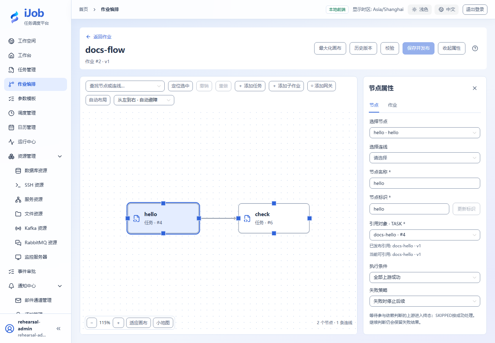
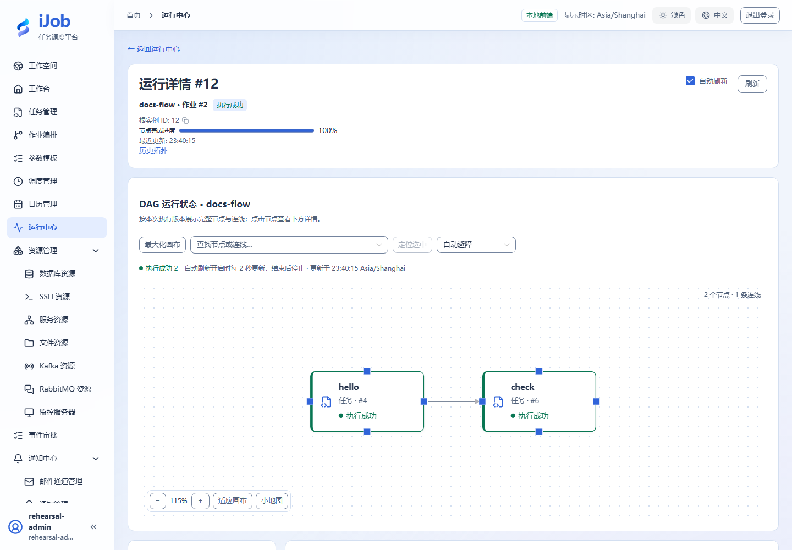

# 编排并行汇合与条件分支

[English](../../en/examples/dag-control-flow.md) · [手册首页](../README.md)

先让两个分支完成后汇合，再按金额选择一个后续分支。

## 适用场景与读者

适合已能运行单个任务、开始编排并行汇合和条件分支的用户。

## 开始前准备

先完成[教程公共准备](../examples.md)，再准备下表中的资源。

| 资源 | 要求 |
| --- | --- |
| 基础任务 | 四个已发布、只输出自身名称的SCRIPT任务A/B/C/D；重试0。 |

## 配置一览

| 界面字段 / 配置项 | 本例填写值 |
| --- | --- |
| 并行连线 | A→B、A→C、B→D、C→D |
| D条件 / 失败策略 | ALL_SUCCESS / STOP |
| 排他网关 | 条件 `input.amount > 100`；review优先级1、非默认；finish优先级2、唯一默认 |

## 操作步骤

### 1. 创建节点任务

分别保存A/B/C/D，选择LOCAL与POWERSHELL，例如使用`Write-Output 'A'`、`Start-Sleep -Seconds 1`。B和C如输出变量，使用branchB和branchC等不同键名，避免汇合名称冲突。

### 2. 绘制并发布并行作业

作业编排→新增，添加四个任务节点并按表连线，D设ALL_SUCCESS。校验、保存并发布，核对实际引用版本。

### 3. 运行并核对汇合

手动运行，查看拓扑和各节点时间。B/C都在A完成后开始，D在B/C均结束后开始；四个节点成功，根实例SUCCESS。并行是否真实重叠还受Worker容量和并发策略影响。

### 4. 单独建立金额分支作业

通过“新增作业”建立独立的金额分支示例，避免在原并行画布留下孤立节点。先发布两个无副作用SCRIPT任务review、finish，分别输出自身名称。

添加排他网关G及任务节点review、finish，以G作为入口，按下列关系连线：

```text
G -> review
G -> finish
```

选中G到review的分支，通过结构化条件编辑器设置：

| 字段 | 填写值 |
| --- | --- |
| 路由标识 | review |
| 优先级 | 1 |
| 默认分支 | 关闭 |
| 条件操作 | 大于 GT |
| 左值类型 / 值 | 变量 / input.amount |
| 右值类型 / 值 | 常量 / 100（数值，不加引号） |

G到finish的路由标识填finish、优先级2，设为唯一默认分支，不填写判断条件。校验并保存发布。

创建参数模板，添加 `amount`，类型INTEGER、非必填、无默认值。手动执行时载入模板，先传数值150，再新执行一次传数值50；前者只走review，后者只走finish，未选分支显示SKIPPED。输入应为数值，不是字符串。

### 5. 可选：演练缺失和失败

在金额分支作业再次执行时，保持可选参数 `amount` 未传入。裸比较会条件失败，不会自动走默认分支；如果业务需要允许缺失值，应显式使用EXISTS保护后另行核对。

另建与A→B/C→D相同的失败演练作业，令B任务脚本退出7。分别设置B节点失败策略STOP、B失败策略SKIP且D条件ALL_SUCCESS、B失败策略SKIP且D条件ALWAYS。每次保存发布后再执行，比较下游运行/跳过情况；三种情况下根作业均保留FAILED。

## 预期结果

| 检查项 | 预期值 |
| --- | --- |
| 并行汇合 | D等待B/C终态，成功基线根实例SUCCESS |
| 金额150 / 50 | 分别选择review / finish；未选分支SKIPPED，根实例SUCCESS |
| B失败（可选扩展） | 根实例保留FAILED；下游按策略决定运行或跳过，逐个变体单独核对 |

## 常见失败

| 现象 | 处理方法 |
| --- | --- |
| 汇合变量冲突 | 上游输出不同业务变量使用不同键名，不能依赖覆盖顺序。 |

## 安全与清理

停用练习调度，删除不需要的分支和失败副本；不要修改被其他作业使用的任务。

## 适用版本与限制

适用1.0.0的四节点并行汇合与金额排他分支；基础任务使用Windows PowerShell。缺失参数和不同失败策略保留为可选扩展。既有界面参考不替代本页四节点图的运行结果。

## 界面参考

以下为该功能的真实界面参考；示例名称和实例 ID 可与本次运行不同。扩展步骤以正文配置和结果为准。





## 相关页面

- [作业节点、条件与网关](../user-guide/job-nodes.md)

- [作业：编排、发布与版本](../user-guide/jobs.md)
