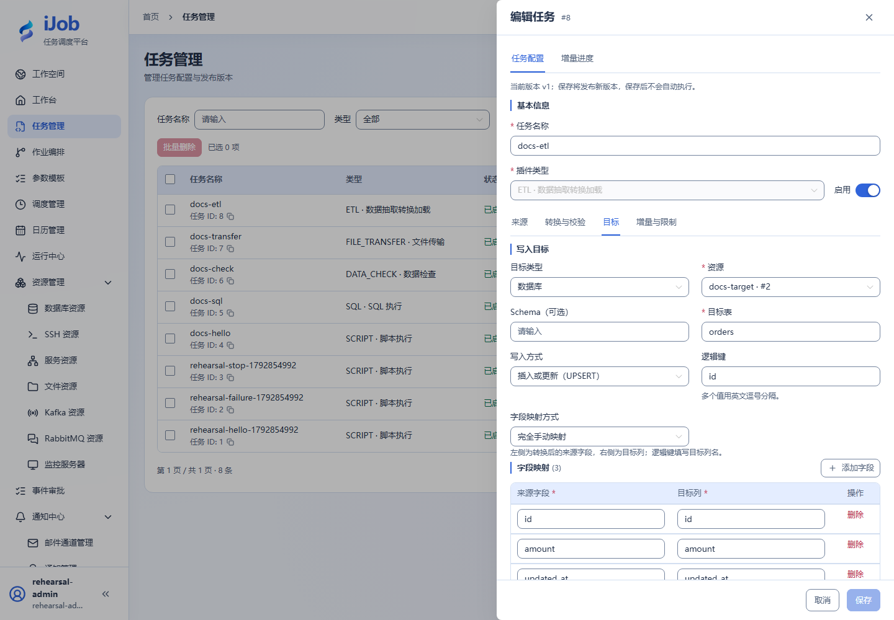
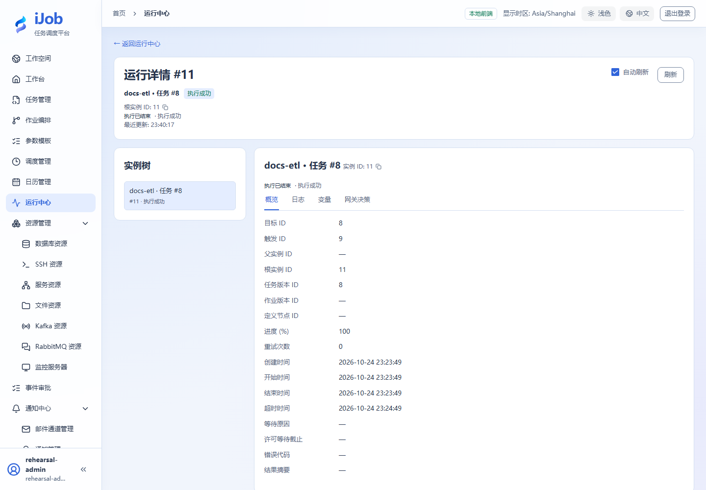

# 全量、增量与 ETL 检查点

[English](../../en/examples/etl-full-incremental.md) · [手册首页](../README.md)

**验证状态：基础路径已在独立环境实测；下述扩展不自动继承通过结论。**

相关字段：[ETL：源、转换、目标与增量](../user-guide/plugins/etl.md)。

## 准备、配置与执行

复用本案例独立业务源的三行 orders，另建空目标库和同结构表。ETL source=DATABASE，SQL 为 `SELECT id,amount,updated_at FROM orders ORDER BY id`；target=DATABASE、table=orders、mode=UPSERT、logicalKeys=[id]，三列同名映射。保持增量关闭，执行后用独立连接核对：

```sql
SELECT COUNT(*), SUM(amount) FROM orders;
-- 3, 600
```

这证明本次全量 DATABASE→DATABASE 配置。增量扩展单独准备检查点：watermarkField=updated_at，明确其类型与初值，id 作稳定 tie breaker，SQL 的水位条件/排序与检查点一致。新增两条相同水位数据后验证不漏不重，再测试失败与重试，记录检查点推进和目标提交。文件增量、消息源及 SCD2 另需实际依赖与验证；不以本图宣称通过。

## 结束检查

保留输入、定义版本、触发/实例 ID、脱敏日志和目标核对结果。只停止本案例拥有的进程或调度；其他环境和历史证据不作为清理对象。

## 真实页面示例

全量 UPSERT 配置。



真实成功实例；目标行数和金额还通过独立 SQL 核对。


