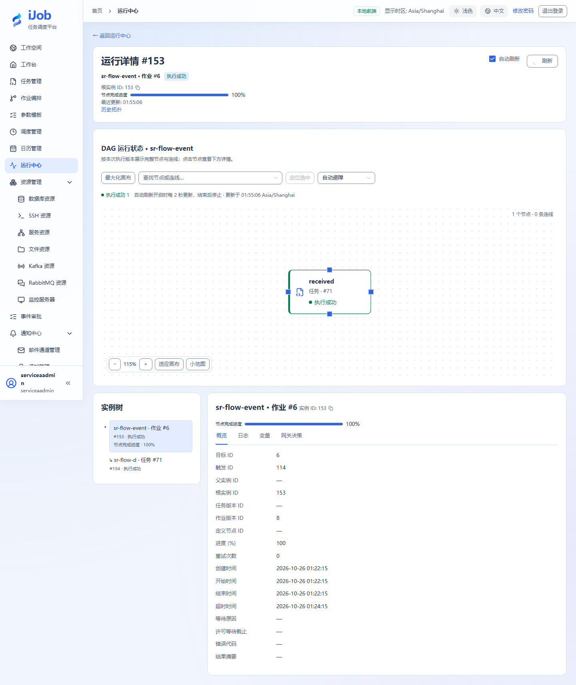
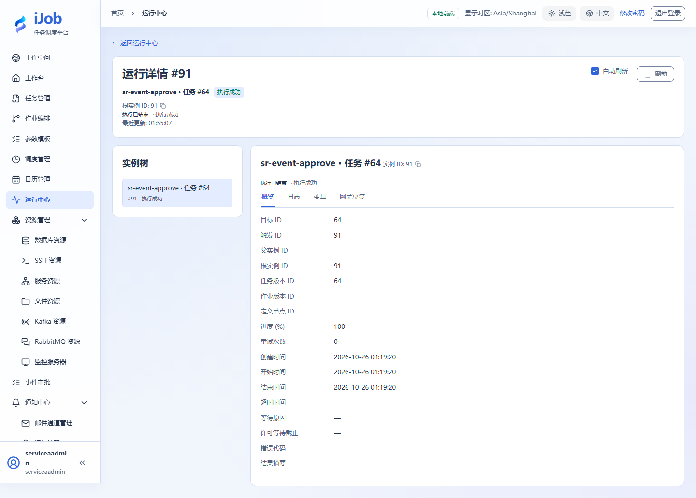

# 等待业务事件或审批后继续运行

[English](../../en/examples/events-and-approval.md) · [手册首页](../README.md)

让实例等待匹配事件，或等待指定用户批准，再观察同一实例继续。

## 适用场景与读者

适合需要等待外部业务信号或人工决定后继续运行的用户。

## 开始前准备

先完成[教程公共准备](../examples.md)，再准备下表中的资源。

| 资源 | 要求 |
| --- | --- |
| 事件环境 | 专属事件编码和业务键；有创建EVENT任务及发布事件的权限。 |
| 审批环境 | DATABASE账号模式，指定ADMIN或OPERATOR账号已完成首次改密并处于启用状态。 |

## 配置一览

| 界面字段 / 配置项 | 本例填写值 |
| --- | --- |
| 事件编码 / 业务键 | docs.order.ready / order-001 |
| 任务公共超时 | 留空 |
| 等待超时 / 回看 | 300秒 / 0秒 |
| 审批人员 | 本环境真实允许操作人，不填示意ID |

## 操作步骤

### 1. 发布等待定义并启动等待

新建EVENT任务，动作选等待事件（WAIT_EVENT）。如果切换动作时提示清空任务公共超时，确认清空；保持公共超时留空，使用插件的等待超时300秒、回看0秒。事件编码填 `docs.order.ready`、业务键填 `order-001`，本例关联键留空。

保存发布后手动执行，在运行中心确认WAITING_EVENT并记下实例ID。等待超时与普通任务执行超时是不同字段，不能同时填写正数公共执行超时。

### 2. 发布匹配事件

另建EVENT发布事件任务，使用相同事件编码和业务键；关联键按等待配置一致，内容填{"rows":3}。保存后执行发布任务。

### 3. 核对原实例恢复

回到第一步实例，检查它离开等待并完成；查看等待匹配记录与输出，不把发布任务自己的成功实例误认为等待实例。

### 4. 建立审批变体

新建EVENT任务，动作选等待审批（WAIT_APPROVAL），任务描述中填写业务说明。在审批动作字段选择真实允许操作人、等待超时300秒，保持任务公共超时留空；如出现清空公共超时确认则确认。

保存执行后，用指定的ADMIN或OPERATOR账号进入审批，核对关联业务与实例后批准。观察同一实例完成；需要查看日志或输出变量时使用ADMIN会话。

### 5. 观察拒绝，并按需扩展权限检查

再次创建独立等待，演练拒绝并查看失败原因；非允许账号不能处理该审批。超过期限或已处理的等待不能当成新成功重复批准。

### 6. 扩展：核对HTTP入口去重

HTTP入口需启用`app.event.ingress.enabled`，并使用有EVENT_PUBLISH权限的已登录账号。新建一条独立等待，业务键使用`order-http-001`；确认等待已建立后，向`POST /api/events`发送：

```json
{"sourceKey":"docs-http-demo","eventCode":"docs.order.ready","businessKey":"order-http-001","idempotencyKey":"tutorial-http-001","payload":{"rows":3}}
```

第一次响应应为`duplicate=false`。保持来源、幂等键和内容不变，重复同一个请求，预期返回同一`eventId`且`duplicate=true`；原等待实例只恢复一次。重新开始独立练习时同时换用新的业务键和幂等键。

## 预期结果

| 检查项 | 预期值 |
| --- | --- |
| 匹配事件 | 原等待实例恢复为SUCCESS，实例ID不变 |
| 审批通过 | 决定可追溯，同一实例继续并达到SUCCESS |
| 审批拒绝 | 独立等待实例结束为FAILED，可查看拒绝原因 |
| HTTP入口重复发布（扩展） | 相同来源、幂等键和内容返回相同eventId；第二次duplicate=true |
| 错误键或未授权用户（可选扩展） | 不恢复错误等待 / 不允许审批，需分别演练 |

## 常见失败

| 现象 | 处理方法 |
| --- | --- |
| STATIC模式无审批人 | 审批使用DATABASE账号模式；不要为了教程临时关闭认证。 |
| 事件早于等待 | 回看0时先建立等待；需要历史匹配时明确设置回看窗口。 |

## 安全与清理

停止仍等待的练习实例，停用本教程事件绑定或调度；不重复发布同一真实业务事件。

## 适用版本与限制

适用1.0.0事件等待、DATABASE审批及HTTP入口幂等。HTTP重复发布应分别核对eventId和duplicate字段；它不等同于EVENT发布任务的执行结果。错误键、未授权用户、文件探测和重启恢复需分别演练。

## 界面参考

以下为该功能的真实界面参考；示例名称和实例 ID 可与本次运行不同。扩展步骤以正文配置和结果为准。





## 相关页面

- [事件发布、等待与审批](../user-guide/plugins/event.md)

- [事件审批与处理记录](../user-guide/events.md)
