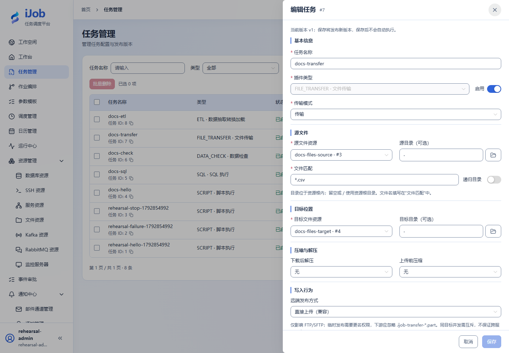
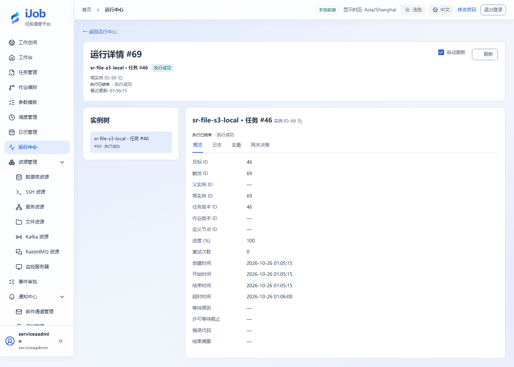

# 本地与远端文件传输

[English](../../en/examples/file-transfer.md) · [手册首页](../README.md)

**验证状态：本轮隔离环境实测，范围及未覆盖项见下文。**

相关字段：[文件传输与归档](../user-guide/plugins/file-transfer.md)。

## 准备、配置与执行

准备两个独立 LOCAL 文件资源，源根下写 orders.csv：

```csv
id,amount
1,100
2,200
3,300
```

任务选择源/目标资源，sourcePath=`.`、targetPath=`.`、filePattern=`*.csv`、recursive=false、overwrite=false、deleteSource=false。运行后目标应有同名文件，字节和 SHA-256 与源一致，源仍保留。

重复运行可能因目标已存在失败，这是覆盖策略的验证点；用新目标目录测试覆盖/归档，避免污染第一次证据。SFTP/S3 变体需要独立服务、身份、桶/目录和实际写入核对，本次 LOCAL 结果不证明这些协议通过。

## 本轮实测范围

本轮在独立 LOCAL、SFTP、FTP、S3 兼容服务间传输 UTF-8 样例 CSV，回读 SHA-256 一致。覆盖 overwrite=false 保留旧目标、FTP 只读账号拒绝写入、S3 错误密钥拒绝读取。大文件、归档限额、断点续传和其他厂商兼容性另验。

## 结束检查

保留输入、定义版本、触发/实例 ID、脱敏日志和目标核对结果。只停止本案例拥有的进程或调度；其他环境和历史证据不作为清理对象。

## 真实页面示例

实测 LOCAL 传输配置，不代表 SFTP/S3 已通过。



2026-10-26 隔离 S3 兼容服务到 LOCAL 的成功实例。读取目标文件后另行核对 SHA-256；截图展示执行状态，不能替代文件内容核对。


