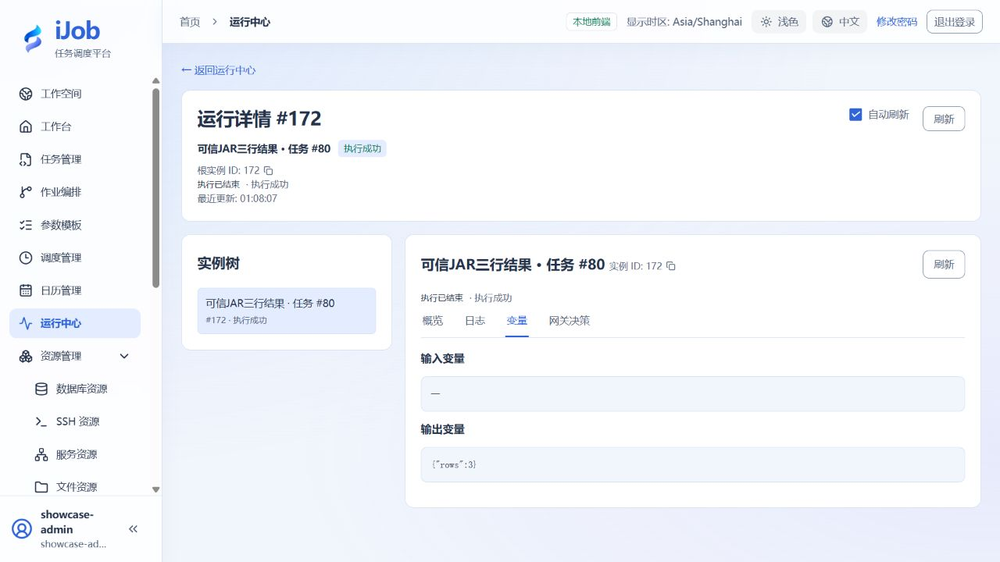

# 部署可信Local JAR并执行一次调用

[English](../../en/examples/local-jar.md) · [手册首页](../README.md)

使用协议1的最小扩展输出hello-localjar与rows=3。

## 适用场景与读者

适合已完成快速入门、需要将该场景用于业务流程的配置人员。

## 开始前准备

先阅读[教程公共准备](../examples.md)。本页预计时间不含外部服务安装；命令中的资源、路径和端口按自己的演练环境填写。

| 资源 | 要求 |
| --- | --- |
| 构建依赖 | Java 21 JDK与可信ijob-plugin-spi:1.0.0 JAR；由部署负责人提供可信SPI 1.0.0制品。 |
| 部署权限 | API与目标Worker可访问各自受控制品目录，启用LOCAL_JAR。 |

## 配置一览

| 界面字段 / 配置项 | 本例填写值 |
| --- | --- |
| 文件名 / 版本 | hello-job-1.0.0.jar / 1.0.0 |
| 入口类 | com.example.jobs.HelloTask |
| 协议 | IJob-Plugin-Api-Version: 1 |
| 业务参数 | 本最小样例无需参数 |

## 样例文件：HelloTask.java

将下列内容保存到自己的新教程目录。

```java
// Copyright (c) 2026 ifielsc
// SPDX-License-Identifier: MIT
package com.example.jobs;

import com.ifielsc.ijob.spi.localjar.LocalJarContext;
import com.ifielsc.ijob.spi.localjar.LocalJarExecution;
import com.ifielsc.ijob.spi.localjar.LocalJarResult;
import com.ifielsc.ijob.spi.localjar.LocalJarTask;

public final class HelloTask implements LocalJarTask {
    public HelloTask() {}

    @Override
    public LocalJarResult run(LocalJarExecution execution, LocalJarContext context) {
        context.checkExecution();
        context.logInfo("hello-localjar");
        context.putVariable("rows", 3);
        return LocalJarResult.success("hello-localjar");
    }
}
```

将本页两个样例文件都保存后，在该新教程目录执行以下对应平台命令。先把第一行SPI路径改成自己的可信制品路径；遇到编译或打包错误时停止并修正，不继续使用残留产物。

Windows PowerShell：

```powershell
$spiJar = 'D:/tutorial/lib/ijob-plugin-spi-1.0.0.jar'
New-Item -ItemType Directory -Path classes | Out-Null
javac --release 21 -cp "$spiJar" -d classes HelloTask.java
jar --create --file hello-job-1.0.0.jar --manifest MANIFEST.MF -C classes .
(Get-FileHash -LiteralPath ./hello-job-1.0.0.jar -Algorithm SHA256).Hash.ToLowerInvariant()
```

Linux：

```sh
SPI_JAR='/srv/tutorial/lib/ijob-plugin-spi-1.0.0.jar'
mkdir classes
javac --release 21 -cp "$SPI_JAR" -d classes HelloTask.java
jar --create --file hello-job-1.0.0.jar --manifest MANIFEST.MF -C classes .
sha256sum hello-job-1.0.0.jar
```

只打包classes中的自有类，不解包或打包SPI JAR。哈希值用于下一步填写制品身份。

## 样例文件：MANIFEST.MF

将下列内容保存到自己的新教程目录。

```text
Manifest-Version: 1.0
IJob-Plugin-Api-Version: 1
IJob-Plugin-Class: com.example.jobs.HelloTask
Implementation-Version: 1.0.0

```

保存MANIFEST.MF时保留末尾换行和空行，使用UTF-8无BOM或ASCII编码。

## 操作步骤

### 1. 准备最小扩展

使用附带HelloTask.java与MANIFEST.MF，编译时引用SPI JAR，打包时只放自己的com/example类，不把SPI或平台类打进插件。命令中的SPI路径替换为可信制品实际路径。

### 2. 记录制品身份

核对Manifest三项：IJob-Plugin-Api-Version=1、Implementation-Version=1.0.0、IJob-Plugin-Class=com.example.jobs.HelloTask。用Get-FileHash或sha256sum取得实际SHA-256。

### 3. 部署到API和Worker

配置app.plugin.local-jar.enabled=true与受控root-directory，按运行方式挂载或复制同一制品，核对各节点SHA-256一致，再按维护流程重启使开关生效。页面不上传JAR。

### 4. 创建并运行任务

新建LOCAL_JAR，填写文件名、真实哈希和入口类，业务参数编辑器保留空对象。保存会核验元数据；保存后核对展示的制品版本为 1.0.0，再手动执行。

### 5. 核对输出和拒绝条件

核对实例 SUCCESS、日志 `hello-localjar` 与输出 `rows` 为数值 `3`，不是脚本声明产生的字符串。可选反例：新增同配置任务草稿，填写错误哈希或入口类，按插件元数据规则检查保存拒绝结果；它们不计入本页已确认的成功调用范围。不要覆盖正确制品来制造失败。

## 预期结果

| 检查项 | 预期值 |
| --- | --- |
| 调用结果 | SUCCESS；日志 `hello-localjar`；`rows` 为数值 `3` |
| 可选元数据反例 | 按自己的草稿检查错误哈希或入口类的拒绝提示，不修改正确制品 |

## 常见失败

| 现象 | 处理方法 |
| --- | --- |
| API能保存但Worker找不到 | 分别核对所有目标节点制品目录与哈希，平台数据库不会复制文件。 |
| 长任务不响应停止 | 扩展需调用checkExecution并注册可关闭资源；该最小同步样例不能证明任意扩展可取消。 |

## 安全与清理

确认无运行实例及已发布引用后，由部署负责人按制品管理流程移除样例；不要清空整个插件目录。

## 适用版本与限制

适用 iJob 1.0.0 新命名空间 SPI、协议 1。示例使用 Java 21 编译并在 Windows Worker 上执行，中英文示例任务均返回 SUCCESS、`hello-localjar` 和数值 `rows=3`。文件大小和 SHA-256 由你实际构建的制品决定，不照抄其他构建的哈希。可信代码在宿主 JVM 中运行；任意扩展的取消、错误元数据反例和多 Worker 部署需另行核对，不构成不可信代码沙箱。

下图来自本教程实际运行：



## 相关页面

- [可信 Local JAR 插件](../user-guide/plugins/local-jar.md)

- [插件开关与 Local JAR 部署](../configuration/plugins.md)
