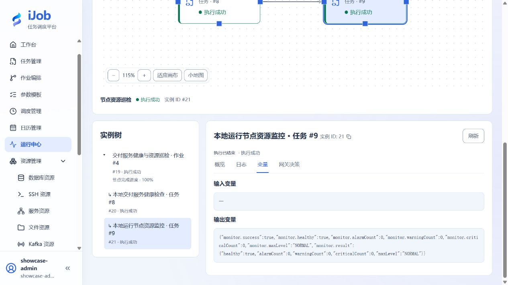
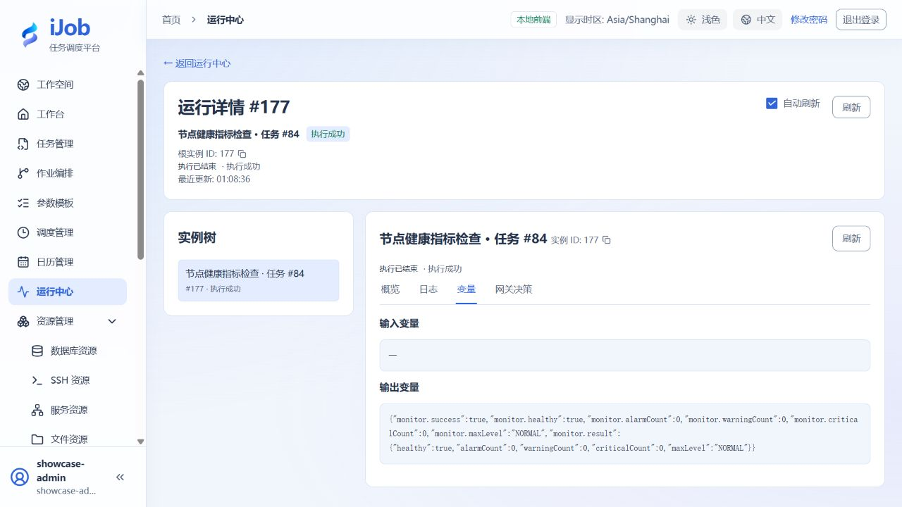

# 采集监控指标并理解阈值告警

[English](../../en/examples/monitoring.md) · [手册首页](../README.md)

查看新鲜内存指标，通过调整练习阈值观察健康状态变化。

## 适用场景与读者

适合配置服务巡检的用户，重点是区分采集完成、指标健康和告警级别。

## 开始前准备

先完成[教程公共准备](../examples.md)，再准备下表中的资源。

| 资源 | 要求 |
| --- | --- |
| Agent | 独立测试Agent及专属token，平台可达且访问受限；当前内存使用率能被采集。 |

## 配置一览

| 界面字段 / 配置项 | 本例填写值 |
| --- | --- |
| 采集项目 | CPU、MEMORY、DISK |
| 基线阈值（警告 / 严重） | CPU 85% / 95%；内存85% / 95%；磁盘90% / 97% |
| 通知 | 首次关闭 |

## 操作步骤

### 1. 创建并测试监控资源

按部署文档启动专属Agent，登记地址、端口和独立token。资源→监控服务器，填写连接配置并测试。

### 2. 配置一次采集

新建SERVER_MONITOR，选择资源与CPU、MEMORY、DISK采集，按配置表设置阈值并关闭通知，保存后手动执行。

### 3. 核对数据与健康变量

查看采集时间、新鲜度、百分比单位，以及monitor.healthy、monitor.alarmCount、monitor.warningCount、monitor.criticalCount。任务SUCCESS只表示采集流程完成，健康结果要按指标与阈值判断。

### 4. 通过阈值制造练习告警

保留基线任务，另建一个副本，将内存警告/严重阈值分别设为1%/2%，其余规则保持不变。当前内存使用率高于2%时，该规则应产生CRITICAL；核对healthy=false、criticalCount及全部告警计数。无需给主机增加负载。

再建一个健康分支副本，将CPU、内存、磁盘的使用率警告/严重阈值暂设为99.9%/100%，保持通知关闭。当三类实际指标均低于警告阈值时，预期healthy=true、alarmCount=0、maxLevel=NORMAL。这组宽松值仅用于观察健康分支，生产阈值应按自身容量基线设置。

对比三个副本的采集结果：基线也可能已有WARNING，降低阈值可出现CRITICAL，放宽阈值可得到NORMAL；三个任务均可执行SUCCESS。

### 5. 可选：区分不可达和告警

在副本中用错误token，或正常停止本教程Agent后运行，确认连接/采集失败而非显示0使用率。恢复Agent后重新运行。

## 预期结果

| 检查项 | 预期值 |
| --- | --- |
| 采集完成 | 实例SUCCESS，时间新鲜、单位正确，不用0代替缺失 |
| 基线健康状态 | 按实际指标和阈值判断；即使采集SUCCESS，也可能healthy=false并已有WARNING |
| 降低阈值 | 跨过阈值时healthy=false，告警计数与级别对应；跨过严重阈值时maxLevel为CRITICAL |
| 健康分支副本 | 所有启用规则均满足时healthy=true、alarmCount=0、maxLevel=NORMAL；不表示自动发送恢复通知 |

## 常见失败

| 现象 | 处理方法 |
| --- | --- |
| SUCCESS仍有告警 | 采集成功和健康结果不同，查看monitor.healthy。 |

## 接收服务巡检

在[订单对账与报表交付](order-reconciliation.md)环境中，将 `SCRIPT → SERVER_MONITOR` 串联：先检查回执服务是否响应，再查看其所在节点的 CPU、内存和磁盘。适用 iJob 1.0.0；以下脚本针对安装了 PowerShell 的 Windows Worker。

### 1. 准备接收端和监控资源

保持订单案例的回执接收端运行。按[独立 Agent 配置](../configuration/deployment-agent.md)准备自己的 Monitor Agent、端口和认证令牌，在“资源 → 监控服务器”创建启用资源：

| 界面字段 | 填写值 |
| --- | --- |
| 名称 | 本地巡检节点 |
| 协议 / 访问地址 | HTTP / 自己的 Agent 地址；本机可填 `http://127.0.0.1:<Agent端口>` |
| 认证令牌 | 自己为该 Agent 配置的令牌 |
| 连接超时 / 读取超时 | 5000 / 10000 毫秒 |
| 操作系统 / Agent 版本 | WINDOWS / 1.0.0 |

回执服务和 Monitor Agent 是两个不同服务，不能混用地址或端口。Worker、接收端和 Agent 采用同机部署；在其他拓扑中按实际可达地址配置。

### 2. 配置健康检查任务

新增 SCRIPT 任务“本地交付服务健康检查”：执行方式 LOCAL，脚本引擎 POWERSHELL，脚本与输出编码 UTF-8，公共超时 30 秒，重试次数及间隔 0。把下方 `<回执端口>` 替换为订单案例接收端的实际端口后保存：

```powershell
$ErrorActionPreference = 'Stop'
$r = Invoke-RestMethod -Uri 'http://127.0.0.1:<回执端口>/health' -TimeoutSec 5
if ($r.status -ne 'ok') { throw 'Health check failed' }
Write-Output 'Delivery service: healthy'
Write-Output ('Receipt records: ' + $r.receiptCount)
```

脚本从 Worker 本机发起请求。正常日志应包含 `Delivery service: healthy` 与当前回执记录数；记录数取决于你已运行的交付次数，不固定为某个值。连接失败或状态不是 `ok` 时脚本失败，后续节点不执行。

### 3. 配置资源监控任务并连接作业

新增 SERVER_MONITOR 任务“本地运行节点资源监控”：

| 界面字段 | 填写值 |
| --- | --- |
| 监控服务器 | 本地巡检节点 |
| 采集项目 | CPU、MEMORY、DISK |
| CPU 阈值 | 启用；警告 85%，严重 95% |
| 内存阈值 | 启用；警告 85%，严重 95% |
| 磁盘阈值 | 启用；警告 90%，严重 97% |
| 应用采集 / 磁盘路径覆盖 | 不配置 |
| 发送监控告警 | 关闭 |
| 公共超时 / 重试次数 / 重试间隔 | 30 秒 / 0 / 0 |

保存任务。新建“交付服务健康与资源巡检”，添加 `health` 节点引用健康检查任务、`monitor` 节点引用资源监控任务，连接 `health → monitor`，使用 ALL_SUCCESS / STOP。启用、校验并保存发布，手动执行；本作业无需业务日期参数。



### 4. 判断可用性与资源健康

| 检查位置 | 判断方式 |
| --- | --- |
| `health` 日志 | 服务响应 `ok`，输出健康提示和当前回执记录数 |
| `monitor` 指标 | CPU、内存和磁盘有当前采集值，百分比与时间正确 |
| `monitor.healthy` | 只有采集值满足所设规则时才预期为 `true`；不要照抄截图数值 |
| 告警计数 | 查看 `monitor.alarmCount`、`monitor.warningCount`、`monitor.criticalCount`，与阈值结果对应 |
| 根运行 | 两个任务完成时为 SUCCESS；资源阈值告警与采集执行失败分别判断 |

本例没有发送通知，也没有创建定时巡检。不要为了得到绿色状态而提高生产阈值。练习结束后退役本节作业和任务，只停止本节自己准备且无其他使用者的 Agent；共享的订单案例接收端等其案例完成后再清理。

## 安全与清理

停用练习调度与通知绑定，恢复阈值；仅停止本教程新建的Agent。

## 适用版本与限制

适用1.0.0 Agent监控，涵盖采集及NORMAL、WARNING、CRITICAL健康级别。主机负载会改变健康结果，宽松演练阈值不作为生产建议。错误令牌和Agent不可达是可选扩展；通知投递需单独接收器，当前不支持恢复通知和跨次告警去重。

下图来自本教程实际运行：



## 相关页面

- [服务器监控](../user-guide/plugins/server-monitor.md)

- [启动变量、Compose 与独立 Agent](../configuration/deployment-agent.md)

- [发布三条订单消息，并单独配置运行通知](push-and-notifications.md)
