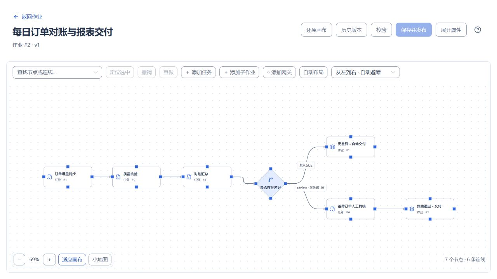
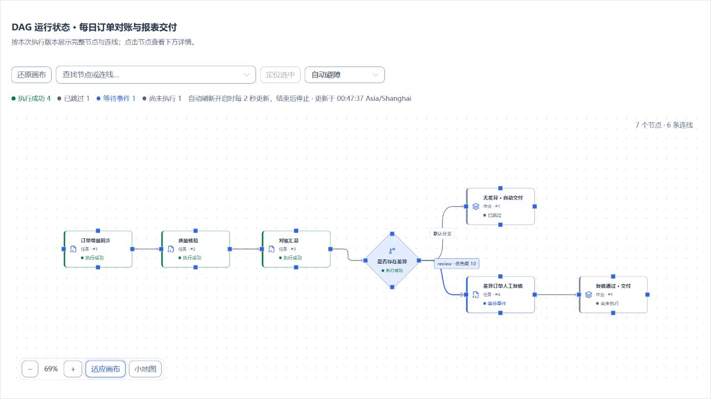
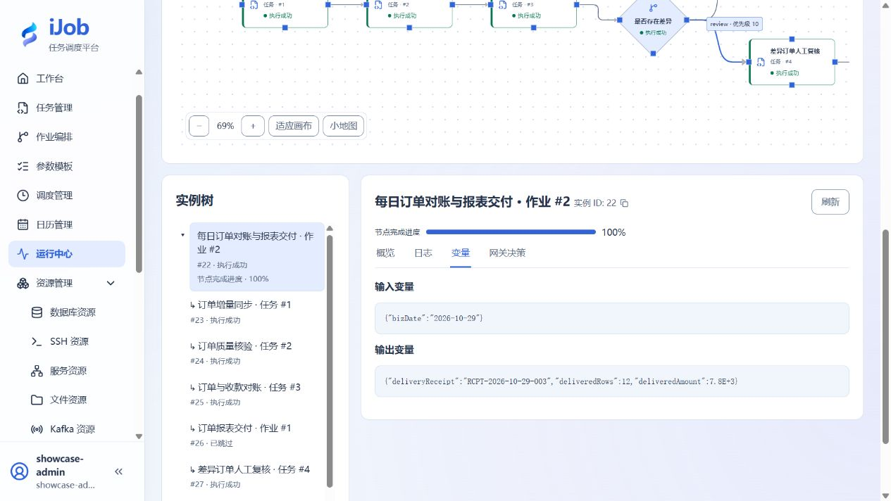

# 每日订单对账与报表交付

[English](../../en/examples/order-reconciliation.md) · [手册首页](../README.md)

同步指定业务日期的订单，核对收款；无差异直接交付报表，有差异先人工复核，质量不合格则阻止交付。

## 适用场景与读者

适合已完成[快速入门](../quickstart.md)、需要组合数据库、审批和文件交付的配置人员。难度：中级；预计 45–60 分钟，不含服务安装。

本例使用 7 个任务、一个 3 节点交付子作业和一个 7 节点主作业。两个分支引用同一个已发布子作业，展示依赖、条件路由、版本复用和运行结果追踪。

## 开始前准备

先阅读[教程公共准备](../examples.md)。使用自己的独立练习环境，不连接真实订单、收款或客户收件端。

| 资源 | 要求 |
| --- | --- |
| iJob | 1.0.0，单机节点可用；按[账号模式切换](../operations/account-mode-change.md)完成 DATABASE 模式配置，并以管理员重新登录 |
| 配置账号 | ADMIN；用于资源、任务、参数模板及作业配置，也用于查看日志与变量 |
| 审批账号 | 已启用且完成首次改密的 ADMIN 或 OPERATOR；后续选择该账号为审批人员 |
| 订单来源库 | 新建专属 PostgreSQL 业务数据库；任务账号能 SELECT 来源表 |
| 订单对账库 | 另一个专属 PostgreSQL 业务数据库；任务账号能读取收款表，并读取、插入、更新目标订单表 |
| 文件目录 | 两个不同的空目录：报表生成目录和报表交付目录；执行 Worker 可读写 |
| 回执接收端 | Python 3.9 或更新版本，标准库即可；与 Worker 在同一台练习主机，读取交付目录，绑定你选定的空闲回环端口 |

业务数据库与 iJob 平台数据库分别准备。建表使用具有 CREATE/INSERT 权限的初始化身份，不必让任务账号拥有建库权限。下文的目录和端口均由你选择；资源中填写真实值，不填写尖括号占位文字。

## 操作步骤

### 1. 准备三个业务日期的数据

三个日期分别对应正常交付、差异复核和质量阻断。每个日期有 12 笔订单，正常金额为 100、200、…、1200，合计 7,800。

先按[案例准备页](order-reconciliation-setup.md#初始化业务数据)创建来源和目标表，再回到本页核对下表。

| 业务日期 | 数据设计 | 预期路线 |
| --- | --- | --- |
| 2026-10-28 | 12 笔订单和收款完全一致 | 自动交付 |
| 2026-10-29 | 第 1 笔订单金额 100，收款金额 0 | 1 笔差异、差额 100，先人工复核 |
| 2026-10-30 | 第 1 笔订单金额为空 | 质量检查失败，禁止生成和交付报表 |

来源表应有 36 行，收款表应有 36 行，目标 `orders` 仍为空。若表已存在，换用新的专属库，不覆盖其他练习的数据。

### 2. 启动只读取交付结果的回执接收端

将[案例准备页的 Python 代码](order-reconciliation-setup.md#本地回执接收端代码)保存为 `receipt_receiver.py`。先建立自己的交付目录和回执记录目录，再启动：

```text
python receipt_receiver.py --port <空闲端口> --delivered-root <交付目录绝对路径> --records <回执记录文件绝对路径>
```

将尖括号内容替换成实际值；路径含空格时加双引号。进程只监听 `127.0.0.1`。打开 `http://127.0.0.1:<空闲端口>/health`，应返回 `status = "ok"` 和当前 `receiptCount`。保持进程运行。

`POST /receipts` 会读取已经交付的 CSV，计算行数与金额后返回回执；不会仅凭请求中的“成功”标记宣告交付成功。容器或远程 Worker 的 `127.0.0.1` 指向它自身，本例请将 Worker、文件目录和接收端放在同一练习主机。

### 3. 创建五个资源

进入“资源”，按下表创建并核对连接。名称可沿用本例，标识使用自己的独立标识。

| 名称 | 类型 | 关键填写项 |
| --- | --- | --- |
| 订单来源库 | 数据库 / PostgreSQL | 来源库 JDBC URL、任务读取账号及口令 |
| 订单对账库 | 数据库 / PostgreSQL | 目标库 JDBC URL、任务读写账号及口令 |
| 报表生成目录 | 文件 / LOCAL | 你建立的生成目录绝对路径 |
| 报表交付目录 | 文件 / LOCAL | 另一个交付目录绝对路径；与接收端 `--delivered-root` 一致 |
| 报表接收方 | 服务 / HTTP | `http://127.0.0.1:<你选择的端口>`；本地样例认证方式 NONE；调用超时 10 秒 |

资源全部启用。数据库、文件和 HTTP 端点均从使用它们的节点访问；API 节点连接测试成功不等于另一台 Worker 也可访问。

### 4. 定义业务日期参数

新增参数模板“订单对账业务日期”，只添加一项：

| 字段 | 填写值 |
| --- | --- |
| 参数名 | `bizDate` |
| 类型 | ENUM |
| 必填 | 是 |
| 枚举选项 | `2026-10-28`、`2026-10-29`、`2026-10-30`，每行一个 |
| 设置默认值 | 开启，值为 `2026-10-28` |
| 敏感参数 | 关闭 |

主作业发布后，将此模板设为它的默认模板。每次执行选择其中一个日期；不要把模板名称填进参数值。

### 5. 创建七个任务

进入“任务管理 → 新增任务”。以下任务全部启用，自动重试次数与间隔均设为 0；除审批任务外，公共任务超时填 120 秒。执行分组可留空；如填写，必须与本环境 Worker 的分组匹配。

每个任务配置完成后点击“保存”发布版本。保存不会执行；先完成全部定义，再从主作业发起运行。

#### 5.1 订单增量同步：ETL

| 界面字段 | 填写值 |
| --- | --- |
| 来源类型 / 资源 | DATABASE / 订单来源库 |
| 查询 SQL | 下方来源查询 |
| 查询参数（JSON） | `{"bizDate":"${bizDate}"}` |
| 目标类型 / 资源 / 目标表 | DATABASE / 订单对账库 / `orders` |
| 写入方式 | UPSERT |
| 逻辑键 | `biz_date, order_id` |
| 字段映射 | `biz_date → biz_date`、`order_id → order_id`、`amount → amount`、`customer_region → customer_region` |
| 事务范围 | RUN |
| 空值策略 | OVERWRITE |
| 启用增量 | 开启 |
| 检查点键 | 使用新的专属键，例如 `tutorial-orders-${bizDate}` |
| 标记字段 / 类型 / 初始标记 | `order_id` / LONG / `0` |
| 上界查询 SQL | 下方上界查询 |
| 允许越过无效记录推进 | 关闭 |

来源查询：

```sql
SELECT biz_date, order_id, amount, customer_region
FROM source_orders
WHERE biz_date = :bizDate
  AND order_id > :etlLastWatermark
  AND order_id <= :etlUpperWatermark
ORDER BY order_id
```

上界查询：

```sql
SELECT MAX(order_id)
FROM source_orders
WHERE biz_date = '${bizDate}'
```

`etlLastWatermark` 和 `etlUpperWatermark` 由增量执行提供，不要把它们建成用户参数。检查点按日期分开，避免一个日期的进度影响另一个日期。首次运行每个日期提取 12 行，后续无新增数据时不重复提取这些订单。

这里的水位是递增订单编号，用来演示**新增订单**。修改已经越过水位的旧订单不会自动再次同步；需要捕获更新时，使用合适的更新时间和稳定排序方案，参阅[增量同步教程](etl-full-incremental.md)。

#### 5.2 订单质量核验：DATA_CHECK

选择“订单对账库”，查询超时 30 秒，开启“导出结果变量”，关闭发送通知。新增三项检查，级别均为 ERROR：

| 名称 | 类型 | 比较条件 / 期望值 | 输出实际值变量 |
| --- | --- | --- | --- |
| 订单数量 | 结果行数 COUNT | EQ / 数值 `12` | `qualityRowCount` |
| 金额完整且有效 | 空结果 EMPTY | 无需填写 | 留空 |
| 订单主键无重复 | 空结果 EMPTY | 无需填写 | 留空 |

三项查询分别填写：

```sql
SELECT order_id FROM orders
WHERE biz_date = '${bizDate}';
```

```sql
SELECT order_id FROM orders
WHERE biz_date = '${bizDate}'
  AND (amount IS NULL OR amount <= 0);
```

```sql
SELECT order_id FROM orders
WHERE biz_date = '${bizDate}'
GROUP BY order_id HAVING COUNT(*) > 1;
```

COUNT 比较的是查询返回的行数，所以第一项返回订单明细行；不要替换成 `SELECT COUNT(*)` 后仍使用 COUNT 类型。EMPTY 在查询不返回行时通过。主键约束已防止重复，第三项保留为流程中明确可见的质量规则。

#### 5.3 订单与收款对账：SQL

| 界面字段 | 填写值 |
| --- | --- |
| 数据库资源 | 订单对账库 |
| 事务 / 出错后继续 | 开启 / 关闭 |
| 查询超时（秒） | `30` |
| 结果变量（可选） | `summary` |
| SQL 内容 | 下方查询 |

```sql
SELECT COUNT(*) AS order_count,
       SUM(o.amount) AS total_amount,
       SUM(CASE WHEN o.amount <> COALESCE(b.amount, 0)
                THEN 1 ELSE 0 END) AS difference_count,
       SUM(o.amount - COALESCE(b.amount, 0)) AS difference_amount
FROM orders o
LEFT JOIN bank_receipts b
  ON o.biz_date = b.biz_date AND o.order_id = b.order_id
WHERE o.biz_date = '${bizDate}';
```

查询返回一行，`summary` 包含订单数、订单金额、差异数和差额，供紧邻的下游网关使用。

**参数写法需要区分：** ETL 来源查询使用 `:bizDate`，在查询参数中映射 `${bizDate}`，由数据库驱动绑定；不要给 `:bizDate` 加 SQL 字符串引号。SQL 插件、DATA_CHECK 查询以及本例增量上界查询中的 `${bizDate}` 是文本替换，字符串引号由 SQL 本身提供。本例用三个固定 ENUM 选项约束日期，不接收任意拼入 SQL 的自由文本。详见[变量参考](../reference/variables.md)。

#### 5.4 差异订单人工复核：EVENT

| 界面字段 | 填写值 |
| --- | --- |
| 事件动作 | 等待审批 WAIT_APPROVAL |
| 等待超时（秒） | `3600` |
| 审批人员 | 选择本环境已启用的真实 ADMIN 或 OPERATOR 账号 |
| 任务公共超时 | 留空；若切换动作提示清空，确认清空 |

审批人员要有审批权限，并在此任务的允许名单内。等待审批使用插件的等待超时，不能同时设置正数公共任务超时。

#### 5.5 生成订单交付报表：ETL

| 界面字段 | 填写值 |
| --- | --- |
| 来源类型 / 资源 | DATABASE / 订单对账库 |
| 查询参数（JSON） | `{"bizDate":"${bizDate}"}` |
| 查询 SQL | 下方查询 |
| 目标类型 / 资源 | FILE / 报表生成目录 |
| 文件路径 | `${bizDate}/orders.csv` |
| 字段映射 | 与同步任务相同的四列，按该顺序排列 |
| 字符编码 / 分隔符 / 首行为表头 | UTF-8 / 逗号 / 开启 |
| 已有文件处理 | OVERWRITE |
| 空数据输出 | CREATE_WITH_HEADER |
| 启用增量 | 关闭，导出所选日期的完整报表 |

```sql
SELECT biz_date, order_id, amount, customer_region
FROM orders
WHERE biz_date = :bizDate
ORDER BY order_id
```

#### 5.6 交付订单报表：FILE_TRANSFER

| 界面字段 | 填写值 |
| --- | --- |
| 传输模式 | TRANSFER |
| 源文件资源 / 目标文件资源 | 报表生成目录 / 报表交付目录 |
| 源目录 / 目标目录 | 均为 `${bizDate}` |
| 文件匹配 | `orders.csv` |
| 递归目录 | 关闭 |
| 下载后解压 / 上传前压缩 | 均为 NONE |
| 远端发布方式 | DIRECT，适用于本例独立本地目录 |
| 覆盖同名文件 | 开启 |
| 成功后删除源文件 | 关闭 |

完成后，源目录仍保留报表，交付目录出现同名 CSV。不要让两个资源指向同一目录。

#### 5.7 核对报表交付回执：API_CALL

| 界面字段 | 填写值 |
| --- | --- |
| 服务资源 | 报表接收方 |
| 请求方法 / 请求路径 | POST / `/receipts` |
| 请求体（JSON） | 下方内容 |
| 业务成功条件 | 开启；JSONPath `$.ok`，比较方式 EQ，预期值 `true` |
| 响应变量提取 1 | 变量名 `deliveryReceipt`；JSONPath `$.receiptId` |
| 响应变量提取 2 | 变量名 `deliveredRows`；JSONPath `$.rows` |
| 响应变量提取 3 | 变量名 `deliveredAmount`；JSONPath `$.totalAmount` |

```json
{
  "bizDate": "${bizDate}",
  "fileName": "orders.csv",
  "rootInstanceId": "${ijob.instance.rootId}",
  "uploadedFileCount": "${fileTransfer.uploadedFileCount}"
}
```

最后一个值来自直接上游文件传输任务的输出。HTTP 200 还需要满足 `$.ok = true`；接收端发现文件缺失、行数或金额不符时，不能作为成功交付。

### 6. 发布可复用的交付子作业

新建作业“订单报表交付”，添加三个任务节点：

| 节点标识 | 节点名称 | 引用任务 | 上游 |
| --- | --- | --- | --- |
| `export` | 生成 CSV 报表 | 生成订单交付报表 | 无 |
| `transfer` | 文件交付 | 交付订单报表 | `export` |
| `receipt` | 回执核对 | 核对报表交付回执 | `transfer` |

三个节点使用“全部上游成功 ALL_SUCCESS”和“失败时停止后续 STOP”。连线方向为 `export → transfer → receipt`。启用作业，点击“校验”，确认引用后“保存并发布”。

### 7. 编排并发布主作业

新建“每日订单对账与报表交付”，添加下列节点。节点标识保持与表中一致，后续条件引用的是标识，不是显示名称。

| 节点标识 | 节点名称 | 类型与引用 |
| --- | --- | --- |
| `sync` | 订单增量同步 | 任务：订单增量同步 |
| `quality` | 质量核验 | 任务：订单质量核验 |
| `reconcile` | 对账汇总 | 任务：订单与收款对账 |
| `difference` | 是否存在差异 | 排他网关 |
| `auto_delivery` | 无差异 · 自动交付 | 子作业：订单报表交付 |
| `approval` | 差异订单人工复核 | 任务：差异订单人工复核 |
| `reviewed_delivery` | 复核通过 · 交付 | 子作业：订单报表交付 |

先连接 `sync → quality → reconcile → difference`，再建立两个分支：

| 起点 → 终点 | 分支标识 | 优先级 | 默认分支 | 条件 |
| --- | --- | --- | --- | --- |
| `difference → approval` | `review` | `10` | 否 | `nodes.reconcile.summary.difference_count` 大于数值 `0` |
| `difference → auto_delivery` | `clear` | `100` | 是 | 不填写 |
| `approval → reviewed_delivery` | 无 | 无 | 不适用 | 普通依赖连线 |

差异分支可用结构化编辑：左值选择变量 `nodes.reconcile.summary.difference_count`，运算符 GT，右值选择数值 `0`。对应高级 JSON：

```json
{
  "op": "GT",
  "left": {"var": "nodes.reconcile.summary.difference_count"},
  "right": {"literal": 0}
}
```

网关直接上游必须是 `reconcile`，它的 SQL 结果变量必须叫 `summary`。两个交付节点引用**同一个子作业**，但有不同节点标识；不要将它们合并为一个需要同时等待两条路线的节点。

所有执行节点保持 ALL_SUCCESS / STOP，主作业超时留空。启用主作业，校验并“保存并发布”；核对两个交付节点引用同一子作业版本。再到主作业的参数设置，将第 4 步模板设为默认模板。



### 8. 运行正常交付日期

执行主作业，选择 `bizDate = 2026-10-28`。打开本次运行：同步、质量检查和对账应完成，网关选择默认路线，交付子作业的三个节点成功。审批路线显示 SKIPPED，属于未选分支，不是失败。

在目标库执行：

```sql
SELECT COUNT(*) AS order_count, SUM(amount) AS total_amount,
       COUNT(*) FILTER (WHERE amount IS NULL) AS null_amounts
FROM orders WHERE biz_date = '2026-10-28';
```

预期 `12 / 7800.00 / 0`。打开交付目录中的 `2026-10-28/orders.csv`：一行表头、12 行数据，金额合计 7,800。查看回执文件对应记录和运行输出 `deliveredRows = 12`、`deliveredAmount = 7800`，回执中的根实例 ID 应与当前根运行一致。

### 9. 运行有差异日期，并在原实例中完成审批

再次执行主作业，选择 `2026-10-29`。对账汇总应为订单数 12、订单金额 7,800、差异数 1、差额 100。根运行与审批节点进入 WAITING_EVENT；此时交付目录中不应有该日期的报表，也不应收到该日期的新交付回执。



用第 5.4 步选择的账号打开“事件审批”，核对业务日期和根实例，填写“已确认该笔差异，本次允许交付样例报表”等处理意见，点击“通过”。回到**原根实例**：审批完成，复核后的交付子作业继续，最终 SUCCESS，根实例 ID 不变。核对该日期 CSV 与回执同样为 12 行、7,800。



审批通过表示允许继续本例交付，不会修改收款表，也不会把差异金额自动改为 0。真实业务应由自己的审批规则决定是否允许带差异交付。

### 10. 运行质量失败日期

执行主作业，选择 `2026-10-30`。同步仍会写入 12 行，但质量检查发现第 1 笔金额为空：三项检查中一项失败，质量节点 FAILED，根运行 FAILED；对账和交付不应执行。

```sql
SELECT COUNT(*) AS order_count,
       COUNT(*) FILTER (WHERE amount IS NULL) AS null_amounts
FROM orders WHERE biz_date = '2026-10-30';
```

预期 `12 / 1`。生成目录和交付目录都不应出现 `2026-10-30/orders.csv`，接收端也不应记录该日期的回执。这是**同步后的交付门禁**：不会回滚已经写入目标库的订单。

## 预期结果

| 场景 | 平台结果 | 业务结果 |
| --- | --- | --- |
| 正常日期 | 根运行 SUCCESS；自动交付成功；审批路线 SKIPPED | 目标 12 行、合计 7,800；CSV 12 数据行；回执行数和金额一致 |
| 差异日期，审批前 | WAITING_EVENT；差异数 1、差额 100 | 尚无该日期报表和回执 |
| 差异日期，审批通过后 | 原根实例继续并 SUCCESS | 生成并交付 12 行报表；回执关联同一根实例 |
| 质量失败日期 | 质量节点 FAILED；根运行 FAILED；下游未执行 | 目标含 1 条空金额；没有该日期的生成文件、交付文件或回执 |

根运行输出通常只包含最终交付结果。查看质量明细和对账汇总时，在拓扑中选择对应节点后打开“变量”，不要要求每个中间变量都出现在根输出中。

## 常见失败

| 现象 | 排查与处理 |
| --- | --- |
| 增量同步为 0 行，但预期首次读取 | 核对日期、来源数据和专属检查点键；可能已运行过该日期。不要随意清空其他任务的检查点 |
| 修正来源空金额后仍失败 | 旧订单编号已越过增量水位，不会因修改而重读；用独立修复流程更新本教程目标数据，或重建专属练习数据与新检查点，再重新演练 |
| 质量数量实际值为 1 | COUNT 类型统计结果行数；若 SQL 写成 COUNT(*)，改为返回订单行，或改用 NORMAL 比较标量 |
| 网关走错分支或条件无效 | 检查节点标识 `reconcile`、结果变量 `summary`、字段 `difference_count` 和数值比较；网关只引用直接上游输出 |
| 没有审批操作 | 核对 DATABASE 模式、账号角色、允许操作人和等待期限；普通 WAIT_EVENT 不是人工审批 |
| 等待审批很快超时 | 公共任务超时应留空；使用 EVENT 等待超时 3600 秒。根作业也不要设置短于人工处理时间的期限 |
| 回执提示文件未交付 | 核对接收端读取的目录与目标文件资源根目录一致，且前一步上传文件数为 1 |
| HTTP 可达但任务失败 | 检查实际响应 `ok`，以及 CSV 数据行数与金额；不能只凭 HTTP 200 判断业务成功 |
| 修改任务后主作业仍使用旧配置 | 保存任务后重新发布引用它的子作业，再发布主作业；旧作业版本固定旧引用 |

## 安全与清理

本例没有创建自动调度。演练结束后先停止仍在等待的本例实例；若自行添加了调度或事件绑定，先停用。确认没有活动运行，再退役本例主作业、子作业和任务，移除不再被引用的专属资源。

停止自己的回执接收端，删除本教程专属的生成文件、交付文件和回执记录。数据库清理仅针对本教程新建的业务库或三张样例表。保留仍在使用的检查点；重新从头演练时使用新的专属检查点键。审批、停止和任务失败均不会自动回滚已经发生的数据库写入或文件交付。

## 适用版本与限制

适用 **iJob 1.0.0**。覆盖本地单机、PostgreSQL 来源与目标、按业务日期的递增编号提取、三项质量检查、对账分支、DATABASE 人工审批、子作业复用、LOCAL 文件交付和本地 HTTP 回执。

本页不覆盖旧订单更新捕获、跨主机文件存储、SFTP/S3、银行真实接口、生产审批制度或外部事务的整体回滚。样例接收端仅用于本机演练，不作为公开业务服务。界面中的名称和实例编号可能与你的运行不同，判断结果时关联自己的同一次根运行。

## 本地回执接收端代码

完整代码见[案例准备：回执接收端](order-reconciliation-setup.md#本地回执接收端代码)。

## 相关页面

- [ETL：源、转换、目标与增量](../user-guide/plugins/etl.md)
- [数据校验](../user-guide/plugins/data-check.md)
- [SQL 执行](../user-guide/plugins/sql.md)
- [事件发布、等待与审批](../user-guide/plugins/event.md)
- [文件传输与归档](../user-guide/plugins/file-transfer.md)
- [接口调用](../user-guide/plugins/api-call.md)
- [作业节点、条件与网关](../user-guide/job-nodes.md)
- [子作业与版本](subjobs-and-versions.md)
