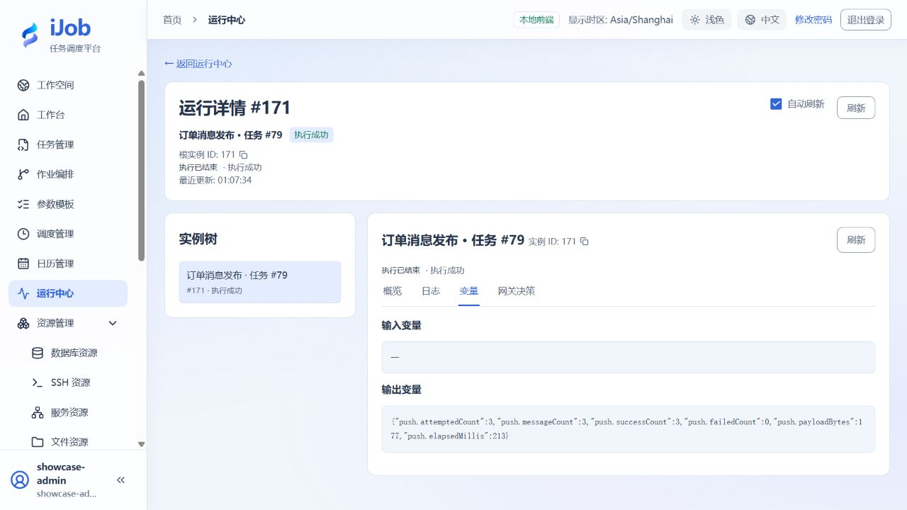

# 发布三条订单消息，并单独配置运行通知

[English](../../en/examples/push-and-notifications.md) · [手册首页](../README.md)

在消费端核对订单消息，再区分业务消息与平台邮件通知。

## 适用场景与读者

适合已完成快速入门、需要将该场景用于业务流程的配置人员。

## 开始前准备

先阅读[教程公共准备](../examples.md)。本页预计时间不含外部服务安装；命令中的资源、路径和端口按自己的演练环境填写。

| 资源 | 要求 |
| --- | --- |
| 源数据 | 专属 PostgreSQL 数据库资源；使用下方只读 VALUES 查询生成三条记录，无需建立业务表。 |
| 消息服务 | 专属 Kafka topic 与只消费该 topic 的消费者；本节主线采用 Kafka。 |
| 通知接收器 | 可选：专属SMTP接收器或测试邮箱，无真实业务收件人。 |

## 配置一览

| 界面字段 / 配置项 | 本例填写值 |
| --- | --- |
| SQL | 使用下方 VALUES 查询；每次练习使用自己的批次标记 |
| 序列化 / 压缩 | json / none |
| 目标 | KAFKA / 自己的专属 topic；Kafka 资源 acks=all |
| 批量大小 / 最大发布中数量 | 3 / 3 |
| 发布超时 / 插件内重试次数 | 30 秒 / 0 |

## 操作步骤

### 1. 创建资源与只读来源查询

创建自己的 PostgreSQL 和 Kafka 资源，Kafka 填写本环境可达的服务地址、`acks=all`，准备没有其他消息的专属 topic。启动只读取该 topic 的消费者。来源查询如下；将 `orders-demo-01` 换为本次练习自己的批次标记：

```sql
SELECT order_id, amount, 'orders-demo-01' AS tutorial_run
FROM (VALUES (1,100),(2,200),(3,300)) AS tutorial_orders(order_id,amount)
ORDER BY order_id;
```

### 2. 保存 PUSH 任务

新建 PUSH，来源选择 PostgreSQL，填写查询；目标选择 KAFKA、对应资源和专属 topic，序列化 json、压缩 none。批量大小 3、最大在途 3、发布超时 30 秒、插件重试 0；公共任务超时 120 秒、自动重试次数与间隔 0。保存后先完成下一步通知配置，再执行一次。

### 3. 可选：先配置成功通知

准备仅用于本教程的 SMTP 接收器。在通知中心建立启用的邮件通道，填写自己的地址、端口与发件人；本例使用安全模式 NONE、不开启认证，仅适用于受限练习网络。创建 EMAIL 通知，收件人指向自己的专属接收器。先测试连接，再发送测试邮件并核对实际接收内容。

为刚创建的 PUSH 任务添加通知绑定，策略选择 **ON_SUCCESS**。测试发送和任务运行通知是两条不同记录：测试发送成功不会证明任务绑定已生效。不需要邮件时跳过本步，业务消息仍可独立完成。

### 4. 执行一次并分别核对消息和邮件

执行 PUSH。输出应为 `push.attemptedCount=3`、`push.messageCount=3`、`push.successCount=3`、`push.failedCount=0`。消费者应收到 order_id 为 1、2、3，金额为 100、200、300，合计 600，且 `tutorial_run` 与本次批次一致。

若设置了通知，检查该 PUSH 实例对应的发送记录为 DELIVERED，再核对接收器邮件；不要把之前的测试邮件当作运行通知。重复执行可能重新发布三条消息，消费者应按业务键处理重复，并用批次标记区分练习。

### 5. 可选扩展：RabbitMQ 与消息 ETL

RabbitMQ 需要独立准备 exchange、routing key、已绑定队列和消费者；消息 ETL 还需独立目标表与位点或确认策略。它们不属于上述 Kafka + SMTP 主线的已确认结果。扩展时按[资源](../user-guide/resources-messaging.md)和[ETL](../user-guide/plugins/etl.md)说明配置，在自己的环境检查消息数、目标数据及失败恢复；不把 PUSH 与下游写入视为一个事务。

## 预期结果

| 检查项 | 预期值 |
| --- | --- |
| 首次业务投递 | SUCCESS；消费者收到 3 条，金额合计 600，批次标记一致 |
| PUSH 输出 | attempted/message/success 为 3，failed 为 0 |
| ON_SUCCESS 运行通知 | 同一 PUSH 实例的发送及投递记录为 DELIVERED；接收器有对应邮件 |

## 常见失败

| 现象 | 处理方法 |
| --- | --- |
| PUSH成功但没有邮件 | PUSH发布业务消息；邮件依赖单独通知渠道、规则与绑定。 |
| 重复业务消息 | 依据业务ID幂等，不承诺端到端恰好一次。 |

## 安全与清理

停用本教程通知绑定和调度，停止专属消费者；只清理本教程主题/队列和收件数据。

## 适用版本与限制

适用 iJob 1.0.0；主线环境为 PostgreSQL、Kafka 与受限网络中的无认证 SMTP 接收器，中英文任务均覆盖三条消息及成功通知。RabbitMQ、消息 ETL 失败恢复、SMTP TLS/认证、通知自动重试与跨次告警去重不列入本页已确认范围。

下图来自本教程实际运行：



## 相关页面

- [数据库结果推送到消息队列](../user-guide/plugins/push.md)

- [邮件通道、规则与发送记录](../user-guide/notifications.md)

- [ETL：源、转换、目标与增量](../user-guide/plugins/etl.md)

- [查询订单，并设置数据质量门禁](sql-and-validation.md)
