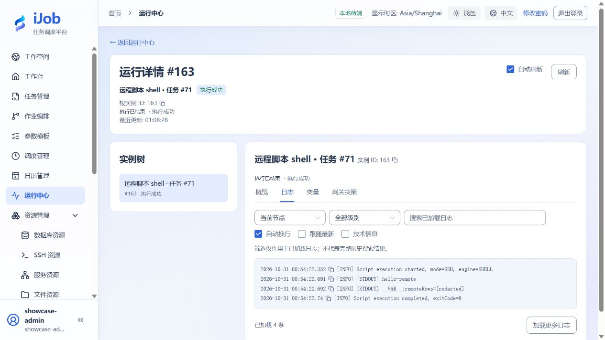

# 通过SSH执行远程脚本

[English](../../en/examples/remote-script.md) · [手册首页](../README.md)

在远端输出一条消息和一个变量，核对远端路径与执行结果。

## 适用场景与读者

适合已完成快速入门、需要将该场景用于业务流程的配置人员。

## 开始前准备

先阅读[教程公共准备](../examples.md)。本页预计时间不含外部服务安装；命令中的资源、路径和端口按自己的演练环境填写。

| 资源 | 要求 |
| --- | --- |
| SSH环境 | 专属Linux SSH主机、受限账号、空演练目录和经独立核实的主机指纹。 |
| 解释器 | 远端/bin/sh；Python变体仅在远端已安装对应解释器时使用。 |

## 配置一览

| 界面字段 / 配置项 | 本例填写值 |
| --- | --- |
| 执行方式 | SSH |
| 脚本引擎 / 工作目录 | SHELL / 本次远端专属目录 |
| 脚本 | 使用下方SHELL代码块 |

## 操作步骤

### 1. 建立SSH资源

资源 → SSH 资源，填写自己的主机、端口、受限账号和已核实的主机密钥。使用私钥认证时，“私钥”（技术字段 `privateKey`）填写**执行 Worker 能读取的私钥文件路径**，不是粘贴 PEM 内容，也不是远程主机上的路径；私钥口令单独填写。API 与 Worker 分开部署时，连接测试所在 API 节点也需要能读取该路径。先限制文件访问权限，再测试连接；脚本与日志中不放认证材料。

### 2. 配置远程任务

新建 SCRIPT，执行方式选 SSH 并选择该资源，引擎选 SHELL，工作目录填写远程专属目录的绝对路径。SHELL 没有可填写的“解释器”字段；远程主机应提供 `/bin/sh`。重试次数与间隔均为 0，超时 60 秒，脚本如下：

```sh
echo hello-remote
echo __VAR__:remoteRows=3
printf '3\n' > remote-result.txt
exit 0
```

保存发布。`__VAR__:` 后的值按字符串处理；这里的输出是字符串 `"3"`，不是数值3。

### 3. 执行并核对输出

使用ADMIN会话查看实例日志中的hello-remote、输出变量 `remoteRows`（字符串 `"3"`）及领取任务的Worker。变量值在脚本日志中会脱敏，实际值在输出变量中查看。

工作目录在 SSH 主机上，不在浏览器机器或 Windows Worker 本机。检查该目录的 `remote-result.txt`，应只有一行 `3`；重复运行会覆盖这个样例文件。

### 4. 分别演练失败条件

新建同配置、不同名称的脚本任务，把退出码改为 7，运行应为 FAILED。另建 SSH 资源填写不匹配的主机密钥，连接测试应拒绝；不要关闭校验来绕过。错误解释器路径只适用于下面的 PYTHON 配置；SHELL 不提供这个字段。无权限工作目录属于另一种失败条件，需要按自己的远程权限单独检查。

### 5. 使用远程 Python

新增任务，仍选择 SSH 和同一资源，将引擎改为 PYTHON。“Python 解释器”填写远端已安装的解释器命令或绝对路径，例如 `/usr/bin/python3`；工作目录仍是远端目录，重试 0、超时 60 秒。

```python
print("hello-remote-python")
print("__VAR__:remoteRows=3")
```

保存执行后应为 SUCCESS，日志含 `hello-remote-python`，输出 `remoteRows` 仍为字符串 `"3"`。

## 预期结果

| 检查项 | 预期值 |
| --- | --- |
| 消息与变量 | 日志含hello-remote；remoteRows为字符串"3" |
| 退出码 7 | FAILED，不能因 SSH 连接建立成功而判成功 |
| 远端文件 | `remote-result.txt` 内容为一行 `3` |
| Python 任务 | SUCCESS；`remoteRows` 为字符串 `"3"` |
| 不匹配主机密钥 | 连接测试被拒绝，不进入脚本执行 |

## 常见失败

| 现象 | 处理方法 |
| --- | --- |
| 平台已超时，远端仍运行 | 关闭SSH连接不保证终止远端进程。远端任务需要自己的期限、取消和幂等机制，另行检查远端进程。 |

## 安全与清理

清理本教程新建文件与失败副本；若有长任务，先在远端确认其退出。

## 适用版本与限制

适用 iJob 1.0.0。示例环境为 Windows Worker 通过私钥连接 Linux SSH 主机，覆盖 SHELL 与 PYTHON 成功、退出码 7 失败、主机密钥不匹配拒绝，以及远端文件内容核对。密码认证、跳板机和任意远程长进程的停止效果不在本页确认范围内；平台停止不代表远端事务回滚。

下图来自本教程实际运行：



## 相关页面

- [脚本](../user-guide/plugins/script.md)

- [SSH 资源与主机信任](../user-guide/resources-ssh.md)
