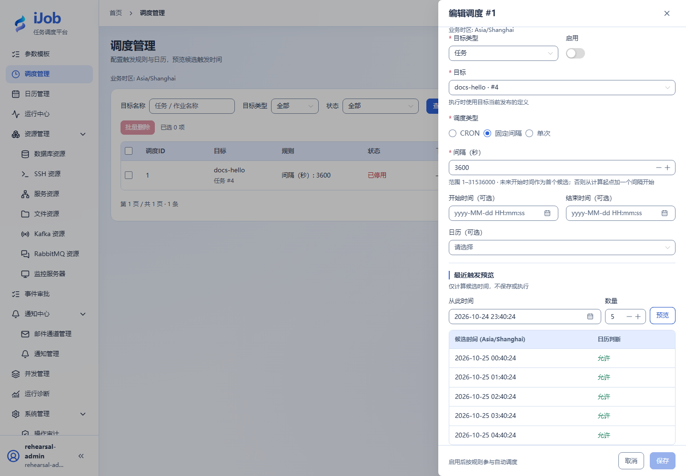

# 预览调度，并理解停机后的补发

[English](../../en/examples/schedules-and-calendars.md) · [手册首页](../README.md)

先核对时区与日历，再在专属安装比较三种错过触发策略。

## 适用场景与读者

适合已完成快速入门、需要将该场景用于业务流程的配置人员。

## 开始前准备

先阅读[教程公共准备](../examples.md)。本页预计时间不含外部服务安装；命令中的资源、路径和端口按自己的演练环境填写。

| 资源 | 要求 |
| --- | --- |
| 任务 | 已发布的无副作用docs-hello；Worker可领取。 |
| 补发演练 | 允许停机的专属安装，不在业务平台制造停机。 |

## 配置一览

| 界面字段 / 配置项 | 本例填写值 |
| --- | --- |
| 预览调度 | INTERVAL=3600秒，停用，未来5次 |
| 补发演练类型 / 表达式 | CRON / `0 * * * * *`，每分钟整点 |
| 补发策略 | SKIP / FIRE_ONCE / CATCH_UP_BOUNDED |
| 有限补发上限 | 2 |

## 操作步骤

### 1. 创建停用调度并预览

调度管理→新增，选择docs-hello、间隔3600秒，保持停用。预览未来5次，核对业务时区、开始结束时间。顶部显示时区不修改业务时区。

### 2. 添加日历排除日期

创建日历，排除预览范围内一个未来日期，绑定调度后再预览，核对该日不作为允许执行时点。

### 3. 为补发准备三条练习调度

仅在允许停机的专属安装，新增三个内容与 docs-hello 相同、任务名称不同的无副作用任务，用任务名称区分 SKIP、FIRE_ONCE、CATCH_UP_BOUNDED。为每个任务新增一条调度，类型选 CRON、表达式填 `0 * * * * *`，分别指定对应补发策略。**调度表单没有名称字段**；通过目标任务与调度 ID 区分记录。

每条调度宽限设5秒、排队期限设600秒；有限补发的数量上限设2。检查部署配置中的补发窗口覆盖本次停机范围；该窗口不是本步骤中可任意假定的调度字段。

选择有足够准备时间的未来整分钟 T0，三条调度的开始时间均设 T0，结束时间设 T0 后 2 分钟；本例结束时点包含在窗口中。移除前一步日历绑定或确认该日期允许执行。预览起点选 T0 前 1 秒，应只得到 T0、T0 后 1 分钟、T0 后 2 分钟这三个时点。随后**启用全部三条调度并确认状态**，在 T0 前完成正常停机。T0 是你选择的实际未来日期时间，不是要原样输入的文字。

### 4. 制造并记录可控停机窗口

在 T0 前正常停止专属安装；等到 T0 后 2 分钟又 6 秒以后再恢复，使三个时点都超过 5 秒宽限。恢复时仍须处于 600 秒排队期限和部署补发窗口内。记录实际停机与恢复时间，确认 Worker 就绪；不结束其他实例的进程。有限结束时间保证恢复后不会继续产生本例的正常分钟触发。

### 5. 按计划时间核对补发

只统计上述停机窗口内的计划时点，不把恢复后的正常调度算进去。若三个时点均在补发窗口和排队期限内，SKIP应0次，FIRE_ONCE为1次，有限补发为2次；核对触发记录关联的实例和日志，结束后停用三条调度。

## 预期结果

| 检查项 | 预期值 |
| --- | --- |
| 日历预览 | 排除日不作为允许候选；预览本身不执行 |
| SKIP | 不生成补发触发，数量 0 |
| FIRE_ONCE | 补发 1 次，关联实例 SUCCESS |
| CATCH_UP_BOUNDED，上限 2 | 补发 2 次，两个关联实例均 SUCCESS |

## 常见失败

| 现象 | 处理方法 |
| --- | --- |
| 数量与预期不符 | 先查实际停机窗口、宽限、队列期限与Worker分组，区分未来正常触发和补发。 |
| 触发SKIPPED无实例 | 可能是排队期限到期；它与已运行任务失败不同。 |

## 安全与清理

停用所有练习调度并确认无等待触发；恢复专属安装到练习前状态。

## 适用版本与限制

适用 iJob 1.0.0。示例使用独立 Windows 安装、Asia/Shanghai 业务时区和有限三时点 CRON 窗口；中英文示例配置的策略结果均为 0 / 1 / 2。日历预览属于前置练习，未与全部补发策略组合覆盖；其他时区、夏令时与跨多节点停机需另行核对。下方截图展示候选预览，不代表补发运行画面。

## 界面参考

以下为该功能的真实界面参考；示例名称和实例 ID 可与本次运行不同。扩展步骤以正文配置和结果为准。

## 相关页面

- [调度配置、预览与补发](../user-guide/schedules.md)

- [日历规则与例外](../user-guide/calendars.md)

- [调度、事件、通知与历史保留](../configuration/scheduling-retention.md)
