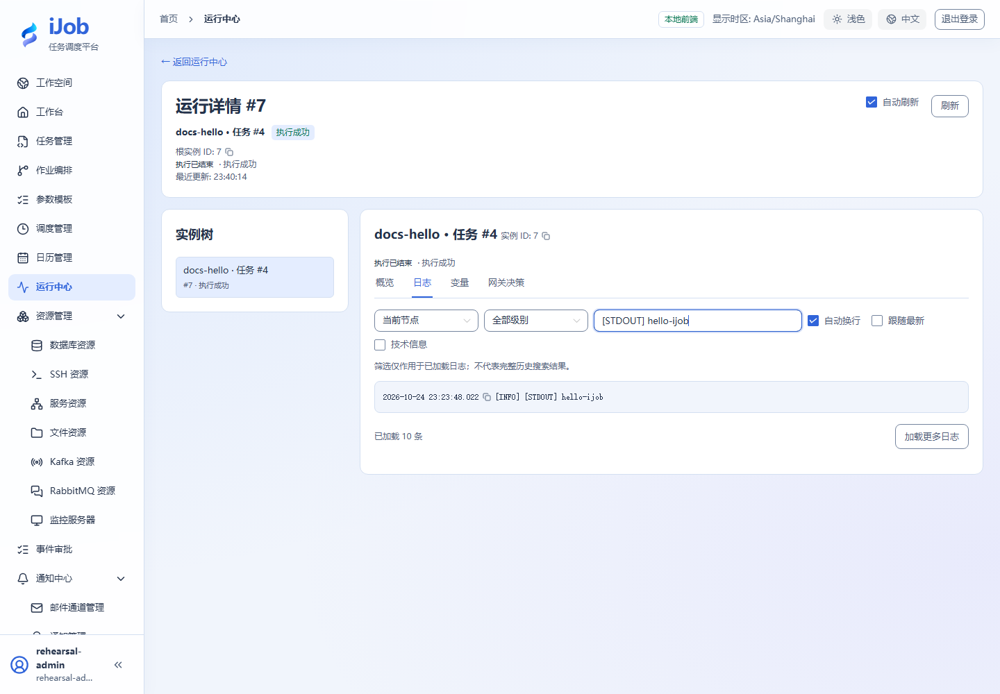

# 运行脚本，识别成功、失败和停止

[English](../../en/examples/script-lifecycle.md) · [手册首页](../README.md)

通过三个无副作用脚本，理解触发受理与实际执行结果的区别。

## 适用场景与读者

适合第一次执行脚本的用户，完成后能区分成功、非零退出、停止和超时。

## 开始前准备

先完成[教程公共准备](../examples.md)，再准备下表中的资源。

| 资源 | 要求 |
| --- | --- |
| Worker | 主步骤使用Windows PowerShell，SCRIPT引擎选择POWERSHELL。BAT或Linux SHELL需改用对应语法与解释器。 |

## 配置一览

| 界面字段 / 配置项 | 本例填写值 |
| --- | --- |
| 执行方式 | LOCAL |
| 重试 / 超时 | 0 / 60秒 |
| 成功脚本 | 使用下方可复制代码块 |

## 操作步骤

### 1. 创建并发布成功任务

任务→新增→SCRIPT，命名docs-hello。执行方式选LOCAL，引擎选POWERSHELL，脚本和输出编码均设UTF-8，重试0、超时60秒：

```powershell
Write-Output 'hello-ijob'
Write-Output '__VAR__:greeting=hello'
exit 0
```

保存会发布版本，不会自动运行。`__VAR__:`输出变量的值是字符串；本例得到`greeting="hello"`。若改用BAT或Linux SHELL，可使用`echo hello-ijob`和`exit 0`，并单独核对对应解释器。

### 2. 手动执行并检查日志

点击执行，在参数弹窗确认。进入运行中心，等待实例SUCCESS，查看STDOUT中的hello-ijob以及领取任务的Worker。

### 3. 观察非零退出

新建docs-failure，沿用POWERSHELL、重试0和超时60秒，脚本改为：

```powershell
Write-Output 'tutorial-failure'
exit 7
```

保存发布后手动执行，预期FAILED。触发受理成功与脚本执行成功分别判断。

### 4. 停止一个长任务

另建docs-stop，使用POWERSHELL、重试0、超时120秒：

```powershell
Write-Output 'started'
Start-Sleep -Seconds 45
Write-Output 'finished'
```

保存发布并执行，看到实例运行中且日志已输出`started`后请求停止。等待STOPPED，并核对本次运行没有输出`finished`；停止请求受理不等于停止完成。

### 5. 可选：观察超时与重试

在独立副本中使用`Start-Sleep -Seconds 10`，将任务公共超时设为2秒、重试0，执行后核对TIMED_OUT。

重试是另一项可选扩展：把非零退出副本重试次数设为1，检查尝试记录。重试资格取决于插件结果，不能将脚本的结果推广到HTTP错误等其他插件。

## 预期结果

| 检查项 | 预期值 |
| --- | --- |
| 成功脚本 | SUCCESS，日志有hello-ijob，输出greeting为字符串hello |
| 失败脚本 | FAILED，退出码非零 |
| 停止脚本 | 输出started后请求停止，达到STOPPED，不输出finished |
| 超时副本 | 10秒等待、2秒任务超时，达到TIMED_OUT |

## 常见失败

| 现象 | 处理方法 |
| --- | --- |
| 没有运行实例 | 先查触发记录、Worker就绪与分组，不要反复点击执行。 |
| 停止后还有写入 | 停止不撤销已完成的外部副作用；本教程脚本不写业务数据。 |

## 安全与清理

停用本教程调度（若创建）；确认无活动实例后删除不需要的练习任务。

## 适用版本与限制

适用1.0.0。主步骤使用Windows PowerShell，涵盖成功、退出码7、停止和2秒任务超时。BAT/Linux SHELL及自动重试是独立扩展，应在对应解释器核对。

## 界面参考

以下为该功能的真实界面参考；示例名称和实例 ID 可与本次运行不同。扩展步骤以正文配置和结果为准。



## 相关页面

- [脚本](../user-guide/plugins/script.md)

- [运行中心、日志、拓扑与停止](../user-guide/runs.md)
