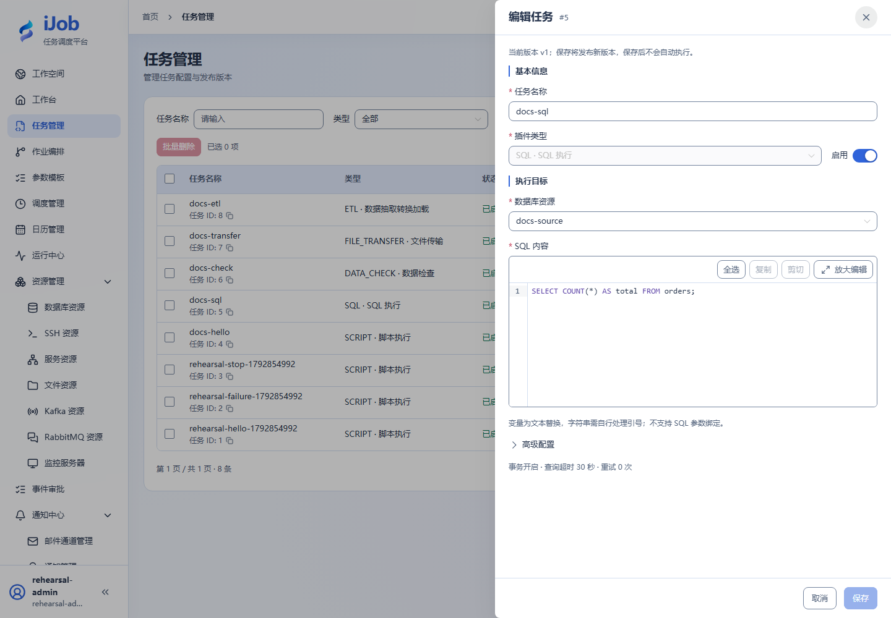
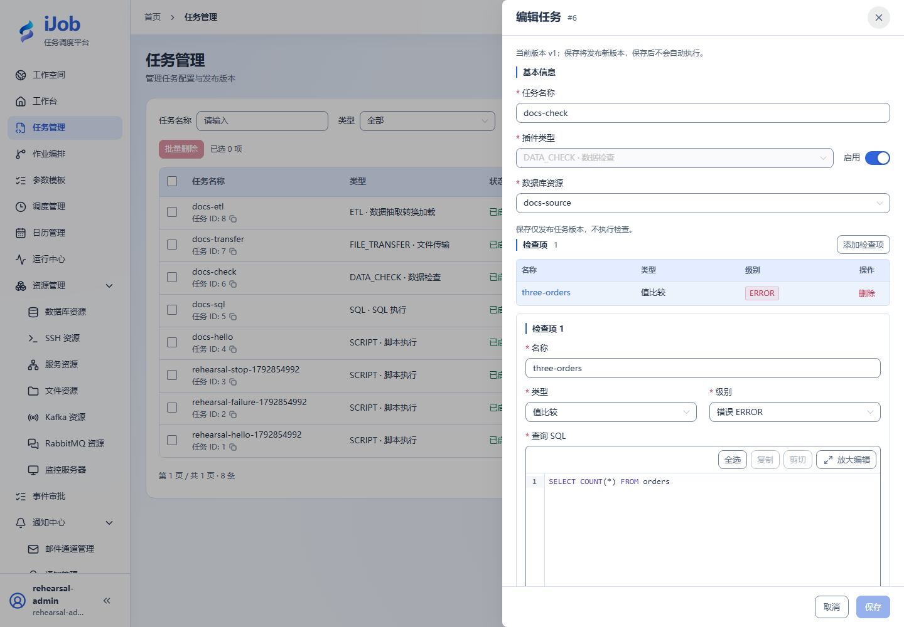

# SQL 与数据质量门禁

[English](../../en/examples/sql-and-validation.md) · [手册首页](../README.md)

**验证状态：基础路径已在独立环境实测；下述扩展不自动继承通过结论。**

相关字段：[SQL 执行](../user-guide/plugins/sql.md)。

## 准备、配置与执行

使用独立 PostgreSQL 业务库，创建三行样例：

```sql
CREATE TABLE orders(id INTEGER PRIMARY KEY, amount INTEGER, updated_at TEXT);
INSERT INTO orders VALUES
 (1,100,'2026-01-01'),(2,200,'2026-01-02'),(3,300,'2026-01-03');
```

SQL 任务选该资源，执行 `SELECT COUNT(*) AS total FROM orders;`，resultVariable=ordersResult、超时 30 秒。DATA_CHECK 选择同一资源，NORMAL / EQ / expected=3，查询 `SELECT COUNT(*) FROM orders`，级别 ERROR。

依次运行，两者应成功，查询标量为 3。将校验接到下游作业可阻止不合格数据继续处理；两行失败变体应在另一份数据上验证，不能改本次证据源。COUNT 类型与 SQL COUNT(*) 不等同。结束保留只读样例，不用平台数据库做练习。

## 结束检查

保留输入、定义版本、触发/实例 ID、脱敏日志和目标核对结果。只停止本案例拥有的进程或调度；其他环境和历史证据不作为清理对象。

## 真实页面示例

已实测的查询配置。



检查项配置；完整比较规则见上方可复制样例。


