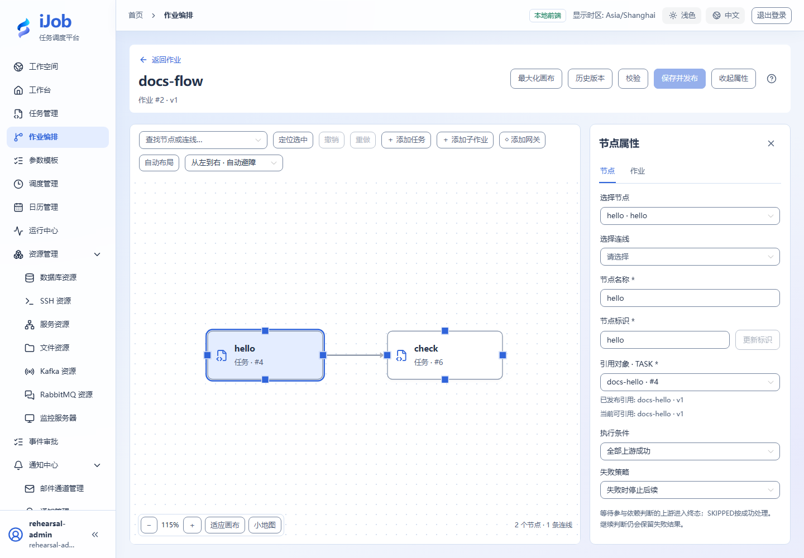

# 更新子任务后，控制父作业采用的版本

[English](../../en/examples/subjobs-and-versions.md) · [手册首页](../README.md)

观察父作业固定引用旧版本，并通过逐层发布采用新版本。

## 适用场景与读者

适合需要复用子作业并控制变更生效范围的用户，重点是父子引用的版本快照。

## 开始前准备

先完成[教程公共准备](../examples.md)，再准备下表中的资源。

| 资源 | 要求 |
| --- | --- |
| 环境 | 可执行本地SCRIPT的Worker；三个独立对象：任务、子作业、父作业。 |

## 配置一览

| 界面字段 / 配置项 | 本例填写值 |
| --- | --- |
| 任务v1输出 | 使用步骤1的脚本 |
| 任务v2输出 | 使用步骤3的脚本 |

## 操作步骤

### 1. 建立第一层任务

新建SCRIPT docs-version，选择LOCAL执行，本例使用Windows POWERSHELL，脚本和输出编码为UTF-8。填写以下脚本并保存发布，记录定义版本：

```powershell
Write-Output 'version-one'
Write-Output '__VAR__:buildLabel=version-one'
exit 0
```

### 2. 建立子作业与父作业

子作业docs-child添加该任务并保存发布；父作业docs-parent添加子作业节点并保存发布。查看两层已发布引用。执行父作业，日志应为version-one。

### 3. 只更新任务

编辑原任务，脚本替换为：

```powershell
Write-Output 'version-two'
Write-Output '__VAR__:buildLabel=version-two'
exit 0
```

保存发布任务，不发布任何作业。再执行父作业，仍应输出version-one。

### 4. 更新子作业引用

编辑子作业并重新保存发布，确认采用任务新版本。父作业暂不发布，再运行父作业仍应输出version-one，因为它固定旧子作业快照。

### 5. 发布父作业采用新版本

重新发布父作业，确认采用新的子作业版本。执行父作业，应输出version-two；历史版本仍只读，旧快照引用保持不变。

## 预期结果

| 检查项 | 预期值 |
| --- | --- |
| 只发布任务 | 父作业输出version-one |
| 再发布子作业 | 旧父作业仍输出version-one |
| 最后发布父作业 | 父作业输出version-two |
| 版本定位 | 日志与buildLabel字符串一致；任务、子作业和父作业采用对应的定义快照 |

## 常见失败

| 现象 | 处理方法 |
| --- | --- |
| 发布预检与最终引用不同 | 预检不锁定版本，发布事务采用当时的当前版本；核对最终快照。 |

## 安全与清理

练习结束保留需要的历史示例；移除对象时先检查父子引用，不能先删除仍被引用的子任务。

## 适用版本与限制

适用1.0.0单层父/子发布引用，基础任务使用Windows PowerShell。分别观察首次运行、仅更新任务、再发布子作业和最终发布父作业；并发编辑冲突和多层循环不在这些步骤内。

## 界面参考

以下为该功能的真实界面参考；示例名称和实例 ID 可与本次运行不同。扩展步骤以正文配置和结果为准。



## 相关页面

- [任务：公共配置与版本](../user-guide/tasks.md)

- [作业：编排、发布与版本](../user-guide/jobs.md)
