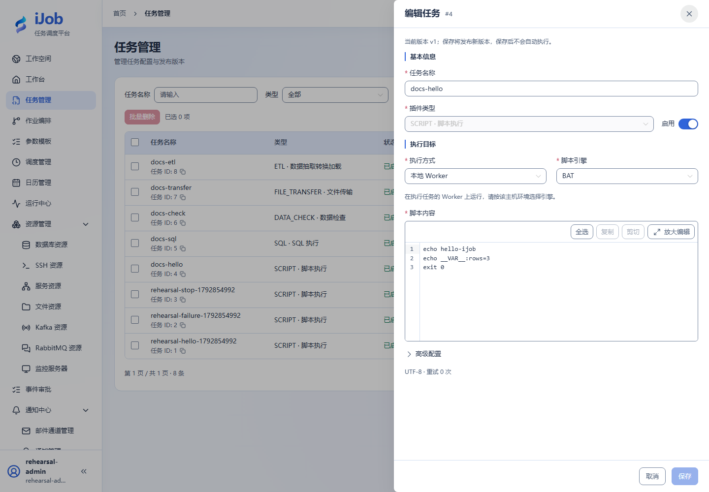
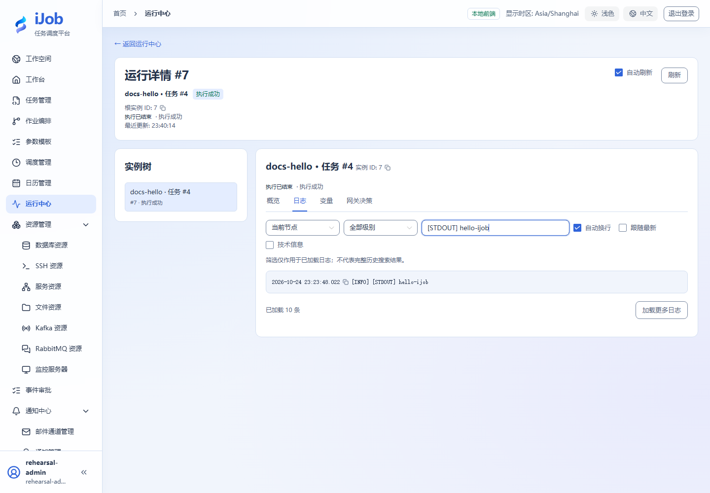
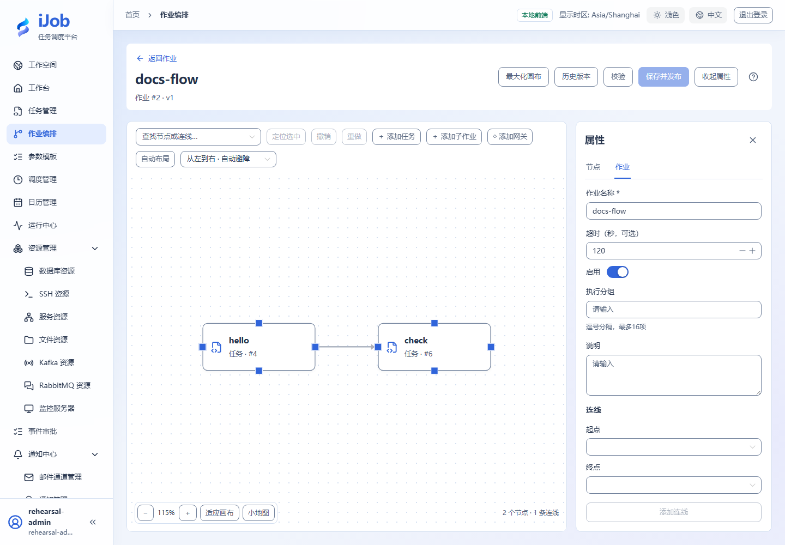
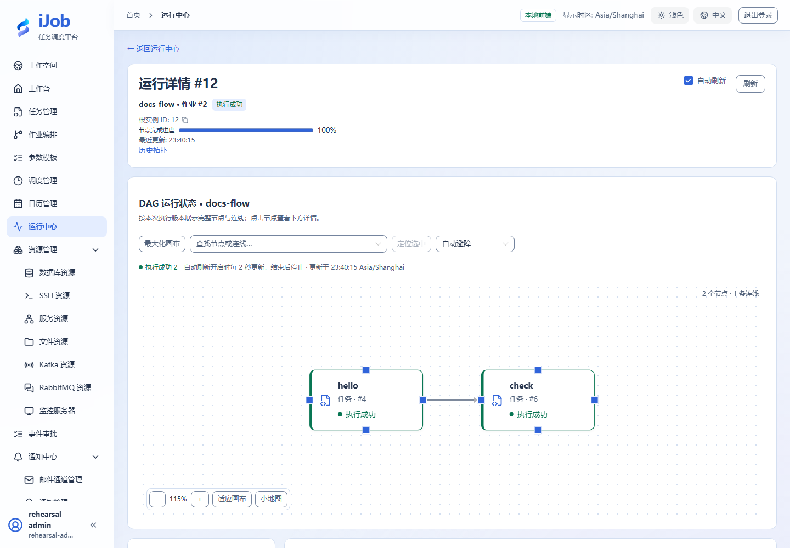
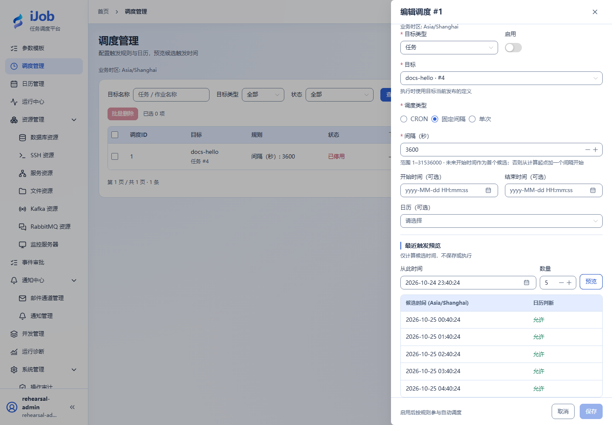

# 快速入门：从第一个任务到作业

[English](../en/quickstart.md) · [手册首页](README.md)

## 准备

先阅读[核心概念](concepts.md)，按[安装](installation.md)和[首次初始化](installation/first-start.md)启动独立实例并登录。使用自己创建的 ADMIN 完成本章；OPERATOR 可执行已有定义，但不能创建任务，VIEWER 不能执行。先确认工作台存在可用 Worker。示例不访问业务系统。

## 1. 创建并保存脚本任务

任务 → 新增，名称 `docs-hello`，插件 SCRIPT，执行方式 LOCAL。Windows 选 BAT；Linux 选 SHELL。本例将高级配置设为重试 0 次、重试间隔 1 秒、超时 60 秒；初次不限制分组。

```sh
echo hello-ijob
echo __VAR__:rows=3
exit 0
```

保存发布第一个版本，**保存不会运行任务**。下图为 Windows BAT 的真实配置，Linux 需选择对应引擎。



## 2. 执行并查看结果

列表点击执行，确认参数弹窗。触发受理后进入运行中心，选择实例，打开本次 docs-hello。应看到 SUCCESS；日志页有 `[STDOUT] hello-ijob`。在变量页核对输出 rows 为字符串 `"3"`；变量声明行在日志中隐藏值。stdout/stderr 会记录，但有大小上限，不作为文件输出存储。

日志截图使用页面搜索过滤到 hello 输出，完整日志仍保留。



## 3. 组合两节点作业

只用本章脚本即可完成：新增作业 `docs-flow`，添加两个任务节点 first/second，均引用 docs-hello；连 first→second，执行条件 ALL_SUCCESS、失败策略 STOP。校验、保存并发布，核对发布时引用版本，再执行。

下图来自进阶样例 hello→check：第二个节点为已配置数据库的 DATA_CHECK。基础入门可把第二个引用仍选 docs-hello；画布和依赖操作相同。



查看作业运行拓扑，确认两个节点依序完成。子任务以后更新不会改变已发布作业的旧引用；要采用新版本需重新发布作业。



## 4. 预览自动调度

调度管理 → 新增，选择 TASK/docs-hello、INTERVAL=3600，保持停用。预览 5 个未来候选，核对业务时区；预览不保存、不执行。需要自动运行时再启用，并用触发记录和实例核验一次，随后停用练习调度。详见[调度](user-guide/schedules.md)。



## 完成检查

你现在应能区分保存发布、触发受理、实际实例和业务结果。接着阅读[页面操作手册](user-guide/README.md)或[经典案例](examples.md)。日常停止按对应平台章节，不通过删除数据库“重置”练习。
