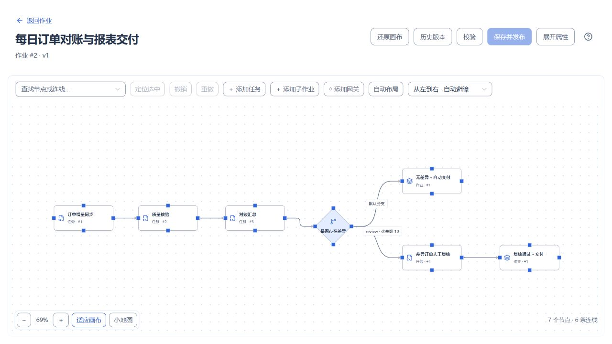
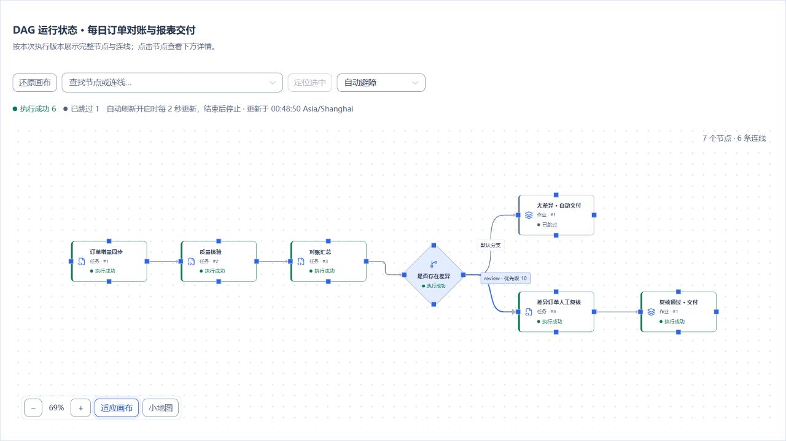

# 作业节点、条件与网关

[English](../../en/user-guide/job-nodes.md) · [手册首页](../README.md)

## 入口与操作路径

作业编辑器 → 选中节点/连线。ADMIN 可创建、修改和删除配置；OPERATOR、VIEWER 可查看概要，配置动作不可用。 完整动作见[角色权限矩阵](users-audits.md)。

## 配置和动作说明

字段名称与中文界面一致；初始值指新建节点或连线时界面填入的值。任务和子作业属于执行节点，引用类型由添加动作决定；网关固定使用排他分支。

### 节点属性

| 字段 | 是否必填 | 界面初始值 | 显示条件 | 说明 |
| --- | --- | --- | --- | --- |
| 节点名称 | 必填 | 按添加类型填入名称 | 选中节点 | 画布中的显示名称，最多 128 个字符。 |
| 节点标识 | 必填 | 自动生成 `node-` 前缀标识 | 选中节点 | 作业内唯一，最多 64 个字符；修改后点击“更新标识”应用到连线和已解析的条件引用。 |
| 引用对象 | 必填 | 未选择 | 执行节点 | 选择已发布任务或子作业；保存并发布时固定其当前版本。 |
| 已发布引用 | 只读 | 尚无发布引用 | 执行节点已有引用版本 | 显示当前快照中记录的引用名称与版本。 |
| 当前可引用 | 只读 | 按所选对象读取 | 编辑执行节点且当前版本可用 | 显示再次发布时可引用的版本，可与已发布引用对照。 |
| 执行条件 | 有初始值 | 全部上游成功（`ALL_SUCCESS`） | 执行节点 | 等待参与依赖判断的上游进入终态后，按全部成功、任一成功（`ANY_SUCCESS`）或上游终态后执行（`ALWAYS`）判断；`SKIPPED` 按成功处理。 |
| 失败策略 | 有初始值 | 失败时停止后续（`STOP`） | 执行节点 | 可改为失败后继续判断（`SKIP`）；继续判断仍保留本节点的失败结果。 |

### 连线与网关分支

普通连线表达依赖。选中从网关引出的连线，才会显示分支条件；执行节点的“执行条件”用于判断上游状态，与这里的业务条件不同。每个网关至少两个分支，且恰好一个默认分支。

| 字段 | 是否必填 | 界面初始值 | 显示条件 | 说明 |
| --- | --- | --- | --- | --- |
| 起点 | 添加连线时必填 | 未选择 | 编辑作业时的连线区域 | 选择上游节点；不能与终点相同，不能产生重复边或循环。 |
| 终点 | 添加连线时必填 | 未选择 | 编辑作业时的连线区域 | 选择下游节点。 |
| 分支标识 | 必填 | 默认分支为 `fallback`，其余为 `route-序号` | 选中网关出线 | 同一网关内唯一，最多 64 个字符；用于识别分支。 |
| 优先级 | 必填 | 按出线顺序填入 10、20、30… | 选中网关出线 | 0–10000 的整数，同一网关内唯一；非默认分支按数字从小到大判断，首个匹配生效。 |
| 默认分支 | 有初始值 | 尚无默认分支时开启，否则关闭 | 选中网关出线 | 开启后取消该网关其他分支的默认标记；仅当所有非默认条件均不匹配时进入，不填写条件。 |
| 条件 | 非默认分支必填 | `EXISTS` 检查 `input.value` | 选中非默认网关出线 | 根据输入、直接上游输出或 `trigger` 元数据选择业务路径；需要替换为实际业务条件。 |

### 条件编辑器

| 字段 | 是否必填 | 界面初始值 | 显示条件 | 说明 |
| --- | --- | --- | --- | --- |
| 运算符 | 必填 | 新建非默认分支为 `EXISTS` | 结构化编辑 | 比较可选 `EQ`、`GT` 等；`AND`、`OR` 组合至少两个条件，`NOT` 包含一个条件。 |
| 左值 | 按运算符填写 | 新建非默认分支为变量 `input.value` | 叶子条件 | 从“变量”或“字面量（JSON）”选择值类型；存在性和空值检查使用变量。变量仅支持输入、直接上游输出和触发元数据。 |
| 右值 | 二元比较必填 | 切换到普通比较时为字面量 `0` | 非一元检查的叶子条件 | 字面量须为合法 JSON，例如数字 `0`、字符串 `"review"`；`IN`、`NOT_IN` 的右值使用数组。`EXISTS`、`IS_NULL`、`IS_NOT_NULL` 不显示右值。 |
| 高级JSON | 必填 | 当前条件的 JSON | 切换至高级JSON模式 | 可直接编辑条件表达式；切回结构化编辑后核对类型与引用，并重新校验。 |

缺失变量先用 `EXISTS` 判断；默认分支不负责兜底条件求值错误。完整语法见[变量与表达式](../reference/variables.md)。

### 节点与分支操作

| 动作 | 可用角色 | 可用条件 | 结果 |
| --- | --- | --- | --- |
| 更新标识 | ADMIN | 编辑节点，新标识唯一且相关条件可解析 | 更新节点、连线与已解析的条件引用；修改后重新校验。 |
| 添加连线 | ADMIN | 已选择不同的起点与终点，连线合法 | 增加依赖；起点为网关时同时初始化分支字段。 |
| 放大编辑条件 | ADMIN | 编辑非默认网关分支 | 在更大的编辑区域配置同一条件。 |
| 添加条件 | ADMIN | 当前为 `AND` 或 `OR` 条件组，未达到嵌套深度限制 | 在当前条件组增加一条子条件。 |
| 移除条件 | ADMIN | 当前条件组超过两个子条件 | 删除所选子条件，保留条件组最少两个子条件。 |
| 删除连线 | ADMIN | 编辑作业并选中连线 | 删除依赖及该连线的分支条件；重新检查默认分支与分支数量。 |
| 删除节点 | ADMIN | 编辑作业并确认删除 | 删除节点及关联连线；相关条件引用需要重新校验。 |
| 查看已发布子拓扑 | ADMIN | 当前快照中的节点引用已发布子作业 | 查看该快照固定的子作业拓扑。 |
| 校验 | ADMIN | 草稿和引用元数据可用 | 检查拓扑、引用与条件；通过后仍需保存并发布。 |

保存和发布操作见[作业：编排、发布与版本](jobs.md)。

## 操作与结果核对

下图使用[订单日结与差异复核](../examples/order-reconciliation.md)案例：订单同步、质量校验、对账汇总后，由“是否存在差异”网关选择交付路径。对账汇总是网关的直接上游，输出变量为 `summary`。

| 分支 | 分支标识 | 优先级 | 条件 | 预期路径 |
| --- | --- | --- | --- | --- |
| 差异复核 | `review` | 10 | `nodes.reconcile.summary.difference_count` 大于数值 `0` | 进入人工复核，通过后执行交付子作业。 |
| 默认交付 | `clear` | 100 | 默认分支，不填写条件 | 没有差异时直接执行交付子作业。 |

分别运行无差异和有差异的数据，核对被选中的分支、审批状态、子作业结果和业务产物。未选中的分支会跳过，与任务执行失败不同；重命名节点标识或改变连线后，应重新校验条件引用。

## 真实页面示例

编排画布中的菱形为条件网关；上方为默认交付，下方为差异复核，两个交付节点复用同一个子作业。选中网关出线可编辑上表中的分支标识、优先级与条件。

下面是差异订单完成复核后的真实运行拓扑：复核路径及后续交付已完成，上方未选中的自动交付节点显示为跳过。

