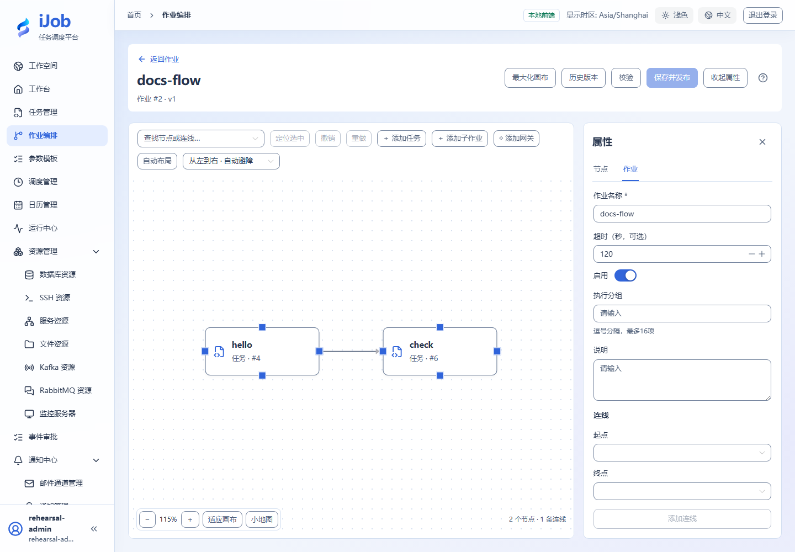

# 作业：编排、发布与版本

[English](../../en/user-guide/jobs.md) · [手册首页](../README.md)

## 入口与操作路径

作业编排 → 新增作业。页面动作随当前账号权限提供；先确认操作对象及环境。

## 配置和动作说明

| 字段/动作 | 用途与填写规则 |
| --- | --- |
| `名称 / 说明 / 启用 / 超时 / 分组` | 公共业务信息；可选超时以秒计，分组匹配根作业领取。 |
| `添加任务 / 子作业 / 网关` | 执行节点引用已发布定义；网关决定条件分支。 |
| `连线 / 自动布局` | 箭头起点为上游；布局和避障显示偏好不改变依赖语义。 |
| `校验 / 保存并发布` | 先校验，再核对引用确认。发布事务取各子对象当前版本；预检不锁版本。 |
| `历史版本 / 子拓扑` | 历史为只读快照；子对象以后更新不会修改旧快照。 |

## 操作与结果核对

最小作业添加 hello、check 两个任务节点，连 hello→check，使用 ALL_SUCCESS/STOP；保存并发布后手动运行，查看[运行拓扑](runs.md)。多节点不允许孤立节点、自环或循环；1–500 节点、最多 5000 连线。详细条件见[节点与网关](job-nodes.md)。

## 真实页面示例

两节点编排与作业属性。

