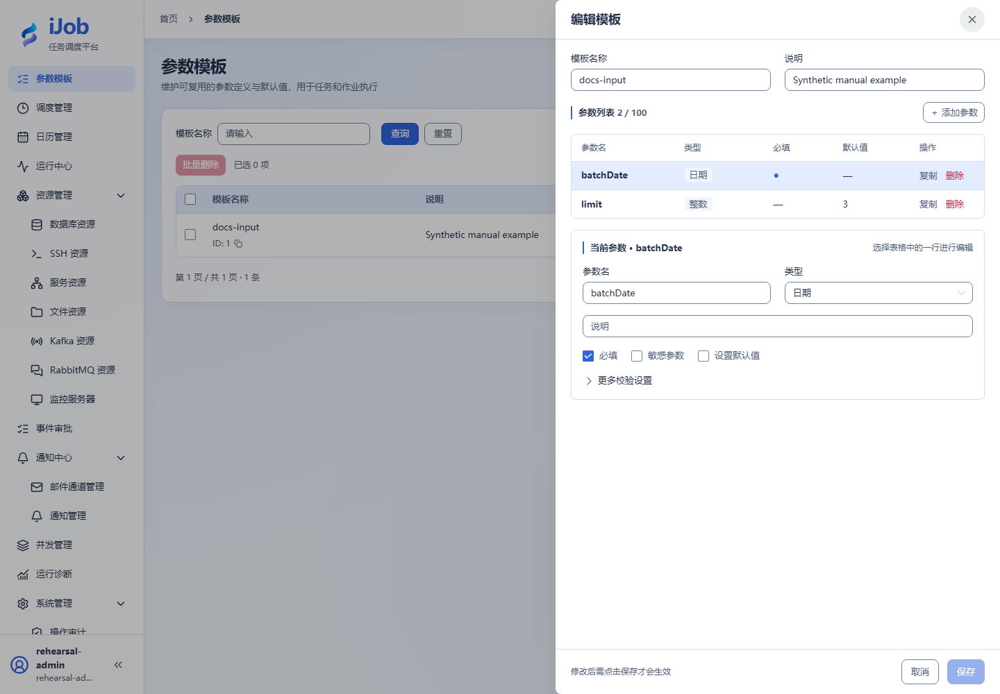

# 参数模板、输入和变量

[English](../../en/user-guide/parameters.md) · [手册首页](../README.md)

## 入口与操作路径

参数模板；任务/作业执行弹窗。页面动作随当前账号权限提供；先确认操作对象及环境。

## 配置和动作说明

| 字段/动作 | 用途与填写规则 |
| --- | --- |
| `参数名 / 类型` | 最多 100 项；STRING/INTEGER/DECIMAL/BOOLEAN/DATE/DATETIME/ENUM/OBJECT/ARRAY，保持 JSON 类型。 |
| `必填 / 默认值 / 敏感` | 是否必填与是否有默认值独立；敏感项不允许保存默认值。 |
| `选项 / 最小最大 / 长度` | 按类型设置枚举、数值和长度限制；空、缺失、0、false 不混同。 |
| `传入 / 本次值` | 执行弹窗只影响本次执行，不自动修改模板或调度。 |
| `默认绑定 / 重新载入` | 绑定用于后续选择；已保存调度不会随模板更新，重新载入会替换当前草稿。 |

## 操作与结果核对

示例模板含 batchDate（DATE、必填）和 limit（INTEGER、默认 3）。手动执行填日期后核对运行输入快照。变量不是秘密保险库；口令、token 放资源配置。脚本可用 `__VAR__:rows=3` 输出变量；条件/插件引用按各自字段提示使用，不假设所有文本都支持同一种插值语法。

## 真实页面示例

两个参数的真实模板：必填日期与默认值 3 的整数。

