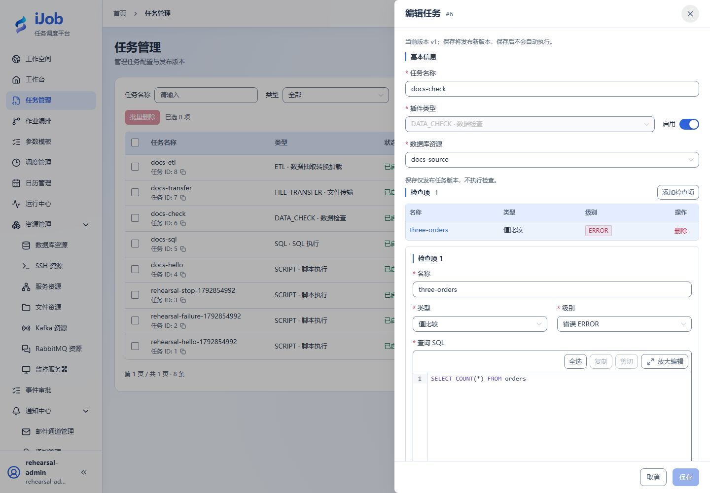

# 数据校验

[English](../../../en/user-guide/plugins/data-check.md) · [手册首页](../../README.md)

## 入口与前提

任务 → 新增/编辑 → 插件 `DATA_CHECK`。先准备字段表要求的资源、权限及执行节点依赖。任务公共超时、重试和发布规则见[任务](../tasks.md)。

## 字段与作用

| 页面字段/动作 | 用途与填写规则 |
| --- | --- |
| 数据库资源、查询超时（秒） | 业务数据库资源；每条查询超时默认 30 秒。 |
| 检查项名称、查询 SQL、类型 | 每条检查有可辨名称和查询；type 为 NORMAL/COUNT/EXISTS/EMPTY，按结果含义选择。 |
| 比较条件、期望值、下界、上界 | EQ/NE/GT/GE/LT/LE/BETWEEN；普通比较填 expected，范围比较填边界，保持数值类型。 |
| 输出实际值变量、级别、结果处理 | 输出变量、检查级别（默认 ERROR）及后续处理；不要将警告当作数据已修复。 |

## 最小样例与核对

先准备上表的独立测试资源，按页面逐项填写；保存后手动执行，再按下文核对实例、输出与目标系统。保存本身不会执行。

| 配置项 | 填写内容 |
| --- | --- |
| 数据库资源 | 选择包含三行 orders 数据的测试库资源 |
| 检查项名称 | `three-orders` |
| 查询 SQL | `SELECT COUNT(*) FROM orders` |
| 类型 | 值比较（NORMAL） |
| 比较条件 | 等于 EQ |
| 值类型 | 数值 |
| 期望值 | `3` |
| 级别 | 错误 ERROR |

补业务数据库资源后运行：三行时通过，再用独立副本改为两行核对失败。查看每项检查和总实例状态；COUNT 与 SQL COUNT(*) 的语义不要混淆，标量比较样例用 NORMAL。校验仅发现问题，除非另配处理器，不会修复数据。

示例中的资源、路径及对象名称需替换为本环境实际值；实际外部协议验收状态见[案例索引](../../examples.md)。

## 真实页面示例

NORMAL 值比较与 ERROR 级别；比较值在下方表单填写。

## 技术字段对照（按需查阅）

以下是保存配置中的键名，供开发或排障定位；不是需要粘贴的任务 JSON。自动核验的元数据不作为页面手工输入。

| 页面字段/分组 | 技术键名 |
| --- | --- |
| 数据库资源、查询超时（秒） | `resourceId / queryTimeoutSeconds` |
| 检查项名称、查询 SQL、类型 | `checks[].name / sql / type` |
| 比较条件、期望值、下界、上界 | `compareType / expected / minValue / maxValue` |
| 输出实际值变量、级别、结果处理 | `variable / level / handlers` |
