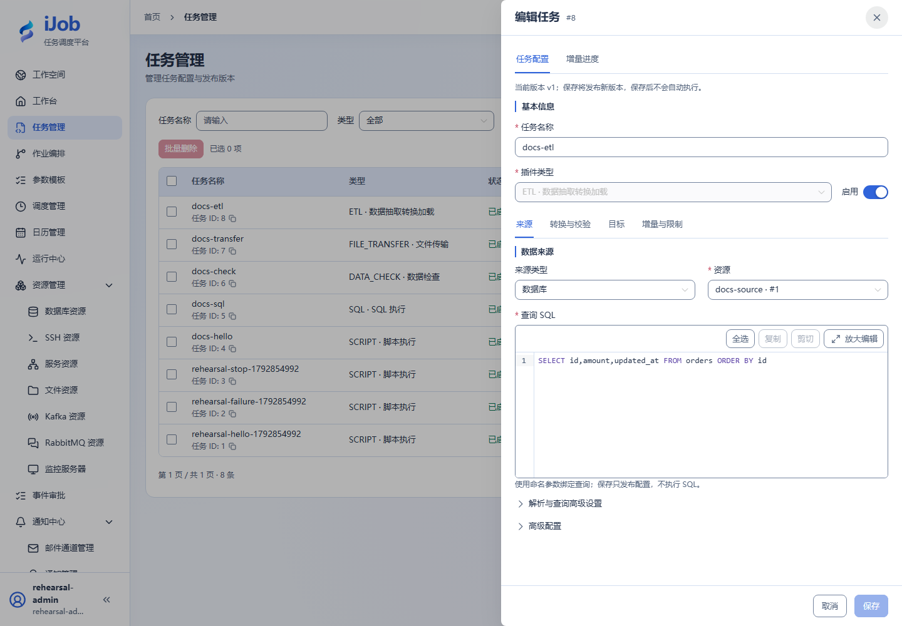
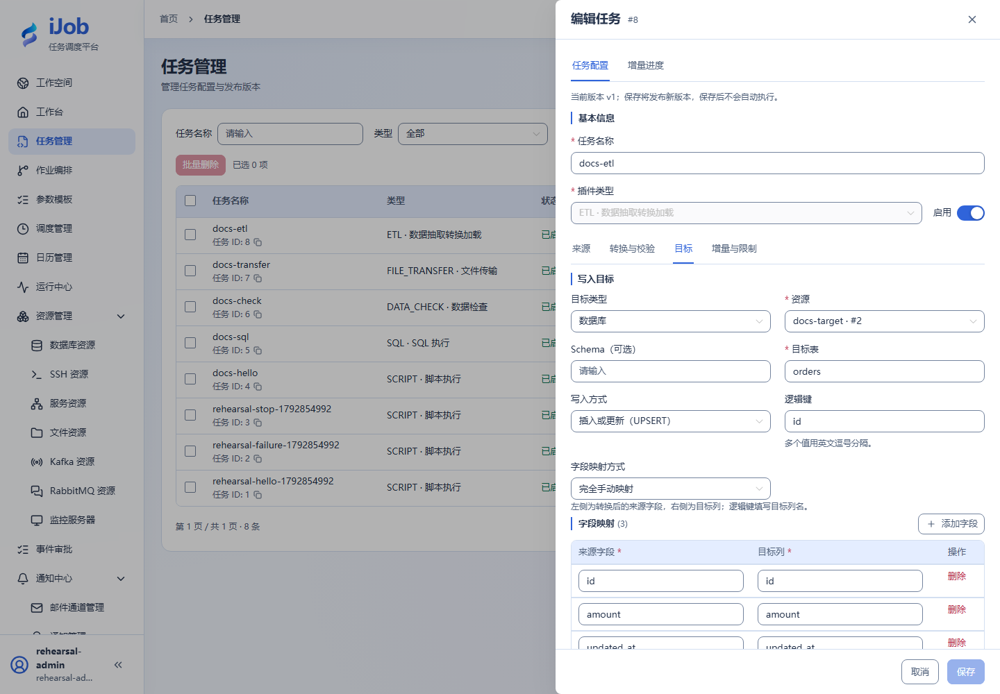

# ETL：源、转换、目标与增量

[English](../../../en/user-guide/plugins/etl.md) · [手册首页](../../README.md)

## 入口与前提

任务 → 新增/编辑 → 插件 `ETL`。先准备字段表要求的资源、权限及执行节点依赖。任务公共超时、重试和发布规则见[任务](../tasks.md)。

## 字段与作用

| 页面字段/动作 | 用途与填写规则 |
| --- | --- |
| 来源类型、资源 | DATABASE/FILE/KAFKA/RABBITMQ；资源类型必须匹配。 |
| 查询 SQL、查询参数、前置 SQL、查询提取批量 | 数据库读取 SQL、绑定参数、前置 SQL 与抓取批次（2000）。前置 SQL 可能写入。 |
| 文件路径、文件格式、读取方式 | FILE 支持 CSV/TXT/EXCEL/REGEX/SQLITE/MDB；DIRECT 与 SQL 读取方式有不同字段。SQLite 文件源不是 DB 资源。 |
| 字符编码、分隔符、引号、转义符、首行为表头、跳过行数 | 文件解码与分隔；默认 UTF-8、逗号、双引号、有表头、跳过 0 行。 |
| 工作表名称、工作表序号、多工作表配置、表头行号、起始行号 | Excel 单/多工作表及行定位；headerRow 默认 0，按页面索引提示填写。 |
| 正则读取模式、内容正则、块起止正则、正则字段映射 | 正则逐行或分块读取；字段指定捕获组和默认值，限制块行数/字符数。 |
| 暂存表名、暂存列名 | 文件 SQL 模式临时表和列名；不等于平台业务表。 |
| 转换与校验规则 | 按顺序转换字段，再按规则校验；先预览样本并核对类型、空值和丢弃行为。 |
| 目标类型、资源、Schema、目标表、文件路径 | DATABASE 或 FILE 目标，按分支填表或文件路径。 |
| 映射方式、字段映射、排除字段、逻辑键 | 手工或自动映射；显式核对源到目标列。UPSERT 等需要有效逻辑键。 |
| 写入方式、事务范围、空值策略、按列空值策略 | APPEND/UPSERT/INSERT_ONLY/UPDATE_ONLY/SCD2；默认 APPEND、BATCH、KEEP_TARGET。逐列空值策略可覆盖总策略。 |
| 前置 SQL、后置 SQL、记录保护、SCD2 配置 | 前后 SQL、受保护记录和历史拉链配置会影响业务写入；SCD2 配业务键、比较列、生效时间、历史范围/当前标记列。 |
| 文件已存在时、空数据输出 | 默认 FAIL / CREATE_WITH_HEADER；覆盖、跳过和空文件输出需明确选择。 |
| 启用增量、检查点键、标记字段、标记类型 | 启用增量并明确检查点归属、水位列和类型；默认关闭，类型 STRING。 |
| 同值排序字段、排序初始值、上界查询 SQL、初始标记 | 相同水位用稳定唯一排序打破平局；初值和上界 SQL 必须与查询条件/排序一致。 |
| 允许越过无效记录推进、文件增量规则 | 默认允许越过无效记录；决定是否可接受跳过。文件增量还需标记位置/模板或正则/时区/回看/稳定期/变更策略。 |
| 执行限制、消息读取限制、非幂等重试确认 | 读取/写入批次、查询超时、记录/文件/文本/Excel 上限；消息源另限摄入时间、空闲时间、批次/缓冲/字节和 JSON 深度。非幂等重试默认不放行。 |

## 最小样例与核对

先准备上表的独立测试资源，按页面逐项填写；保存后手动执行，再按下文核对实例、输出与目标系统。保存本身不会执行。

| 配置项 | 填写内容 |
| --- | --- |
| 来源类型 / 来源资源 | 数据库 / 独立测试源库 |
| 目标类型 / 目标资源 | 数据库 / 独立测试目标库 |
| 目标表 | `orders`（预先创建） |
| 写入方式 | 插入或更新（UPSERT） |
| 逻辑键 | `id` |
| 字段映射 | `id→id`、`amount→amount`、`updated_at→updated_at` |
| 启用增量 | 关闭 |

```sql
SELECT id, amount, updated_at FROM orders ORDER BY id;
```

入门先做全量三行 DATABASE→DATABASE，目标 orders，映射 id/amount/updated_at，逻辑键 id，模式 UPSERT；核对目标 3 行、金额和 600。再单独演练增量：相同水位两行、重试、失败回退、无效记录与检查点；不要仅靠最大时间戳认定不漏数。BATCH 事务可能部分提交，重试前核对目标和检查点。消息源提交/确认与目标写入是不同边界。

示例中的资源、路径及对象名称需替换为本环境实际值；实际外部协议验收状态见[案例索引](../../examples.md)。

## 真实页面示例

数据库源和只读提取 SQL。



目标表、UPSERT、逻辑键与同名字段映射。



## 技术字段对照（按需查阅）

以下是保存配置中的键名，供开发或排障定位；不是需要粘贴的任务 JSON。自动核验的元数据不作为页面手工输入。

| 页面字段/分组 | 技术键名 |
| --- | --- |
| 来源类型、资源 | `source.type / resourceId` |
| 查询 SQL、查询参数、前置 SQL、查询提取批量 | `source.sql / parameters / beforeSql / fetchSize` |
| 文件路径、文件格式、读取方式 | `source.path / format / readMode` |
| 字符编码、分隔符、引号、转义符、首行为表头、跳过行数 | `source.charset / delimiter / quote / escape / header / skipLines` |
| 工作表名称、工作表序号、多工作表配置、表头行号、起始行号 | `source.sheetName / sheetIndex / sheets / headerRow / startRow` |
| 正则读取模式、内容正则、块起止正则、正则字段映射 | `source.regexMode / pattern / blockStart / blockEnd / regexFields` |
| 暂存表名、暂存列名 | `source.stagingTable / stagingColumns` |
| 转换与校验规则 | `transforms / validations` |
| 目标类型、资源、Schema、目标表、文件路径 | `target.type / resourceId / schema / table / path` |
| 映射方式、字段映射、排除字段、逻辑键 | `target.mappingMode / columns / excludedFields / logicalKeys` |
| 写入方式、事务范围、空值策略、按列空值策略 | `target.mode / transactionScope / nullPolicy / columnNullPolicies` |
| 前置 SQL、后置 SQL、记录保护、SCD2 配置 | `target.beforeSql / afterSql / protection / scd2` |
| 文件已存在时、空数据输出 | `target.existingFilePolicy / emptyFilePolicy` |
| 启用增量、检查点键、标记字段、标记类型 | `incremental.enabled / checkpointKey / watermarkField / watermarkType` |
| 同值排序字段、排序初始值、上界查询 SQL、初始标记 | `incremental.tieBreakerFields / initialTieBreakerValues / upperBoundSql / initialWatermark` |
| 允许越过无效记录推进、文件增量规则 | `incremental.allowCheckpointPastInvalidRecords / file` |
| 执行限制、消息读取限制、非幂等重试确认 | `execution / message / allowNonIdempotentRetry` |
