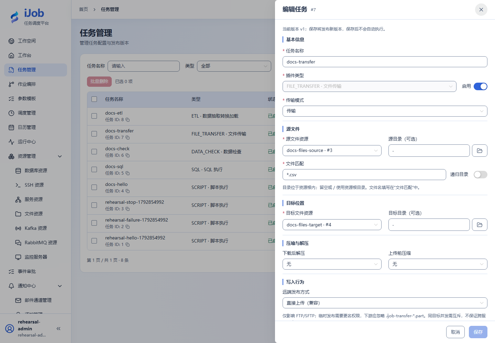

# 文件传输与归档

[English](../../../en/user-guide/plugins/file-transfer.md) · [手册首页](../../README.md)

## 入口与前提

任务 → 新增/编辑 → 插件 `FILE_TRANSFER`。先准备字段表要求的资源、权限及执行节点依赖。任务公共超时、重试和发布规则见[任务](../tasks.md)。

## 字段与作用

| 页面字段/动作 | 用途与填写规则 |
| --- | --- |
| 传输模式、源文件资源、目标文件资源 | 选择传输或仅读取模式，并选择适用的源/目标文件资源；默认传输（TRANSFER）。压缩与解压在单独区域配置。 |
| 源目录、目标目录、文件匹配、递归目录 | 使用资源根下的路径、匹配模式，默认 *、不递归；先用一个 CSV 验证。 |
| 覆盖同名文件、成功后删除源文件、远端发布方式 | 默认覆盖 true、删除源 false、DIRECT 发布。初次演练改 overwrite=false 并保留源。 |
| 下载后解压、上传前压缩、压缩包名称、压缩级别 | 按实际格式选择解压/压缩、归档文件名和级别，默认 NONE/NONE/DEFAULT。 |
| 解压条目上限、解压单项上限、解压总量上限、最大压缩比 | 默认 10000 / 256 MiB / 1 GiB / 100；保护解压规模。 |
| 最大扫描深度、扫描条目上限、源单文件上限、源总量上限、临时空间上限 | 默认 32 / 10000 / 256 MiB / 1 GiB / 2 GiB；考虑 Worker 临时磁盘。 |

## 最小样例与核对

先准备上表的独立测试资源，按页面逐项填写；保存后手动执行，再按下文核对实例、输出与目标系统。保存本身不会执行。

| 配置项 | 填写内容 |
| --- | --- |
| 传输模式 | 传输（TRANSFER） |
| 源文件资源 | 选择独立测试源目录资源 |
| 目标文件资源 | 选择独立测试目标目录资源 |
| 源目录 | 留空，使用资源根目录 |
| 目标目录 | 留空，使用资源根目录 |
| 文件匹配 | `*.csv` |
| 覆盖同名文件 | 关闭 |
| 成功后删除源文件 | 关闭 |

补源目标资源后，核验目标文件名、字节数与 SHA-256，并确认源文件仍在。FTP/SFTP/S3 需先测资源连通和权限；远端发布/重命名能力因协议而异。失败重试前检查已存在目标，不能仅看任务日志推断没有复制任何文件。

示例中的资源、路径及对象名称需替换为本环境实际值；实际外部协议验收状态见[案例索引](../../examples.md)。

## 真实页面示例

源目标资源及 CSV 匹配；写入选项在下方。

## 技术字段对照（按需查阅）

以下是保存配置中的键名，供开发或排障定位；不是需要粘贴的任务 JSON。自动核验的元数据不作为页面手工输入。

| 页面字段/分组 | 技术键名 |
| --- | --- |
| 传输模式、源文件资源、目标文件资源 | `mode / sourceResourceId / targetResourceId` |
| 源目录、目标目录、文件匹配、递归目录 | `sourcePath / targetPath / filePattern / recursive` |
| 覆盖同名文件、成功后删除源文件、远端发布方式 | `overwrite / deleteSource / remotePublishMode` |
| 下载后解压、上传前压缩、压缩包名称、压缩级别 | `decompressType / compressType / archiveName / compressionLevel` |
| 解压条目上限、解压单项上限、解压总量上限、最大压缩比 | `maxArchiveEntries / maxExtractedEntryBytes / maxExtractedTotalBytes / maxCompressionRatio` |
| 最大扫描深度、扫描条目上限、源单文件上限、源总量上限、临时空间上限 | `maxScanDepth / maxScannedEntries / maxSourceFileBytes / maxSourceTotalBytes / maxStagingBytes` |
