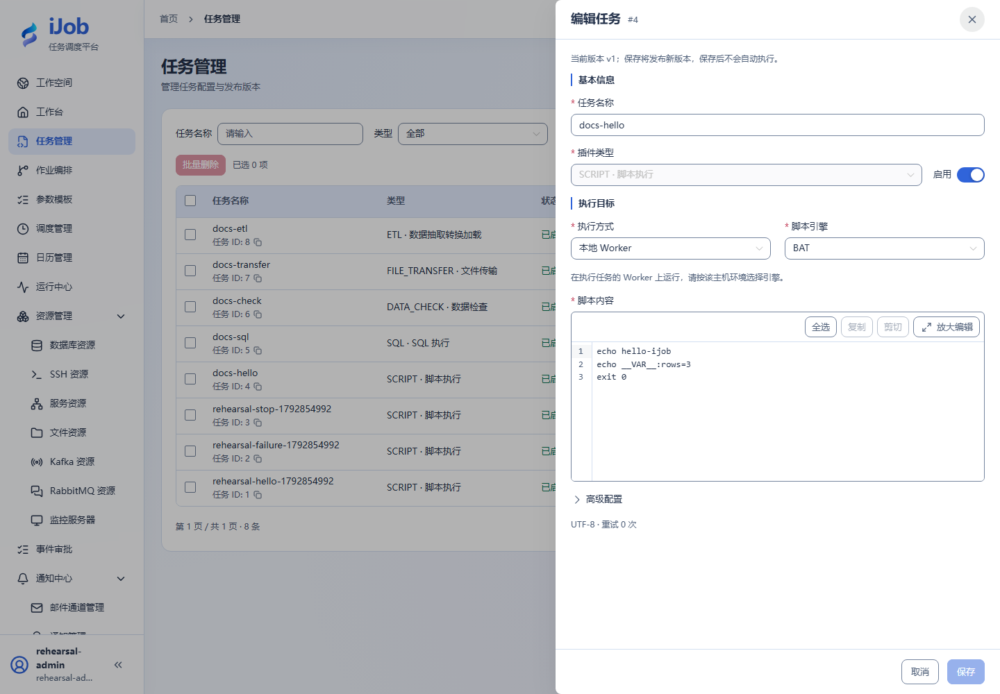

# 脚本

[English](../../../en/user-guide/plugins/script.md) · [手册首页](../../README.md)

## 入口与前提

任务 → 新增/编辑 → 插件 `SCRIPT`。先准备字段表要求的资源、权限及执行节点依赖。任务公共超时、重试和发布规则见[任务](../tasks.md)。

## 字段与作用

| 字段/动作 | 用途与填写规则 |
| --- | --- |
| `executionMode / sshResourceId` | LOCAL 在 Worker 本机/容器执行；SSH 使用独立 SSH 资源，在远端执行。 |
| `engine / interpreter` | 选择与执行系统匹配的引擎；非内置解释器填写节点上可执行的路径。Windows 入门用 BAT，Linux 用 SHELL /bin/sh。 |
| `script / workingDir / env` | 脚本文本、工作目录和环境变量。路径属于执行机器，不是浏览器机器；秘密使用资源配置。 |
| `scriptCharset / outputCharset` | 脚本文件编码与输出解码分别配置；UTF-8 优先，旧 charset 仅兼容。 |

## 最小样例与核对

```bat
echo hello-ijob
echo __VAR__:rows=3
exit 0
```

最小样例选择 LOCAL/BAT；Linux 将引擎改为 SHELL，解释器 /bin/sh，脚本同样使用 echo 和 exit。退出码非零为失败。stdout/stderr 会进入实例日志，分别标记 STDOUT/STDERR；并非“不记录”。输出受限：行 16 KiB，捕获/日志预算各 256 KiB，捕获最多 1000 行；变量值 16 KiB、最多 100 个。`__VAR__:rows=3` 写入输出变量，日志会隐藏变量值。超限日志可能截断，不用于保存大文件。停止会请求终止进程，但不能撤销已完成写入。

样例代码是配置片段，资源 ID/路径需替换；实际外部协议验收状态见[案例索引](../../examples.md)。

## 真实页面示例

Windows LOCAL/BAT 样例。


