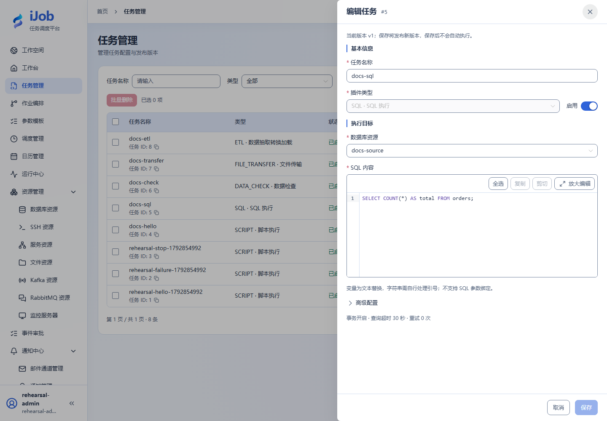

# SQL 执行

[English](../../../en/user-guide/plugins/sql.md) · [手册首页](../../README.md)

## 入口与前提

任务 → 新增/编辑 → 插件 `SQL`。先准备字段表要求的资源、权限及执行节点依赖。任务公共超时、重试和发布规则见[任务](../tasks.md)。

## 字段与作用

| 字段/动作 | 用途与填写规则 |
| --- | --- |
| `resourceId / script` | 选择启用的业务数据库资源，填写 SQL；不要将平台库作为练习目标。资源支持 MySQL/PostgreSQL/SQL Server/Oracle，平台 SQLite 不等于可选 SQLite 业务资源。 |
| `delimiter / transaction` | 默认分隔符 ;、事务 true；事务能力受目标数据库和语句类型影响。 |
| `continueOnError / queryTimeoutSeconds` | 默认 false / 600 秒；继续执行不代表失败语句成功，需核对日志和提交范围。 |
| `minRows / maxRows / resultVariable` | 按结果行数要求设置边界；结果变量用于后续引用，不适合无限结果集。 |

## 最小样例与核对

```sql
SELECT COUNT(*) AS total FROM orders;
```

准备独立 orders 表，保存任务后手动执行，查看 SQL 结果和实例日志，再在数据库查询实际写入。SQL 插件使用文本替换，不提供 SQL 参数绑定；严格校验输入并正确处理字符串引号。需要命名参数绑定的读取可查看 ETL 源配置。DDL 和非事务引擎可能不能回滚；重试 INSERT 前先做唯一键或幂等设计。

样例代码是配置片段，资源 ID/路径需替换；实际外部协议验收状态见[案例索引](../../examples.md)。

## 真实页面示例

只读 SQL、资源选择和事务/超时摘要。


