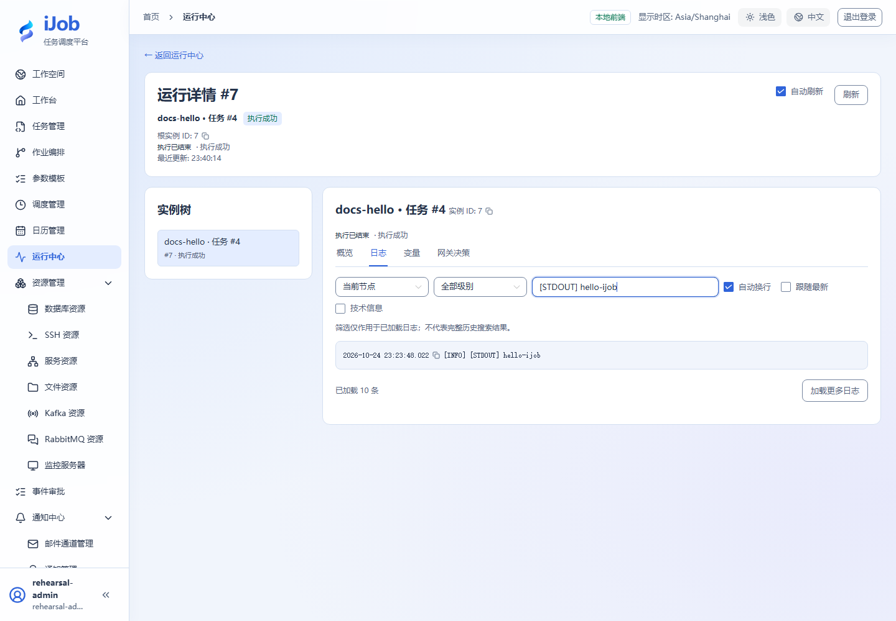
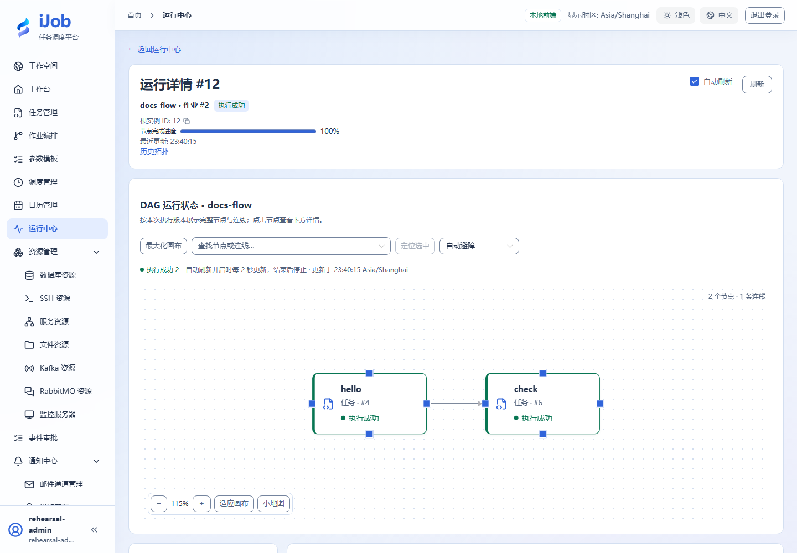

# 运行中心、日志、拓扑与停止

[English](../../en/user-guide/runs.md) · [手册首页](../README.md)

## 入口与操作路径

运行中心 → 触发/实例详情。三个角色均可查看运行概要。停止、暂停、恢复、重试需要 ADMIN 或 OPERATOR，且实例必须处于允许该动作的状态；日志与输入输出详情需要 ADMIN。 完整动作见[角色权限矩阵](users-audits.md)。

## 配置和动作说明

### 运行信息

| 页面显示 | 含义 | 出现条件 |
| --- | --- | --- |
| 触发 ID | 标识一次请求；受理不等于已创建实例或执行成功。 | 始终 |
| 根实例 ID | 一次根运行的身份；重试沿用同一根实例。 | 根实例已建立 |
| 任务版本 ID | 本次任务使用的定义快照，不是当前编辑草稿。 | 任务实例概览 |
| 作业版本 ID | 本次作业使用的定义快照及固定引用。 | 作业实例概览 |
| 开始时间 | 实际开始执行的时间；等待中可能尚未出现。 | 始终 |
| 结束时间 | 执行进入终态后的时间。 | 始终 |
| 耗时 (ms) | 以毫秒展示实际记录的耗时。 | 始终 |
| 状态 | 区分等待、运行、暂停和终态；SUCCESS 仍需核对目标业务结果。 | 始终 |
| 日志 | 根据当前所选根实例或节点查看上下文，最多显示最近 5000 条。 | ADMIN；所选实例可读取日志 |
| 输入变量 | 本次执行输入，不是后来修改的模板默认值。 | ADMIN；变量页 |
| 输出变量 | 所选节点的输出；脱敏、截断和不可用提示表示当前预览并非完整原始数据。 | ADMIN；变量页 |
| 实例树 | 根实例、节点和子实例的关系；按所选节点切换信息范围。 | 始终 |

### 实例控制

| 动作 | 可用角色 | 可用条件 | 结果 |
| --- | --- | --- | --- |
| 暂停 | ADMIN / OPERATOR | 根实例为 RUNNING | 提交暂停命令，在执行检查点生效。 |
| 恢复 | ADMIN / OPERATOR | 根实例为 PAUSED | 继续同一次根运行。 |
| 停止 | ADMIN / OPERATOR | 根实例处于等待、运行、暂停或等待事件等非终态 | 请求停止并继续核对最终状态；不会撤销已发生的外部写入。 |
| 重试 | ADMIN / OPERATOR | 根实例为 FAILED 或 TIMED_OUT | 沿用原版本和同一根实例；作业失败分支由服务端选择，外部操作可能重复。 |

## 操作与结果核对

docs-hello 应出现 SUCCESS 和 `[STDOUT] hello-ijob`；输出变量 rows 在变量视图核对。作业详情看 hello→check 两节点都完成。日志分页/截断不表示任务只执行了显示的部分。暂停在支持的步骤边界生效，当前外部操作可能继续，暂停时间仍计入超时。

## 真实页面示例

真实日志使用页面搜索过滤到 hello 输出；清空搜索可查看其他已加载日志。

真实作业运行的两个节点均成功。

